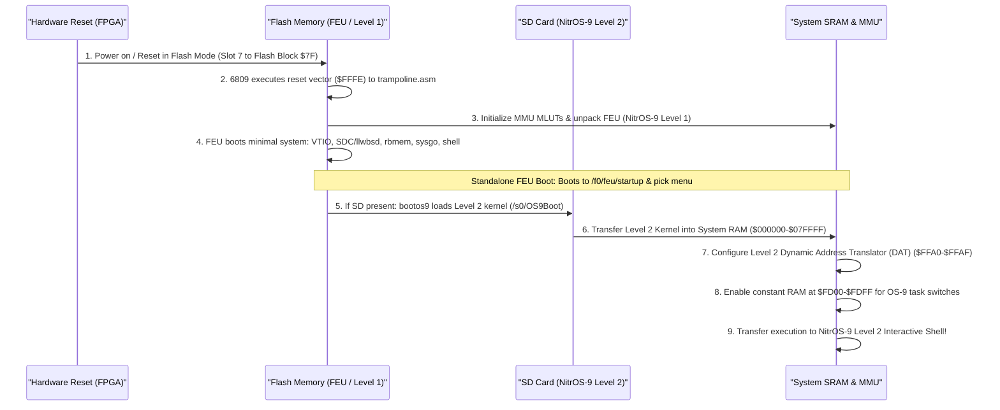
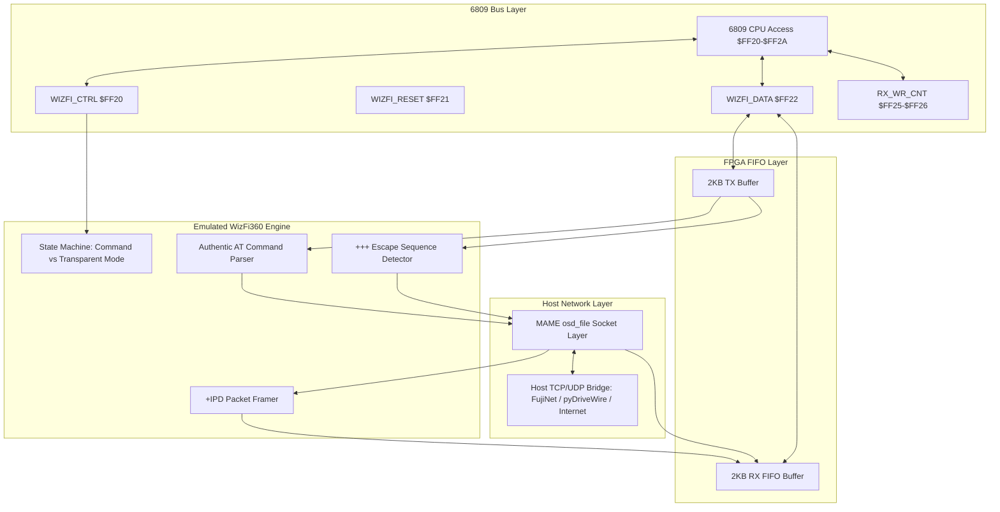
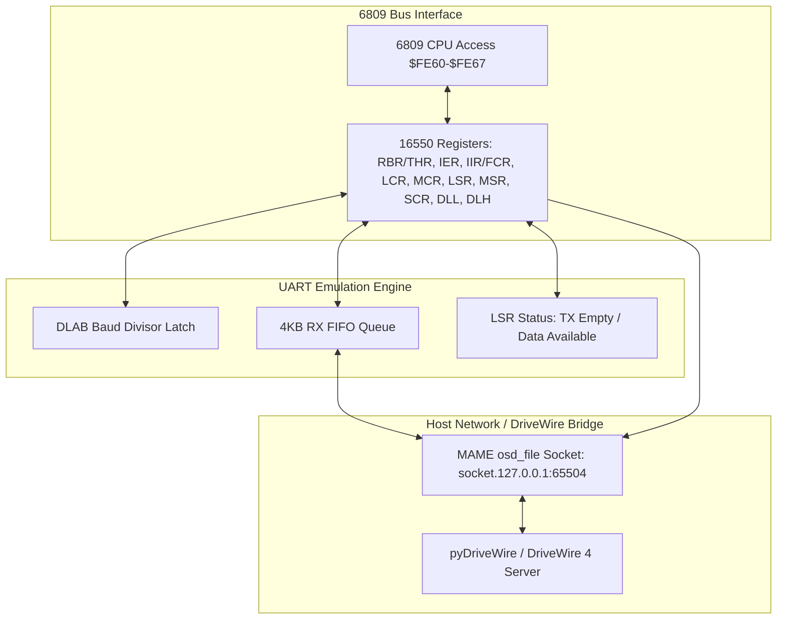
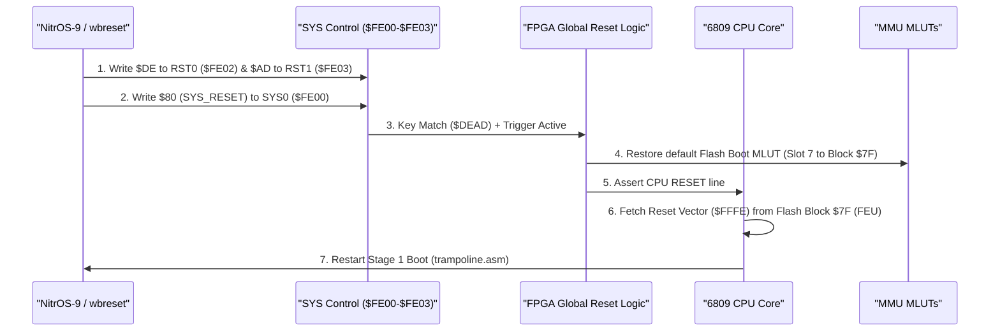

# Wildbits Jr2 (6809 Core) Technical Reference & Architecture Specification

---

## 1. Overview & System Specifications

The **Wildbits Jr2** (formerly known as the **Foenix F256 Jr2** / **JrJr**) is a modern retrocomputing platform powered by an FPGA-centric architecture on a compact Pico-ITX motherboard (100mm × 70mm). When loaded with the **FNX6809** firmware core (authoritative hardware baseline: **`wildbits_jr2_6809_Longview_rc24`**, core built 2026-10-09 12:28, timing report `bitstreams/wildbits_jr2_6809_Longview_rc24_timing_summary.rpt`, WNS +0.011 ns, WHS +0.036 ns, zero failing endpoints; prior baselines `v8_rc20`, core built 2026-09-28 12:24; `v8_rc19`, core built 2026-09-26 22:23; `v8_rc18`, core built 2026-09-24 18:46; `v8_rc17`, core built 2026-09-23 17:51), the system pairs a Motorola 6809 CPU core with the **TinyVicky II** graphics engine, a hardware Memory Management Unit (MMU) supporting up to **2,016 KB (1.96875 MB) contiguous SRAM**, integrated audio synthesizers including Yamaha OPL3 FM synthesis, an adaptive CPU/MMU scheduler (`LONGVIEW_MEMFAST`) delivering up to 25 MHz execution, high-speed DMA with bitwise logic operations and vertical-blank channel ownership gating, hardware Bresenham line drawer with CPU hold arbitration, an integer math coprocessor, modern WizFi360 Wi-Fi FIFO bridge, and rich peripheral interfaces.

```
+----------------------------------------------------------------------------------------+
|                                 WILDBITS JR2 (FNX6809)                                 |
+----------------------------------------------------------------------------------------+
| [6809 CPU @ 6.29 MHz / 12.5-25 MHz Turbo] <-> [MMU (4x MLUTs)] <-> [Up to 2,016KB RAM] |
|            |                                                |                          |
|            v                                                v                          |
|  [TinyVicky II Video]                              [System I/O & Bus]                  |
|  - 80x30 / 80x60 Text (8x8 glyphs, DBL_Y/X)        - Dual SPI SD Card Ports (SD0/SD1)  |
|  - 3x 256-Color Bitmaps (320x240 / 320x200)        - WizFi360 Layout ($FF20-$FF2A)    |
|  - HIRES4 640x240 / 16-Color Bitmaps ($FFCB)       - 16750/16550 UART (FIFO pop fix)   |
|  - 3x Scrolling Tilemaps (Readable regs, rc24)     - Dual Cartridge Ports (/c0, /c1)   |
|  - 128x Hardware Sprites (8x8 to 32x32, 8 bpp)     - PS/2 Keyboard & Mouse Ports       |
|  - 4x Graphics CLUTs + 2x Text CLUTs (Readable)    - bq4802 Real-Time Clock (RTC)      |
|  - Hardware Grayscale Mouse Cursor                 - WDC 65C22 VIA / Joysticks         |
|  - Line Interrupts & Counters (SOL/SOF)            - OPL3 FM Synthesizer (FPGA)        |
|  - Pre-loaded OS-9 Bannerfont & Palette BRAM       - VS1053b MP3 Decoder (12.288 MHz)  |
|  - Bresenham Line Drawer (HoldLine CPU hold)       - Fixed Sound Regs ($FF91-$FF99)    |
|  - DMA Engine w/ Logic Ops ($FED4, VDMA gated)     - Adaptive Turbo (25M coast, 20M rd)|
|  - Reset Border Color Default Black ($000000)      - SAM2695 MIDI per-byte IRQ (rc24)  |
+----------------------------------------------------------------------------------------+
```

### Key Specifications
* **CPU:** Motorola 6809 soft core (FNX6809, Big Endian) running inside an onboard FPGA (**Xilinx Artix-7 35T**, `xc7a35tcsg324`), clocked dynamically by the Longview adaptive MMU scheduler from 6.29 MHz up to **25.0 MHz** (derived from the 200 MHz core PLL and 25.175 MHz dot clock oscillator; in MAME configured via `XTAL(25'175'000)`).
* **Adaptive CPU/MMU Scheduler (`LONGVIEW_MEMFAST`, Longview_rc23/rc24):** Controlled by onboard DIP switch `SW_BOOT_MODE0` (`$FF90` bit 0, active-low: `0` = Turbo enabled, `1` = Stock 6.29 MHz mode). The scheduler dynamically adjusts CPU cycle durations based on bus operation type and memory region:
  * **Dead / Internal Coast Cycles (`ShortFrame`, `AVMA = 0`):** Complete in **8 master ticks (40 ns) = 25.0 MHz**, idled bus completely surrendered to video and DMA engines.
  * **Turbo Mode Enabled (`Turbo_En = 1` / `$FF90[0] = 0`):**
    * **RAM Reads (Blocks `$00–$FB`):** Complete in **10 master ticks (50 ns) = 20.0 MHz** (Address capture at tick 2, data read latch at tick 7).
    * **RAM Writes (Blocks `$00–$FB`):** Complete in **14 master ticks (70 ns) = 14.28 MHz** (Address capture at tick 2, write pulse active ticks 6..9, write release at tick 11).
    * **Internal Fast Decodes:** Fixed constant RAM (`$FDxx`), internal vector RAM (`$FFFx`), MMU registers (`$FFAx`), and TinyVicky Video-Port BRAM (Sectored Pages `$FC–$FF`) complete in **16 master ticks (80 ns) = 12.50 MHz**.
    * **Peripherals & External Bus:** Flash ROM (`$40–$7F` when `FLASHDIS=0`), Cartridge Port (`$80–$9F`), and fixed peripheral I/O (`$FE00–$FFEF`) run at standard **32 master ticks (160 ns) = 6.29 MHz** with RDY wait-state handling.
  * **Stock Mode (`Turbo_En = 0` / `$FF90[0] = 1`):**
    * **RAM Reads:** Complete in **12 master ticks (60 ns) = 16.67 MHz** (Address capture at tick 4, data read latch at tick 9).
    * **RAM Writes:** Complete in **16 master ticks (80 ns) = 12.50 MHz** (Address capture at tick 4, write pulse active ticks 8..11, release at tick 13).
    * **Internal Fast Decodes:** Complete in **16 master ticks (80 ns) = 12.50 MHz**.
    * **Peripherals & External Bus:** Complete in **32 master ticks (160 ns) = 6.29 MHz**.
  * **Synchronous Bus Holds (`HoldCycle = HoldExternal || HoldVideo || HoldLine`):**
    * `HoldVideo`: Video fetch claims SRAM cleanly at frame boundary (`FrameEnd`, E high).
    * `HoldLine` (RC24): Bresenham line drawer holds CPU at frame boundary up to 16 burst + 2 guard ticks while pushing pixels to VRAM, eliminating dropped pixels without DMA conflicts.
  * **VIA Phase Alignment:** Generates a 4-tick Phi2 strobe for WDC 65C22 VIA0 phase alignment (`RisingEDGE_Phi2_o = t2..t5`, `FallingEDGE_Phi2_o = last 2 ticks + t0..t1`).
  * **I/O Setup Margin (`IoPhase`):** I/O valid strobe is asserted 4 master ticks before the 25 MHz edge and held 2 ticks after, providing guaranteed **20 ns address setup time** across all peripheral cycles.
* **Synchronous Reset Architecture (`WildbitsResetSync` & `WildbitsResetManager`):** Centralized multi-stage architecture:
  * `WildbitsResetSync`: 3-stage metastability-hardened synchronizers (`ASYNC_REG="TRUE"`, `SHREG_EXTRACT="NO"`) assert reset immediately upon request and release synchronously after three destination-clock edges local to each consuming clock domain (Bus, 25 MHz, Video, 100 MHz, 200 MHz).
  * `WildbitsResetManager`: Generates a 26-bit reference-clock cold hold for power-on stabilization and a 19-bit stable hold for manual resets. External reset inputs assert internal holds without feeding back into the open-drain output counter, preventing external pin release deadlocks.
* **FPGA Configuration Memory:** 16 MB Micron MT25QL128 Quad-SPI Flash memory (`write_cfgmem -format mcs -size 16 -interface SPIx4`), programmed via `wildbits_jr2_6809_Longview_rc24.mcs` / [`wildbits_jr2_6809_Longview_rc24.bit`](file:///Users/richardlucente/tmp/future_wildbits_jr2_Longview_rc24/wildbits_jr2_6809_Longview_rc24.bit).
* **System Bus:** 20-bit external SRAM address bus (`MEM_A_o[19:0]`) addressing up to 1M × 16 (2 MB) of physical SRAM space with upper/lower byte enables (`MEM_UBn_o`, `MEM_LBn_o`). (Differentiate from K2's 21-bit external bus `MEM_A_o[20:0]` addressing up to 4 MB). Internally, the 6809 MMU addresses 21 bits across 8 KB blocks (`$00–$FF`).
* **CPU Address Space:** 16-bit (64 KB) paged into eight 8 KB slots via 4 hardware Look-Up Tables (MLUTs).
* **Longview Memory Map & System RAM (Up to 2,016 KB Contiguous SRAM):**
  * **Sectored I/O Relocation:** Relocated from `$C0–$C3` to **`$FC–$FF`** (`MMU_Entry[7:2] == 6'b111111`):
    * `$FC`: `VICKY_BLK` (TinyVicky registers, Gamma LUTs, Mouse cursor bitmap, Bitmap plane registers, Line Drawer, Tile plane registers, MemText registers, 128 Sprite attributes, Text FG/BG CLUTs).
    * `$FD`: `FONT_BLK` (Dual 2 KB font banks at `$0000–$0FFF`, 4 Graphics CLUTs at `$1000–$1FFF`).
    * `$FE`: `TEXT_RAM_BLK` (Text matrix character RAM, 4,800 bytes).
    * `$FF`: `COLOR_RAM_BLK` (Text matrix color attribute RAM, 4,800 bytes).
    * Former `$C0–$CF` and `$F0–$FB` undecoded blocks are now **SRAM**!
    * Old `$C4` (Audio), `$C5` (MemText LUTs), and `$C6` (MemText Font) are NO LONGER sectored I/O pages.
  * **Linear Identity Mapping:** For all SRAM blocks `$00–$FB`, $\text{Physical Byte Address} = \text{Block} \times \$2000 + \text{Offset}$.
  * **Reset Map (`FLASHDIS = 0`):** 156 RAM blocks (1,248 KB) = `$00–$3F` (512 KB) + `$A0–$FB` (736 KB). Blocks `$40–$7F` are Parallel Flash (512 KB), `$80–$9F` are Cartridge Port (256 KB).
  * **Max-RAM Map (`FLASHDIS = 1`, `$FFA1` bit 2):** Blocks `$40–$9F` (768 KB) remap to SRAM (`0x080000–0x13FFFF`), making blocks `$00–$FB` a single contiguous pool of **252 RAM blocks = 2,016 KB (1.96875 MB)**!
* **Flash ROM:** 512 KB onboard non-volatile Flash ROM (Physical Blocks `$40 - $7F`, physical `0x080000 - 0x0FFFFF` of the SST39VF chip) when FLASHDIS is inactive. Contains the Level 1 First Execution Unit (FEU), `/f0` flash volume, and user flash drive `/f1`.
* **Expansion Cartridge:** Cartridge decode at Physical Blocks `$80 - $9F` (256 KB window) supporting `/c0` (based at `$80`) and `/c1` (based at `$90`), sharing the external bus and shaped write strobe with onboard flash and RTC.
* **Video Controller:** **TinyVicky II** outputting DVI/VGA at 60 Hz (640 × 480 text, 320 × 240 graphics) or 70 Hz (640 × 400 text, 320 × 200 graphics). Features verified timing closure across all clock domains with worst negative slack **+0.011 ns**, WHS **+0.036 ns** (`wildbits_jr2_6809_Longview_rc24_timing_summary.rpt`), zero failing endpoints.
* **Graphics Engines:**
  * Character text matrix (80 × 30, 80 × 60, 40 × 30, or 40 × 60) with dual 2 KB font banks pre-initialized with the **OS-9 Bannerfont** and color lookup tables pre-initialized with the **OS-9 Palette** directly in FPGA BRAM (`mif/Text_LUT_OS9_palette.coe` and `mif/Font_OS9_bannerfont.coe`), freeing >2 KB of system memory in bootfiles.
  * **Default Border Color:** Hardwired to **Black** (`$000000`) on reset (Longview_rc24).
  * 3 full-screen 256-color bitmapped planes (320 × 200 or 320 × 240).
  * **HIRES4 Bitmap Mode:** 640 × 240 at 16 colors (2 dots per byte, high nibble on the left) indexed into a 16-color CLUT slice (`color = group * 16 + nibble`), selectable globally via `$FFCB` (`VKY_GFX_MODE`) or per plane via bit 4 of `BMx_CTRL_REG`.
  * 3 hardware scrolling tilemap layers supporting 8 × 8 or 16 × 16 tiles across 8 concurrent tile sets. **Tilemap control registers (`$1100–$113F`) and tileset registers (`$1180–$119F`) in Page `$FC` are fully CPU-readable** (Longview_rc23+).
  * 128 hardware sprites (8 × 8, 16 × 16, 24 × 24, or 32 × 32) at 8 bpp indexed color through 4 graphics CLUTs, line-buffered and scanned 127 down to 0 per scanline pair (sprite 0 composites on top). Fetch timeouts (~10–20 µs) abandon stalled fetches, preventing display lockups.
  * 4 graphics Color Look-Up Tables (CLUTs), each with 256 24-bit RGB colors (stored as 32-bit `[Blue, Green, Red, Alpha]` entries).
  * Dedicated text Foreground and Background Color Look-Up Tables (16 colors each), shadowed and **readable by the CPU** at Page `$FC` offsets `$1700` and `$1740`.
  * Hardware Gamma correction look-up tables (Red, Green, Blue).
  * Hardware grayscale mouse cursor (16 × 16) with pixel rendering gated on enable bit (`$FEA0` bit 0) and cursor position preserved across auto-hide (`wb/mouse_hide_unhide`).
  * **Line-Draw Accelerator (Longview_rc24):** Hardware Bresenham line-drawing unit at Page `$FC` offsets `$1080–$1087` backed by a 34-bit pixel FIFO (`LINEDRAW_AddyPixel_FIFO`, carrying `{hires, x[0], ink, pixel_addr}`) supporting both 320 × 240 8 bpp standard bitmaps and 640 × 240 4 bpp HIRES4 bitmaps. On Jr2, FIFO capacity is **4,096 entries** (`legacy_fifo_count[12:0]`), with bit 13 of count register `$1082` hardwired to `0`. Operation requires Master Enable `$FFCA[0] = 1` and Local Enable `$1080[0] = 1`. In Longview_rc24, the line engine asserts `HoldLine`, holding the CPU at frame boundary up to 16 burst + 2 guard ticks while writing pixels, eliminating vector drop without DMA collisions.
* **Audio Subsystem:**
  * **Exclusive Fixed I/O Sound Registers (`$FF91–$FF99`):** Full fixed I/O address decoding (`WildbitsSoundDecode`) mapping PSG Left/Both/Right (`$FF91–$FF93`), Yamaha OPL3 Bank 0/1 Index and Data (`$FF94–$FF97`), and SID Register Selector and Data Write (`$FF98–$FF99`) directly below `$FF90`. Because Block `$C4` is ordinary SRAM in Longview, all audio operations must use `$FF91–$FF99`.
  * **Yamaha OPL3 FM Synthesizer:** Integrated in FPGA core (accessible at fixed I/O `$FF94–$FF97`), providing 4-operator / 2-operator FM music synthesis (write-only register interface; status reads and IRQ unconnected), mixed in stereo as the third term into the master DAC sum.
  * Triple **SN76489** Programmable Sound Generators (PSGs) emulated in FPGA (accessible at fixed I/O `$FF91–$FF93`; software-configurable stereo/mono via `SYS1`). Driven by a 3,579,545 Hz clock enable.
  * Triple **MOS 6581 / 8580** Sound Interface Devices (SIDs) (accessible via indirect fixed I/O at `$FF98–$FF99`; 9 synth voices with multi-mode analog filters). Driven by a 1,022,727 Hz clock enable.
  * **WM8776** Audio CODEC and 24-bit DAC at `$FE70-$FE72` for master mixing, equalization, and volume control (InitCODEC selects all 5 analog inputs via R21 = `$1F` / `$2A1F`, routing VS1053 outputs on AIN3..5; calibrated independently for Jr2 vs. K2 via `play`).
  * **VS1053b** Hardware MP3 / Audio Stream Decoder at `$FF50–$FF57`, clocked at **12.288 MHz** (24.576 MHz ÷ 2, within 12–13 MHz boot spec), equipped with a 2,048-byte SDI stream FIFO at `$FF57`, 16 SCI registers at `$FF50–$FF53`, dual-speed SPI (1.57 MHz default, 6.29 MHz fast), fixed register offset decoding, and hardware DREQ flow control.
  * **SAM2695** General MIDI hardware synthesizer interface with **Edition 2 Control Register** across 10 bytes at `$FF30-$FF39` (`MIDI_CTRL` at `$FF30`, `MIDI_DATA` at `$FF31`, and 11-bit Rx/Tx FIFO read/write counters at `$FF32–$FF39`) featuring Tx/Rx FIFO-empty flags, hardware FIFO reset, **1152-tick mid-bit sample timing** (31,250 baud on 24 MHz clock: $768 \times 1.5 = 1152$), and a **127-CPU-clock active-low per-byte receive interrupt pulse (`MIDI_Rx_IRQn_o`)** on byte arrival at `$FF31` (Longview_rc24).
  * Hardware System Buzzer on `SYS0` (`$FE00` bit 4).
* **Storage & Peripheral Interfaces:**
  * Dual SPI SD Card controllers (SD, SDHC, SDXC). Port 0 (`$FE90–$FE91`, external Main SD slot on top of PCB), Port 1 (`$FF00–$FF01`, internal Micro-SD slot on bottom of PCB).
  * High-speed **WizFi360** (WIZnet WiFi) module interface backed by dual 2 KB hardware FIFOs with **Modern Register Layout (`$FF20-$FF2A`)**:
    * `$FF20`: `CtrlReg` (Bits 4:0: Baud rate code 0..16, reset default 10 = 115,200 baud; Bit 6: RxEmpty R/O; Bit 7: TxEmpty R/O).
    * `$FF21`: `ResetReg` (Bit 7 reads 1 = `WizFi.HasReset` flag; Bit 0: `ChipRst`, Bit 1: `FifoRst`, Bit 2: `UartRst`). *On Jr2 PCB, bit 0 (`WIFI_RSTn_o`) is tied to pin T14, simultaneously asserting `SAM2695_RSTn_o` to reset the MIDI synth!*
    * `$FF22`: `DataReg` (TX push / RX pop, moved from `$FF21` to `$FF22`).
    * `$FF23–$FF2A`: 11-bit Big-Endian counters (`RxD_RD` `$FF23–$FF24`, `RxD_WR` `$FF25–$FF26`, `TxD_RD` `$FF27–$FF28`, `TxD_WR` `$FF29–$FF2A`).
    * Supports **WizCon4** (4 independent concurrent packet-mode incoming telnet shells).
  * **16750 / 16550** compatible UART (RS-232 serial) at `$FE60-$FE67` with 22.1184 MHz BAUDCE exact baud generator (Divisor 5 = 230,400 baud), hardware reset clearing of `BaudAcc`, clock-enabled terminal counter gating in `uart_baudgen.vhd`, and **FIFO Pop Hardening** (`uart_access = CS_UART_i & CPU_Data_Valid_i` producing distinct falling CS edges and latching `uart_read_hold`, eliminating dropped DriveWire FIFO pops under high-speed back-to-back reads).
  * PS/2 Keyboard and Mouse controllers at `$FE50-$FE54` (Jr2 primary keyboard interface).
  * **WDC 65C22** Versatile Interface Adapter (VIA0) at `$FEB0–$FEBF` driving dual Atari-style DE-9 joystick ports and user GPIO, phase-aligned with the CPU via the 4-tick Phi2 strobe.
  * NES / SNES gamepad controller interface at `$FF80-$FF8F` (FNX4N4S interface).
  * **bq4802** Real-Time Clock (RTC) with battery backup at `$FE40-$FE4F`.
  * Commodore IEC serial bus port at `$FE80` (1541/1571/1581 compatible; optional NMI routing).
  * Onboard 8-Position Hardware Configuration DIP Switches at `$FF90` (Turbo stretch mode, Gamma default, Boot mode, and User switches).
  * USB-C debug & flash programming interface (FTDI FT4232H bridge).
* **Hardware Acceleration:**
  * Direct Memory Access (DMA) engine supporting 1D linear fill/copy and 2D rectangular block copy/fill with programmable source/destination strides at `$FEC0-$FED7` (writes are direct at `$FEC0–$FED7`, readback is permuted in hardware per `tests/dma.asm`, transfers run during vertical blanking, and transfer initiation asserts CPU bus halt). Direct write addressing: `$FEC5–$FEC7` source (H/M/L), `$FEC9–$FECB` destination (H/M/L).
  * **Hardware DMA Logic Operations & Data Integrity Architecture (`v8_rc20` / Longview_rc24):**
    * `DMA_OP_REG` at `$FED4`: COPY (0), OR (1), AND (2), XOR (3), MASK (4) nibble transparency, and NOT (bit 3) inversion; bit 7 reads 1 = implemented.
    * **Vertical-Blank Channel Ownership Gating (`DMA_CanStart`):** Evaluates `VDMA_Transfer_Time_Available_RESYNC[2] && VDMA_Trf_Time_Before2Late_RESYNC[2]` and is gated with `VDMA_Channel_Owned_i`, parking the machine cleanly before the display engine claims the channel and eliminating multi-frame paused resume latency.
    * **First-Byte Freshness (`VRAM_1D_ST00B`):** Provides 2 full clocks of read margin on the initial read of each transfer and 2D row, eliminating stale leading bytes.
    * **Op-Fill Completion (`Op_Fill_Done`):** Pointer comparison checks `pointer > stop_address` after write completion, guaranteeing 1D and 2D op fills reach their last byte.
    * **16-bit SRAM Byte-Lane Alignment:** Evaluates `Rd_Lane` (address bit 0) and `Op_S_Lane`; replicates 8-bit plain copy bytes (`{2{Rd_Byte}}`) and 8-bit ALU results (`{2{Op_Res8}}`) to both SRAM byte lanes while asserting appropriate byte-lane enables (`UBn`/`LBn`).
    * **ALU Settling & Write Hold Margin (`OP_WR0`):** State `OP_WR0` allows the ALU to settle before `Write_Strobe` rises, ensuring stable data hold before and after SRAM `WEn`.
    * **Hardened Bus Handshake:** Holds the bus for 8 clocks post-transfer to drain the internal pipeline before releasing CPU halt. Proven with `dmaxfer` ed. 4 (`tests/dma.asm`, `CMDS/dmaxfer`).
  * Hardware Integer Math Coprocessor (16 × 16 → 32-bit unsigned multiplication, 16 / 16 → 16-bit unsigned division with 16-bit quotient at `$FEF4–$FEF5` and 16-bit remainder at `$FEF6–$FEF7`, and 32-bit addition) at `$FEE0-$FEFB`, with fixed remainder readback at `$FEF6–$FEF7` (`MATH_DIV_REM`).
  * Hardware Floating-Point Unit (FPU) accelerator at `$FFE0–$FFEF`.

---

### 1.2 Hardware Distinctions: Wildbits Jr2 vs. Wildbits K2

While both machines share the core TinyVicky II video engine, the FNX6809 CPU core, and the NitrOS-9 operating system, the physical **Wildbits Jr2** possesses distinct hardware characteristics that differentiate it from the **Wildbits K2**:

| Feature / Subsystem | Wildbits Jr2 (Physical Target) | Wildbits K2 (Companion Machine) |
| :--- | :--- | :--- |
| **Physical Form Factor** | Standalone Pico-ITX Motherboard (100mm × 70mm) | Integrated keyboard computer (wedge case) |
| **Physical SRAM Bus** | **20-bit address bus** (`MEM_A_o[19:0]`, 2 MB physical space) | **21-bit address bus** (`MEM_A_o[20:0]`, 4 MB physical space) |
| **Longview Contiguous SRAM** | **2,016 KB** (252 blocks `$00–$FB` in FLASHDIS mode) | **3,072 KB+** (K2 extended physical memory) |
| **Primary Keyboard** | **PS/2 Keyboard** (`$FE50-$FE54`, Group 0 bit 2) | **Optical Keyboard** (`$FE10-$FE16`, Group 3 bit 2) |
| **Optical Keyboard Decode** | **Unpopulated:** Reads constant `$55` (`DataOut_CS_K2_KEYBOARD`) | **Populated:** Optical keyboard scanner registers |
| **Hardware Typematic Repeat** | None (software-paced in OS / PS/2 controller) | Hardware typematic engine in FPGA (`$FE14-$FE16`) |
| **RP2040 Supervisor Mailbox** | **Unpopulated:** `$FE78–$FE7F` and `$FE88–$FE8F` return `$FF` | **Populated:** RP2040 supervisor mailbox (`RPDrv` / `fpga`) |
| **Line-Draw FIFO Capacity** | **4,096 entries** (`legacy_fifo_count[12:0]`, bit 13 reads 0; `HoldLine` CPU arbitration) | **8,192 entries** (`K2_LINE_FAST`, 14-bit count; `Line_Borrow` DMA arbitration) |
| **Secondary VIA (`VIA1` at `$FFB0`)**| **Unpopulated** (VIA0 only at `$FEB0`) | Unpopulated on K2; present on older F256K mechanical models |
| **Blocks `$80–$9F` Decode** | **External Cartridge Port** (`/c0` @ `$80`, `/c1` @ `$90`, or SRAM in FLASHDIS) | **Internal Expansion SRAM** (256 KB at `$10_0000–$13_FFFF`) |
| **Network Interfaces** | **WizFi360 Wi-Fi only** (Modern layout at `$FF20-$FF2A`) | **Dual:** WizFi360 Wi-Fi **+** WIZnet W6100 10/100 Ethernet |
| **VS1053b Audio Decoder** | **Populated:** Clocked at **12.288 MHz** (`$FF50–$FF57`, 24.576 MHz ÷ 2) | **Populated:** Clocked at **12.288 MHz** (`$FF50–$FF57`, 24.576 MHz ÷ 2) |
| **OPL3 FM Synthesizer** | **Populated:** Fixed I/O `$FF94–$FF97` (Block `$C4` is SRAM) | **Populated:** Fixed I/O `$FF94–$FF97` (Block `$C4` is SRAM) |
| **Case Logo LCD (`$FF70–$FF74`)** | **Unpopulated** (standalone motherboard) | **Populated** (front-panel SPI color Logo LCD) |
| **Hardware DIP Switches (`$FF90`)** | **Onboard 8-position DIP switch bank** | **Rear-chassis 8-position DIP switch bank** |
| **Machine ID Register (`$FE07`)** | **`$1A`** (26 decimal: Jr2 6809 core) | **`$16`** (22 decimal: K2 6809 core) |
| **External Bus Write Strobe** | **Shared single `WE` line** (Flash, Cartridge, RTC); shaped pulse | Dedicated / separate write lines; uses raw CPU strobe |
| **Physical Flash Chip** | SST39VF040 (512 KB physical, ID `$BFD7`) / SST39VF1681 window | SST39VF1681 (2 MB physical, 512 KB visible, ID `$BFC9`) |
| **SRAM Address Setup Geometry** | **`LONGVIEW_MEMFAST`** (20 ns setup via `IoPhase`, delayed `WE_n`) | Standard fast write (5 ns setup, `WE_n` t7..t9) |
| **Status Indicators** | Discrete Motherboard LEDs (`SYS0`/`SYS1`: Power, SD, L0, L1) | RGB programmable keyboard LEDs (`$FE06`, `$FE08-$FE0F`) |

> [!IMPORTANT]
> **Emulator Scope Enforcement:** The MAME emulator driver `wbjr2` specifically emulates the **Wildbits Jr2**. It must NOT instantiate the optical keyboard scanner, RP2040 mailbox, W6100 Ethernet, case Logo LCD, or internal expansion SRAM at `$80–$9F`. It must expose the PS/2 keyboard/mouse interface, the dual cartridge ports (`/c0`, `/c1`), the dual SD card ports (`SDC0` at `$FE90`, `SDC1` at `$FF00`), the VS1053b audio decoder at 12.288 MHz, the OPL3 FM synthesizer at fixed I/O `$FF94–$FF97`, the onboard physical DIP switches, the shared bus write strobe behavior, and report `$1A` in Machine ID register `$FE07`.

---

### 1.3 Release Package & Firmware File Reconciliation

The authoritative release kit for the Wildbits Jr2 (**`future_wildbits_jr2_Longview_rc24`**, core built 2026-10-09 12:28, timing report `bitstreams/wildbits_jr2_6809_Longview_rc24_timing_summary.rpt`, WNS +0.011 ns, WHS +0.036 ns; prior baselines `v8_rc20` built 2026-09-28 12:24, `v8_rc19` built 2026-09-26 22:23, `v8_rc18` built 2026-09-24 18:46, and `v8_rc17` built 2026-09-23 17:51) contains the authoritative files required to configure the hardware, program non-volatile flash, and boot NitrOS-9 Level 2:

| File Name | Size | Target Hardware Entity | Function / Memory Destination |
| :--- | :--- | :--- | :--- |
| **`wildbits_jr2_6809_Longview_rc24.mcs`** | 6,165,628 B | Micron MT25QL128 Quad-SPI Flash (16 MB) | **FPGA Configuration Memory.** Intel MCS-86 formatted bitstream with synchronization word `0xAA995566`. Automatically loaded by the FPGA upon power-on. |
| **`wildbits_jr2_6809_Longview_rc24.bit`** | 2,192,140 B | FPGA JTAG / Program | Raw Xilinx Vivado Artix-7 bitstream (`wildbits_jr2_6809_Longview_rc24_timing_summary.rpt`, WNS +0.011 ns, WHS +0.036 ns). |
| **`wildbits_jr2_6809_Longview_rc24.bin`** | 2,192,012 B | FPGA Raw Binary | Raw FPGA programming binary. |
| **`wildbits_jr2_6809_Longview_rc24.prm`** | 475 B | Memory Prom File Parameters | Vivado PROM generator mapping report. |
| **`f0` through `f4`** | 8,192 B ea. (40 KB total) | SST39 Parallel Flash (Sectors `$38–$3C`) | **FEU System Image (`/f0`).** Read-only RBF volume holding FEU utilities, `sysgo`, and the interactive startup menu. Corresponds to MMU blocks `$78–$7C`. |
| **`booter`** | 24,576 B | Flash Booter Image | Raw binary representing the combined `booter_0`..`booter_2` volume. |
| **`booter_0` through `booter_2`** | 8,192 B ea. (24 KB total) | SST39 Parallel Flash (Sectors `$3D–$3F`) | **Hardware Reset Booter & Trampolines.** Mapped to MMU blocks `$7D–$7F`. Block `$7F` supplies the 6809 hardware reset vector at `$FFFE` pointing to `$FC00`. |
| **`wildbitsjr2_future.dsk`** | 134,212,608 B (~128 MB) | External SPI SD Card (Port 0) | **NitrOS-9 Level 2 System Disk Image.** Formatted RBF filesystem incorporating all Longview RC24 drivers (`dwio_serial`, `wizfi` modern layout `$FF20–$FF2A`, `rbmem`, `vtio` Longview `$FC–$FF` sectored I/O, DriveWire FIFO pop hardening, VS1053 plugins, HIRES4 support, DMA logic operations, and `linetest`). |
| **`README.md` & `flash-instructions.md`** | Documentation | Release Documentation | Engineering reports covering the Longview memory architecture, max-RAM kernel, sectored I/O relocation to `$FC–$FF`, and flashing procedures. |

#### Hardware Architecture Evolution (rc18 through Longview_rc24):
Inspection of the release packages and commit history establishes the progression to the Longview_rc24 baseline:
* **Longview_rc24 Hardware Architecture (Authoritative Baseline, 2026-10-09):**
  * **Sectored I/O Relocation to `$FC–$FF`:** Sectored I/O pages relocated from `$C0–$C3` to `$FC–$FF` (`MMU_Entry[7:2] == 6'b111111`). `$FC` = VICKY registers, CLUTs, LineDraw, and Sprites; `$FD` = Fonts and Graphics CLUTs; `$FE` = Text RAM; `$FF` = Color RAM. Blocks `$C0–$CF` and `$F0–$FB` become ordinary SRAM.
  * **2,016 KB Contiguous SRAM Pool:** In `FLASHDIS = 1` mode, Blocks `$00–$FB` form a continuous 252-block SRAM pool (2,016 KB) with linear identity mapping ($\text{Address} = \text{Block} \times \$2000 + \text{Offset}$). Reset mode (`FLASHDIS = 0`) provides 1,248 KB SRAM (156 blocks = `$00–$3F` + `$A0–$FB`).
  * **`LONGVIEW_MEMFAST` Adaptive CPU Scheduler:** Coast cycles run at 25.0 MHz (8 ticks). Turbo RAM reads run at 20.0 MHz (10 ticks), writes at 14.28 MHz (14 ticks). Internal fast decodes run at 12.50 MHz (16 ticks). Peripherals run at 6.29 MHz (32 ticks). Stock mode provides 16.67 MHz reads and 12.50 MHz writes.
  * **Bresenham Line Drawer `HoldLine` CPU Arbitration:** Asserts `HoldLine` to the CPU scheduler at frame boundaries up to 16 burst + 2 guard ticks while writing pixels, eliminating dropped vectors without DMA collisions.
  * **Readable Tilemap Registers:** Tilemap control registers `$1100–$113F` and tileset registers `$1180–$119F` in Page `$FC` are fully CPU-readable.
  * **Default Border Color Black:** Reset border color changed from orange-brown (`$E04000`) to Black (`$000000`).
  * **WizFi360 Modern Register Layout (`$FF20–$FF2A`):** Control register at `$FF20` with 17 baud rate codes, Reset register at `$FF21` (bit 7 reads 1; bit 0 resets Wi-Fi and drives SAM2695 reset via PCB pin T14), Data port moved to `$FF22`, and 11-bit Big-Endian counters at `$FF23–$FF2A`.
  * **SAM2695 MIDI Enhancements:** 1152-tick mid-bit sample timing for 31,250 baud on 24 MHz clock, plus a 127-CPU-clock active-low per-byte receive interrupt pulse (`MIDI_Rx_IRQn_o`) on byte arrival at `$FF31`.
  * **16750 UART DriveWire FIFO Pop Hardening:** Gated CS edge (`CS_UART_i & CPU_Data_Valid_i`) and cycle data latch `uart_read_hold` eliminate lost FIFO pops during high-speed DriveWire transfers.
  * **DMA VDMA Channel Owned Gating:** `DMA_CanStart` gated with `VDMA_Channel_Owned_i` eliminates multi-frame paused resume latency.
* **RC20 Hardware DMA Logic Operations & Data Integrity Overhaul:**
  * `DMA_OP_REG` at `$FED4` supporting COPY, OR, AND, XOR, MASK, NOT; 16-bit physical SRAM byte-lane alignment; initial read strobe latency (`VRAM_1D_ST00B`); ALU settling margin (`OP_WR0`).
* **RC19 12 MHz Turbo Mode Architecture:**
  * Initial adaptive cycle timing with 16-tick reads and 24-tick writes.
* **RC18 Audio Consolidation & Reset Architecture:**
  * Consolidated fixed I/O sound registers at `$FF91–$FF99` (PSG Left/Both/Right, OPL3 Bank 0/1, SID Selector/Data).
  * Centralized synchronous reset architecture (`WildbitsResetSync` and `WildbitsResetManager`).
* **RC16 MMU Window Isolation & FLASHDIS:**
  * MMU register window at `$FFA0–$FFAF` does not leak writes to Slot 7 RAM; initial `FLASHDIS` implementation.
* **RC14 / RC15 Baseline Features:**
  * HIRES4 640 × 240 16-color bitmaps, RAM Window B identity mapping, math coprocessor 16-bit remainder readback (`$FEF6–$FEF7`).


---

## 2. Memory Architecture & MMU

### 2.1 Physical Address Space (21-bit / 2 MB)

The 21-bit physical address bus maps the following resources in the Longview architecture:

| Physical Address Range | Size | Physical 8KB Blocks | Region Type | Description |
| :--- | :--- | :--- | :--- | :--- |
| `0x000000 - 0x07FFFF` | 512 KB | Blocks `$00 - $3F` | **System SRAM** | System & process memory, video framebuffers (VKY fetches from same RAM). |
| `0x080000 - 0x0EFFFF` | 448 KB | Blocks `$40 - $77` | **Flash (`/f1`) / SRAM** | User flash drive (`rbmem`) in normal mode; remapped to SRAM when `FLASHDIS = 1`. |
| `0x0F0000 - 0x0F9FFF` | 40 KB  | Blocks `$78 - $7C` | **Flash (`/f0`) / SRAM** | FEU read-only RBF system volume in normal mode; remapped to SRAM when `FLASHDIS = 1`. |
| `0x0FA000 - 0x0FFFFF` | 24 KB  | Blocks `$7D - $7F` | **Flash (Booter) / SRAM**| Power-on booter (`booter_0..2`) in normal mode; remapped to SRAM when `FLASHDIS = 1`. |
| `0x100000 - 0x13FFFF` | 256 KB | Blocks `$80 - $9F` | **Cartridge Port / SRAM** | Dual external Flash cartridges (`/c0` @ `$80`, `/c1` @ `$90`) in normal mode; remapped to SRAM when `FLASHDIS = 1`. |
| `0x140000 - 0x1F7FFF` | 736 KB | Blocks `$A0 - $FB` | **System SRAM** | High-speed contiguous SRAM (92 blocks; linear identity address $\text{Block} \times \$2000$). Former Windows A/B and undecoded blocks are now SRAM. |
| `0x1F8000 - 0x1FFFFF` | 32 KB  | Blocks `$FC - $FF` | **Sectored I/O Pages** | Relocated TinyVicky registers, CLUTs, font banks, text matrix, and color attribute RAM (`MMU_Entry[7:2] == 6'b111111`). |

> [!NOTE]
> **Flash Visibility Constraint:** Although the physical SST39VF flash chip is 2 MB, only **512 KB** is visible to the 6809 MMU: the FPGA drives 19 address bits (6 block bits + 13 offset bits), and lines A19/A20 do not leave the FPGA.
> **Cartridge Port vs. Expansion SRAM:** On the Wildbits Jr2, Blocks `$80–$9F` route directly to the external cartridge connector, enabling hot-pluggable SST39-compatible flash cartridges (`/c0` and `/c1`). On the companion K2, this same physical decode routes instead to internal expansion SRAM.
> **2,016 KB Contiguous SRAM Decoding (Longview Max-RAM Mode):** The onboard SRAM chip is 1M × 16 (2 MB). In standard/reset mode (`FLASHDIS = 0`), 156 RAM blocks (1,248 KB) are mapped (`$00–$3F` 512 KB + `$A0–$FB` 736 KB). When FLASHDIS mode is enabled (`$FFA1` bit 2 = 1), Blocks `$40–$9F` (96 blocks = 768 KB) are remapped from Flash/Cartridge to physical SRAM at chip addresses `0x080000 - 0x13FFFF`, yielding **2,016 KB (252 blocks = 1.96875 MB)** of total contiguous SRAM for NitrOS-9!
> **Linear Identity Addressing:** For all SRAM blocks `$00–$FB`, $\text{Physical Byte Address} = \text{Block} \times \$2000 + \text{Offset}$, with zero offset anomalies across CPU, VICKY, DMA, and debug port alike.
> **Audio Subsystem in Longview:** Because Block `$C4` is now ordinary SRAM, all audio synthesizers (OPL3, PSG, SID) MUST be accessed via the consolidated fixed I/O registers at **`$FF91–$FF99`**.

#### Dedicated Sectored I/O Blocks (`$FC–$FF`):
* **Block `$FC` (`0x1F8000`):** `VICKY_BLK` — Relocated TinyVicky control registers, CLUTs, LineDraw, and Sprites:
  * `$0000 - $00FF`: Gamma Blue lookup table (256 bytes).
  * `$0400 - $04FF`: Gamma Green lookup table (256 bytes).
  * `$0800 - $08FF`: Gamma Red lookup table (256 bytes).
  * `$0C00 - $0CFF`: Hardware mouse cursor sprite bitmap (16 × 16, 256 bytes; `0` = transparent, `1` = black interior, `255` = white border).
  * `$1000 - $1013`: Bitmap plane control registers & 24-bit physical start addresses (`BM0`, `BM1`, `BM2`).
  * `$1080 - $1087`: Line-Draw Accelerator (`TyVKY_LD_*`, Bresenham line-drawing engine with 4,096 × 34-bit pixel queue `LINEDRAW_AddyPixel_FIFO` for 320 × 240 8 bpp and 640 × 240 4 bpp HIRES4 graphics; `HoldLine` CPU arbitration prevents dropped vectors without DMA collisions).
  * `$1100 - $113F`: Tilemap plane registers (`TL0`, `TL1`, `TL2`), fully **CPU-readable** (Longview_rc23+).
  * `$1180 - $119F`: 8 Tile set base address registers, fully **CPU-readable** (Longview_rc23+).
  * `$1200 - $121F`: `CS_VICKY_MEMTXT_REG` — MemText hardware text engine control registers (`MEMTEXT_REG[0:31]`).
  * `$1300 - $16FF`: **128 Hardware Sprite Attribute Records** (8 bytes each, Big-Endian).
  * `$1700 - $177F`: Text Mode Palettes (Foreground CLUT at `$1700`, Background CLUT at `$1740`; fully shadowed and **readable by CPU**).
* **Block `$FD` (`0x1FA000`):** `FONT_BLK` & `GRAPH_LUT_BLK`:
  * `$0000 - $0FFF`: Dual 2 KB font banks (Font Set 0 at `$0000-$07FF`, Font Set 1 at `$0800-$0FFF`). Pre-initialized with OS-9 Bannerfont.
  * `$1000 - $1FFF`: **4 Graphics CLUTs** (LUT0–3, 256 colors × 4 bytes `[Blue, Green, Red, Alpha]`).
* **Block `$FE` (`0x1FC000`):** `TEXT_RAM_BLK` — Text Matrix character memory (80 columns × 60 rows = 4,800 bytes).
* **Block `$FF` (`0x1FE000`):** `COLOR_RAM_BLK` — Text Matrix color attribute memory (80 columns × 60 rows = 4,800 bytes; High nibble = Foreground palette 0..15, Low nibble = Background palette 0..15).

---

### 2.2 CPU Logical Address Map & Fixed Overrides (64 KB)

The 6809 logical space is divided into eight 8 KB slots. An inhibit decode term (`RAM_Access_Inhibit`) in the FPGA overrides MMU translation for fixed I/O and switchable constant RAM:

| Logical Address | Class | Size | Function / Description |
| :--- | :--- | :--- | :--- |
| **`$0000 - $FCFF`** | MMU Translated | 63.25 KB | Translated via active MLUT (`Slots 0–6` and lower 7 KB of `Slot 7`). |
| **`$FD00 - $FDFF`** | Constant RAM | 256 B | **Dedicated internal RAM page.** Enabled when `$FFA1[0] = 1`. Supersedes MMU translation across all tasks and LUTs. Holds kernel always-mapped routines. When `$FFA1[0] = 0` (reset state), passes through to MMU. |
| **`$FE00 - $FEFF`** | Fixed I/O | 256 B | **Always mapped fixed I/O.** Bypasses MMU translation in all tasks (system control, interrupt controller, timers, RTC, PS/2, UART, VIA0, DMA, Math coprocessor). |
| **`$FF00 - $FF9F`** | Fixed I/O | 160 B | **Always mapped fixed I/O.** SDC1 (`$FF00`), Flash DMA (`$FF10`), WizFi360 Modern FIFO Layout (`$FF20-$FF2A`), SAM2695 MIDI (`$FF30-$FF39`), W6100 Ethernet adapter decode (`$FF40-$FF48`, unpopulated/open-bus on Jr2), VS1053b Audio Decoder (`$FF50-$FF5F`), HDMI I2C (`$FF60-$FF6F`), NES/SNES Gamepads (`$FF80-$FF8F`), DIP Switches (`$FF90`), Exclusive Sound Registers (`$FF91-$FF99`). |
| **`$FFA0 - $FFAF`** | MMU Registers | 16 B | MMU control (`$FFA0`), I/O control (`$FFA1`), and Slot mapping registers (`$FFA8–$FFAF`). Writes to `$FFA0–$FFAF` are inhibited from leaking into physical Slot 7 RAM/ROM. |
| **`$FFB0 - $FFEF`** | Fixed I/O | 64 B | **Always mapped fixed I/O.** TinyVicky master video control (`$FFC0–$FFDF`, including `$FFCB` GFX MODE) and Floating-Point Unit (`$FFE0–$FFEF`). (VIA1 at `$FFB0` is unpopulated on Jr2). |
| **`$FFF0 - $FFFF`** | Constant RAM / Vectors | 16 B | **Dedicated internal vector RAM.** Enabled when `$FFA1[1] = 1`. Supersedes MMU translation to provide fast, task-independent 6809 interrupt vectors (`SWI3`..`RESET`). When `$FFA1[1] = 0` (reset state), vectors fetch from MMU space (Flash Block `$7F`). |

#### Properties of Constant RAM Pages (`$FD00` and `$FFF0`):
1. **Universal Visibility:** When enabled via `$FFA1`, they sit at identical logical addresses in every task and every MLUT without moving or hiding during task switches.
2. **Warm Retention:** Reset clears the enable bits in `$FFA1` (falling back to Flash/MMU space), but their RAM contents are preserved across resets until power-off.
3. **Read/Write Override:** When enabled, all CPU reads and writes access the internal constant RAM; memory behind the window is completely masked.

---

### 2.3 6809 MMU Control Registers & Slot-Entry Encoding

The MMU registers are mapped at `$FFA0 - $FFAF`:

```
$FFA0: MMU_MEM_CTRL (R/W)
       Bits 7..6: Unused
       Bits 5..4: EDIT_LUT - Selects which MLUT (0..3) is read/written at $FFA8-$FFAF
       Bits 3..2: Unused
       Bits 1..0: ACT_LUT  - Selects which MLUT (0..3) is active for CPU translation

$FFA1: MMU_IO_CTRL (R/W)
       Bit 7: FLASHDIS_IMPL (Read-only: 1 = FLASHDIS supported in core, rc16+)
       Bits 6..3: Unused
       Bit 2: FLASHDIS (R/W, reset 0: 0 = Blocks $40-$7F Flash & $80-$9F Cartridge;
              1 = Remap Blocks $40-$9F to physical SRAM 0x080000-0x13FFFF, enabling 2,016 KB contiguous RAM)
       Bit 1: Enable internal vector RAM at $FFF0-$FFFF (Overrides ROM/Flash vectors)
       Bit 0: Enable internal constant RAM at $FD00-$FDFF (NitrOS-9 Level 2 kernel routines)

$FFA8 - $FFAF: MMU Slot Mapping Registers (accesses EDIT_LUT selected by $FFA0[5:4])
       $FFA8: Slot 0 Mapping ($0000 - $1FFF)
       $FFA9: Slot 1 Mapping ($2000 - $3FFF)
       $FFAA: Slot 2 Mapping ($4000 - $5FFF) -- Communal Work Window
       $FFAB: Slot 3 Mapping ($6000 - $7FFF)
       $FFAC: Slot 4 Mapping ($8000 - $9FFF)
       $FFAD: Slot 5 Mapping ($A000 - $BFFF)
       $FFAE: Slot 6 Mapping ($C000 - $DFFF)
       $FFAF: Slot 7 Mapping ($E000 - $FFFF)
```

> [!WARNING]
> **Read-Modify-Write Rule for `$FFA1`:** Any code modifying `$FFA1` MUST perform a read-modify-write. An absolute store clears bit 2 (`FLASHDIS`), which instantly pulls physical RAM out from under code executing in blocks `$40–$9F` when running under a max-RAM kernel.

#### Slot-Entry Target Encoding (Written to `$FFA8–$FFAF`):

| Entry High Bits | Target Region | Block Range | Physical Target |
| :--- | :--- | :--- | :--- |
| `00xx xxxx` | **System RAM** | `$00–$3F` | 512 KB onboard SRAM |
| `01xx xxxx` | **Flash Window / SRAM** | `$40–$7F` | 512 KB Flash ROM window (or SRAM chip `0x080000–0x0FFFFF` in FLASHDIS) |
| `100x xxxx` | **Cartridge Port / SRAM** | `$80–$9F` | 256 KB Cartridge (`/c0`, `/c1`) (or SRAM chip `0x100000–0x13FFFF` in FLASHDIS) |
| `1010 xxxx` .. `1111 10xx` | **System RAM** | `$A0–$FB` | 736 KB contiguous expansion SRAM (92 blocks, linear identity mapping) |
| `1111 11xx` | **Sectored I/O Pages** | `$FC–$FF` | TinyVicky registers, CLUTs, font banks, text matrix, and color attribute RAM |

> [!IMPORTANT]
> **MMU Task/LUT Register Write Leak Fix (rc16):**
> * *Root Cause:* In earlier cores, CPU writes to task or LUT registers (`$FFA0–$FFAF`) were simultaneously sent down the memory write path translated through Slot 7 (`slot 7 block × $2000 + $1FA0–$1FAF`), because the register window sat outside the fixed I/O RAM inhibit term. Whenever Slot 7 held a user graphics block, taking an interrupt or system call (`SWI2` `sta >DAT.Task`) leaked a stray byte into physical RAM.
> * *Hardware Fix:* Starting in `v8_rc16`, the FPGA core actively inhibits RAM, Flash, and expansion bus write strobes across the entire `$FFA0–$FFAF` window. Writes modify only internal MMU registers and never corrupt underlying memory.

---

### 2.4 MMU Slot 2 Driver Window Architecture & Kernel Isolation

In the Wildbits NitrOS-9 implementation, **Slot 2 (`$4000–$5FFF`)** is the designated communal driver work window:

| Driver | Window Equate | Block Mapped In | Purpose |
| :--- | :--- | :--- | :--- |
| **`vtio`** | `MAPSLOT equ MMU_SLOT_2` | `$FC–$FF` | Text character matrix (`$FE`), color attributes (`$FF`), text palettes & VICKY regs (`$FC`), font RAM & graphics CLUTs (`$FD`). (Sound accessed exclusively via fixed I/O `$FF91–$FF99`). |
| **`mousedrv`** | `MAPSLOT equ MMU_SLOT_2` | `$FC` | Updates hardware mouse cursor sprite at `$4C00`. |
| **`rbmem`** | `MMU_SLOT equ 2` | `$40–$7F` | Reads and programs 256-byte flash sectors through `$4000`. |

#### The "One Character, Then Freeze" Hazard & Resolution (`wildbits-mmu-slot-safety.md`):
1. **The Defect:** In NitrOS-9 Level 2, `F$SRqMem` dynamically allocates system memory downward from `$7000`. Under sustained multi-channel load (e.g. four WizFi telnet sockets running `tsmon`), allocations entered pages `$40–$5F` (Slot 2), placing process descriptors and system stacks directly inside `$4000–$5FFF`. When `vtio` or `rbmem` subsequently mapped a VKY page or flash sector into Slot 2, stack pushes were swallowed by the flash chip or overwritten with attribute data. Popping return addresses pulled corrupted data, causing the CPU to wander after printing exactly one character.
2. **The Architectural Fix (Two Layers):**
   * **`krn.asm` Reservation:** At cold start, `krn` actively marks pages `$40–$5F` as permanently allocated. The kernel never allocates system heap or process stacks in Slot 2 again, sacrificing 8 KB of system RAM to ensure memory safety by construction.
   * **`vtio.asm` Stack Independence:** Driver mapping routines park saved slot values in static storage (`V.MapSav` in `defs/wildbits_vtio.d`) rather than pushing them onto the stack, preventing stack corruption even if invoked across unexpected memory states.

---

### 2.5 Boot Trampoline & Kernel Staging Architecture

When changing MMU mappings during boot or reboot, code cannot execute from a slot whose mapping is being pulled out from underneath it. The platform uses a dedicated two-stage hand-off:

1. **The Trampoline at `$0600` (`RELOC_ADDR`):**
   * Block `$00` contains system globals and is mapped into `Slot 0` (`$0000–$1FFF`) in every task.
   * `bootos9` (and the FEU's `os9boot`) copies a small relocatable stub to `$0600` in Block 0 and jumps to it.
   * Running safely from `$0600`, the stub resets MMU slots 0–7 to identity (Blocks `$00–$07`) and jumps to the kernel entry point (`Bt.Start = $EE00`).
2. **Kernel Staging Blocks `(8-n)..7`:**
   * An n-block bootfile (`OS9Boot`, currently n = 4, Blocks `$04–$07`) is staged in the upper RAM blocks below Block 8.
   * The kernel (`krn`) is anchored as the final module exactly 4,096 bytes before the end of the bootfile, landing cleanly at `$EE00` in Slot 7.
3. **Ghost-Test Memory Sizing:**
   * At startup, `krn` does not use a hardcoded table; it writes a marker across successively doubled block numbers (8, 16, 32, 64...) until the write aliases back to Block 0, dynamically discovering the 64 blocks (512 KB) recorded in `D.MemSz`.

---

### 2.6 Kernel `F$Link` Module Placement & Fixed I/O Clearance (`wb/flink_fix`)

* **The Tail-Hiding Hazard:** On the Wildbits 6809 core, the upper 768 bytes of the CPU address space (`$FD00–$FFFF`) are reserved for hardware fixed I/O decodes and switchable constant/vector RAM (`$FDxx` constant RAM, `$FExx` I/O, `$FFxx` I/O and vectors).
* **The CoCo 3 vs. Wildbits Incompatibility:** In standard NitrOS-9 Level 2 on the Tandy Color Computer 3, the kernel's `F$Link` service routine (`FLink` in `level1/modules/kernel/flink.asm`) permitted programs to map into Slot 7 as long as they left a two-page margin (`$FE00–$FFFF`, 512 bytes). On Wildbits, fixed overrides span **three 256-byte pages** (`$FD00–$FFFF`, 768 bytes). If an executable program or shared library module had a size of `$1D00` bytes or greater (out of an 8 KB slot size of `$2000`), mapping it into Slot 7 caused the program's tail (from offset `$1D00` to `$1FFF`) to be shadowed and hidden by the `$FD00–$FFFF` fixed decodes. Executing or reading instructions in the module's tail fetched constant RAM or hardware I/O registers instead of executable code, crashing the application.
* **Empirical Evidence & The Architectural Resolution (`wb/flink_fix`):**
  * *Field Failure Benchmark:* A 7,470-byte (`$1D2E` B) test build of `vs` hung both Jr2 and K2 machines at launch because its tail landed in `$FD00–$FD2E`; a 7,212-byte (`$1C2C` B) build ran cleanly.
  * *Algorithmic Implementation:* Rather than the slow CoCo 3 shift chain, `flink.asm` utilizes 6809 hardware multiplication:
    ```asm
    ldb   #8        ; hi * 8: block count lands in A
    mul             ; A = hi >> 5 (blocks), B = (hi & $1F) << 3
    cmpb  #$E8      ; low 5 bits >= 29 ($1D00 bytes)?
    tfr   a,b       ; B = block count (run length)
    bcs   FLinkWbNoBump ; below 29: slot 7 may hold it
    inca            ; >= 29: start search one slot lower (Slot 6)
    FLinkWbNoBump
    ```
  * *Result:* Modules requiring `$1D00` or more in their final block are actively prohibited from mapping into Slot 7. With `vs` expanding to **9,096 bytes** in `v8_rc12`, this fix ensures stable process execution across all application sizes.

---

## 3. Memory-Mapped I/O Register Map (`$FE00 - $FFFF`)

The following register map details every active hardware device decoded in the fixed I/O pages (`$FE00–$FFFF`) on the **Wildbits Jr2**:

| Address Range | Device / Subsystem | Functionality |
| :--- | :--- | :--- |
| **`$FE00`** | `SYS0` (R/W) | **System Control 0:**<br>• Write: `[7:RESET (armed with $FE02=$DE, $FE03=$AD), 5:CAP_EN, 4:BUZZ, 3:L1, 2:L0, 1:SD_L, 0:PWR_L]`<br>• Read: `[7:SD_WP (tied to 0), 6:SD_CD (0=card present, 1=empty), 5:CAP_EN, 4:BUZZ, 3:L1, 2:L0, 1:SD_L, 0:PWR_L]` |
| **`$FE01`** | `SYS1` (R/W) | **System Control 1:**<br>`[7..6:L1_RATE, 5..4:L0_RATE, 3:SID_MONO, 2:PSG_MONO, 1:L1_MN, 0:L0_MN]` (Bits 3 & 2: 0=Stereo, 1=Mono) |
| **`$FE02`** | `RST0` (R/W) | Write `$DE` to arm software reset |
| **`$FE03`** | `RST1` (R/W) | Write `$AD` to arm software reset |
| **`$FE04 - $FE05`** | `LFSR_RND` (R) | **16-Bit Pseudo-Random Number Output:** `$FE04` = Low byte (`LFSR_Data_Out[7:0]`), `$FE05` = High byte (`LFSR_Data_Out[15:8]`). |
| **`$FE06`** | `LFSR_CTRL` (R/W) | **LFSR Random Generator Control / Status:** Write seed data at `$FE04–$FE05`; write `$FE06` `[1:Seed_DV, 0:Enable]`; read bit 7 = `LFSR_Done`. |
| **`$FE07`** | `MID` (R) | **Machine ID:** Bits 5..0 = `0x1A` (Wildbits Jr2 6809 core; `$16` on K2, `$02` on Jr v1). Returns `{3'b000, 5'h1A}`. |
| **`$FE08 - $FE09`** | `PCBID0..1` (R) | ASCII PCB ID ("A0": `$FE08` = `'A'` / `$41`, `$FE09` = `'0'` / `$30` on Jr2; "B0" on K2). |
| **`$FE0A - $FE0B`** | `CHIP_SUB` (R) | **Chip Subversion (Little-Endian):** `$FE0A` = `$11`, `$FE0B` = `$00` (Subversion `$0011`). |
| **`$FE0C - $FE0D`** | `CHIP_VER` (R) | **Chip Version (Little-Endian):** `$FE0C` = `$00`, `$FE0D` = `$02` (Version `$0200`). |
| **`$FE0E - $FE0F`** | `CHIP_NUM` (R) | **Chip Number (Little-Endian):** `$FE0E` = `$09`, `$FE0F` = `$95` (Part number `$9509` / CFP9509). |
| **`$FE10 - $FE1F`** | `OPT_KBD` (Unwired) | **Optical Keyboard Controller Decode (K2 Only):**<br>Decodes integrated optical keyboard matrix on K2. Unwired on Jr2; reads return constant **`$55`** (`DataOut_CS_K2_KEYBOARD = 8'h55`). Keyboard is strictly PS/2 at `$FE50–$FE54`. |
| **`$FE20 - $FE2F`** | `INTC` (R/W) | **Interrupt Controller (4 Groups × 4 Registers):**<br>• `$FE20-$FE23`: `PENDING_0..3` (R: active, W: clear W1C)<br>• `$FE24-$FE27`: `POLARITY_0..3`<br>• `$FE28-$FE2B`: `EDGE_0..3`<br>• `$FE2C-$FE2F`: `MASK_0..3` (1 = masked, 0 = enabled) |
| **`$FE30 - $FE37`** | `TIMER0` (R/W) | **24-bit Timer 0 (25.175 MHz Dot Clock):**<br>• `$FE30`: `T0_CTR` (W: `[3:UP, 2:LD, 1:CLR, 0:EN]`) / `T0_STAT` (R: `[0:EQ]`)<br>• `$FE31-$FE33`: `T0_VAL` (24-bit value low/mid/high)<br>• `$FE34`: `T0_CMP_CTR` (`[1:RELD, 0:RECLR]`)<br>• `$FE35-$FE37`: `T0_CMP` (24-bit target compare value; match raises Group 0, bit 4) |
| **`$FE38 - $FE3F`** | `TIMER1` (R/W) | **24-bit Timer 1 (Frame/VBLANK Clock):**<br>• `$FE38`: `T1_CTR` / `T1_STAT`<br>• `$FE39-$FE3B`: `T1_VAL` (24-bit)<br>• `$FE3C`: `T1_CMP_CTR`<br>• `$FE3D-$FE3F`: `T1_CMP` (24-bit; match raises Group 0, bit 5) |
| **`$FE40 - $FE4F`** | `RTC` (R/W) | **bq4802 Real-Time Clock:**<br>Seconds, Minutes, Hours, Day, DOW, Month, Year, Century, Alarms, Rates, Enables, Flags, Control (`UTI`, `STOP`, `12/24`, `DSE`). Shared external bus (raw strobe). |
| **`$FE50 - $FE54`** | `PS/2` (R/W) | **PS/2 Keyboard & Mouse Controller (Jr2 Primary Keyboard):**<br>• `$FE50`: `PS2_CTRL` (`[5:MCLR, 4:KCLR, 3:M_WR, 1:K_WR]`)<br>• `$FE51`: `PS2_OUT`<br>• `$FE52`: `KBD_IN` (FIFO data)<br>• `$FE53`: `MS_IN` (FIFO data)<br>• `$FE54`: `PS2_STAT` (`[7:K_AK, 6:K_NK, 5:M_AK, 4:M_NK, 1:MEMP, 0:KEMP]`) |
| **`$FE60 - $FE67`** | `UART` (R/W) | **16750 / 16550 UART (BAUDCE 22.1184 MHz Clocking & DriveWire Pop Fix):**<br>`RXD`/`TXR`, `IER`, `ISR`/`FCR`, `LCR`, `MCR`, `LSR`, `MSR`, `SPR`, `DLL`, `DLH` (Divisor 5 = 230,400 baud, Divisor 11 = 115,200 baud). In Longview_rc24, `uart_access = CS_UART_i & CPU_Data_Valid_i` ensures distinct falling CS edges and read data is latched into `uart_read_hold` across the cycle, eliminating dropped FIFO pops under fast back-to-back reads. |
| **`$FE70 - $FE72`** | `CODEC` (R/W) | **WM8776 Audio CODEC:**<br>• `$FE70`: `CmdLo`<br>• `$FE71`: `CmdHi` (Register 7-bit + Data bit 8)<br>• `$FE72`: Status (R: `BUSY`) / Control (W: `START`). Shipping `vtio` sets R23=`$2E00` (Reset), R10=`$1402` (16-bit I2S), R17=`$2301` (ALC 2), R21=`$2A1F` (all 5 analog inputs unmasked), R22=`$2C07` (Output MUX), R13=`$1A00` (unmuted), R03/R04=`$07FD`/`$09FD` (-1.0 dB DAC attenuation), R00/R01=`$0160`/`$0360` (-25 dB headphone attenuation). |
| **`$FE80 - $FE8F`** | `IEC` (R/W) | **Commodore IEC Serial Bus:**<br>DATA, CLK, ATN, SREQ line control and sense (drives Group 2 IRQ / optional NMI) |
| **`$FE90 - $FE91`** | `SDC0` (R/W) | **External SPI SD Card Port 0 (Main SD Slot, Top of PCB):**<br>• `$FE90`: Status/Control (`[7:SPI_BUSY, 1:SPI_CLK, 0:CS_EN]`)<br>• `$FE91`: `SPI_DATA` (Used by `llwbsd` for `/s0` and `/s1`) |
| **`$FEA0 - $FEA8`** | `MOUSE` (R/W) | **Hardware Mouse Cursor:**<br>• `$FEA0`: `MS_MEN` (`[1:MODE (0:host, 1:hardware PS/2), 0:ENABLE]` - pixel rendering gated on bit 0)<br>• `$FEA2-$FEA3`: `MS_X` (16-bit X position)<br>• `$FEA4-$FEA5`: `MS_Y` (16-bit Y position)<br>• `$FEA6-$FEA8`: `PS2_BYTE_0..2` |
| **`$FEB0 - $FEBF`** | `VIA0` (R/W) | **WDC 65C22 VIA 0:**<br>`IORB` (Joystick Port 0), `IORA` (Joystick Port 1), `DDRB`, `DDRA`, `T1CL/H`, `T1LL/H`, `T2CL/H`, `SR`, `ACR`, `PCR`, `IFR`, `IER`, `IORA2`. Phase-aligned with CPU via 4-tick Phi2 strobe (`RisingEDGE_Phi2_o = t2..t5`). |
| **`$FEC0 - $FED7`** | `DMA` (R/W) | **TinyVicky DMA Controller:**<br>• `$FEC0`: `DMA_CTRL` (`[7:START, 6:DBL_SPEED/16-bit fill, 5:MASK_MSB, 4:MASK_LSB, 3:INT_EN, 2:FILL, 1:2D, 0:ENABLE]`)<br>• `$FEC1`: `DMA_STATUS` (R: `[7:BUSY]`, `b6:0` hardwired 0; idle = `$00`) / `DMA_FILL_BYTE` (W: 8-bit fill byte)<br>• `$FEC2-$FEC3`: `DMA_FILL_WORD_H/L` (16-bit fill word used when CTRL b6 is set)<br>• `$FEC4`: `DMA_UNUSED_0`<br>• `$FEC5-$FEC7`: 24-bit Source Address (`SA_H`, `SA_M`, `SA_L`, Big-Endian)<br>• `$FEC8`: `DMA_UNUSED_1`<br>• `$FEC9-$FECB`: 24-bit Dest Address (`DA_H`, `DA_M`, `DA_L`, Big-Endian)<br>• `$FECC-$FECD`: 16-bit X Size (`X_SIZE_H/L`; in 1D mode, bits 15:0 of 1D length)<br>• `$FECE-$FECF`: 16-bit Y Size (In 2D mode: row count; in 1D mode: `$FECF` is bits 23:16 of 1D length, `$FECE` is live 2D register ignored in 1D)<br>• `$FED0-$FED3`: 2D Strides (`SRC_STRIDE_H/L`, `DST_STRIDE_H/L`)<br>• `$FED4`: `DMA_OP_REG` (rc18/rc17 logic operations: `[b2:0: OP (0=COPY, 1=OR, 2=AND, 3=XOR, 4=MASK nibble transparency), b3: NOT invert (NOR/NAND/XNOR), b7: Implemented (R/O: 1 on rc18/rc17+)]`)<br>• `$FED5-$FED7`: Unused (read/write as ordinary bytes but drive nothing)<br>• *Hardware Readback Permutation:* Writes to `$FEC0–$FED7` are direct, but hardware readback permutes addresses per `tests/dma.asm`: `$FEC4–$FEC7` returns `$C7,$C6,$C5,$C4`; `$FEC8–$FECB` returns `$CB,$CA,$C9,$C8`; `$FECC–$FECF` returns `$CD,$CC,$CF,$CE`; `$FED0–$FED3` returns `$D1,$D0,$D3,$D2`; `$FED4–$FED7` returns `$D4–$D7`; `$FED8–$FEDF` returns `$FF`.<br>• *Longview_rc24 Handshake & VDMA Gating:* `DMA_CanStart` gated with `VDMA_Channel_Owned_i` eliminates multi-frame paused resume latency. |
| **`$FEE0 - $FEFB`** | `MATH` (R/W) | **Hardware Integer Math Coprocessor:**<br>• `$FEE0-$FEE3`: `MULU_A_H/L`, `MULU_B_H/L` → `$FEF0-$FEF3`: `MULU_HH/HL/LH/LL` (16 × 16 → 32-bit unsigned multiply)<br>• `$FEE4-$FEE7`: `DIVU_SOR_H/L` (`$FEE4–$FEE5`, 16-bit divisor), `DIVU_END_H/L` (`$FEE6–$FEE7`, 16-bit dividend) → `$FEF4-$FEF5`: `QUOT_H/L` (16-bit quotient), `$FEF6-$FEF7`: `REM_H/L` (16-bit true remainder, rc14+) (16 / 16 → 16-bit unsigned divide)<br>• `$FEE8-$FEEF`: `ADD_A_HH..LL`, `ADD_B_HH..LL` → `$FEF8-$FEFB`: `ADD_R_HH..LL` (32-bit Add)<br>• *Note:* Writes to result addresses `$FEF0–$FEFB` land in operand registers (write decode ignores address bit 4). |
| **`$FF00 - $FF01`** | `SDC1` (R/W) | **Internal SPI SD Card Port 1 (Micro-SD Slot, Bottom of PCB):**<br>• `$FF00`: Status/Control (`[7:SPI_BUSY, 1:SPI_CLK, 0:CS_EN]`)<br>• `$FF01`: `SPI_DATA` (shifts byte in/out) |
| **`$FF10 - $FF18`** | `FL_DMA` (R/W) | **Splash / SPI Flash DMA Controller:**<br>• `$FF10`: Control (R: `[7:BUSY, 6:FIFO_EMPTY]`)<br>• `$FF11`: Flash Command Byte<br>• `$FF12-$FF13`: Receive FIFO Byte Count (12-bit)<br>• `$FF14-$FF16`: Flash 24-bit Source Address<br>• `$FF17`: Transfer Size / Control<br>• `$FF18`: FIFO Data Port (pops byte) |
| **`$FF20 - $FF2A`** | `WIZFI` (R/W) | **WizFi360 Modern Hardware FIFO Bridge (`defs/wildbits.d`, rc24):**<br>• `$FF20`: `WizFi_CtrlReg` (`[7:TxEmpty (R), 6:RxEmpty (R), 4..0:Baud Rate Code 0..16 (reset 10 = 115,200 baud)]`)<br>• `$FF21`: `WizFi_ResetReg` (`[7:HasReset (reads 1), 2:UartRst, 1:FifoRst, 0:ChipRst]`). *Note: On Jr2, Bit 0 also drives pin T14, asserting `SAM2695_RSTn_o` to reset the MIDI synth!*<br>• `$FF22`: `WizFi_DataReg` (TX push / RX pop, moved from `$FF21` in modern layout)<br>• `$FF23-$FF24`: `RxD_RD_Cnt` (11-bit Big-Endian, `$FF23` = high 3 bits, `$FF24` = low 8 bits)<br>• `$FF25-$FF26`: `RxD_WR_Cnt` (11-bit Big-Endian Available RX Bytes)<br>• `$FF27-$FF28`: `TxD_RD_Cnt` (11-bit Big-Endian)<br>• `$FF29-$FF2A`: `TxD_WR_Cnt` (11-bit Big-Endian)<br>• Supports **WizCon4** (4 independent concurrent packet-mode incoming telnet shells). |
| **`$FF30 - $FF39`** | `SAM2695` (R/W)| **SAM2695 MIDI Synth Interface (Edition 2, 10 Registers):**<br>• `$FF30` Read: `[3:Tx_empty, 2:Rx_empty]`; Write: `[1:FIFO_Reset]` (write 1, then write 0 to release)<br>• `$FF31`: `MIDI_DATA` Rx/Tx FIFO Data Port (writes also reach SAM2695 synth). In Longview_rc24, byte arrival asserts a 127-CPU-clock active-low pulse on `MIDI_Rx_IRQn_o` (Group 3 bit 1 IRQ).<br>• `$FF32-$FF33`: `MIDI_RXD_RD_CNT` (11-bit valid Rx read count, Big-Endian)<br>• `$FF34-$FF35`: `MIDI_RXD_WR_CNT` (11-bit valid Rx write count, Big-Endian)<br>• `$FF36-$FF37`: `MIDI_TXD_RD_CNT` (11-bit valid Tx read count, Big-Endian)<br>• `$FF38-$FF39`: `MIDI_TXD_WR_CNT` (11-bit valid Tx write count, Big-Endian)<br>• *Timing:* `Serial_MIDI_Rx.v` mid-bit sample wait updated to 1152 clocks (31,250 baud on 24 MHz clock: $768 \times 1.5 = 1152$), bit interval 764 clocks. |
| **`$FF40 - $FF48`** | `W6100` (Unwired) | **W6100 Ethernet Adapter Decode (K2 Only):**<br>Decodes W6100 adapter interface in common RTL, but unwired on Jr2 (no physical pins or PHY). Reads return open-bus float (`$FF`); writes ignored. (Yamaha OPL3 FM synthesis is located exclusively at fixed I/O `$FF94–$FF97`). |
| **`$FF50 - $FF57`** | `VS1053` (R/W) | **VS1053b Hardware MP3 / Audio Stream Decoder (Clocked at 12.288 MHz; Fixed Offset Decode):**<br>• `$FF50`: `VS_CTRL` (`[7:BUSY (R), 3:RESET (W: drives XRESET low, flushes FIFO), 2:FAST_SPI (W: 1=6.29 MHz, 0=1.57 MHz), 1:READ (W: 1=read, 0=write), 0:START (W: 0→1 edge)]`)<br>• `$FF51`: `VS_SCI_SEL` (SCI Register Select 0..F: MODE, STATUS, BASS, CLOCKF, DECODE_TIME, AUDATA, etc.)<br>• `$FF52-$FF53`: `VS_SCI_DATA_H/L` (16-bit register value write/read, big-endian)<br>• `$FF54`: `VS_SDI_STAT` (R: `[7:EMPTY, 6:FULL, 2..0:COUNT_10..8]`; reading `$FF54` snapshots the 11-bit count for `$FF55`)<br>• `$FF55`: `VS_SDI_COUNT` (R: Count bits 7..0)<br>• `$FF56`: Reserved (`$00`)<br>• `$FF57`: `VS_SDI_DATA` (W: pushes byte to 2,048-byte hardware stream FIFO)<br>• `$FF58-$FF5F`: Read mirror of `$FF50-$FF57` (hardware DREQ flow control) |
| **`$FF60 - $FF6F`** | `I2C` (Unwired) | **I2C Master Controller Decode (K2 Only):**<br>Used on K2 for SiI9022 HDMI transmitter setup and Ethernet MAC EEPROM. Unwired and unmapped on Jr2 (reads return open-bus float `$FF`; writes ignored). The Jr2 incorporates an internal FPGA TMDS video encoder (`iHDMI_*`) requiring no external I2C configuration. |
| **`$FF80 - $FF8F`** | `GAMEPAD` (R/W)| **NES / SNES Gamepad Controller (FNX4N4S Serial Interface):**<br>• `$FF80`: Control (`[7:START_FETCH, 2:PAD_TYPE (0:SNES, 1:NES), 0:ENABLE]`)<br>• `$FF81-$FF8F`: Latched 16-bit button state registers for connected pads |
| **`$FF90`** | `DIP_SW` (R) | **Onboard 8-Position Hardware DIP Switches:**<br>• Bit 7: `SW_GAMMA_ON` (Hardware Gamma correction default enable)<br>• Bits 6..4: `SW_USER2..0` (General user-configurable switches)<br>• Bits 3..0: `SW_BOOT_MODE3..0` (Hardware boot source selection; **Bit 0 `SW_BOOT_MODE0`** is active-low Turbo gate: `0` = Turbo stretch mode enabled, `1` = Stock mode) |
| **`$FF91`** | `PSG_L` (W) | **PSG Left Channel (SN76489):** Direct write data port for Left PSG voice generator. |
| **`$FF92`** | `PSG_M` (W) | **PSG Both / Mono (SN76489):** Broadcast write data port to Left and Right PSG generators simultaneously. |
| **`$FF93`** | `PSG_R` (W) | **PSG Right Channel (SN76489):** Direct write data port for Right PSG voice generator. |
| **`$FF94`** | `OPL3_B0_IDX` (W) | **Yamaha OPL3 Bank 0 Register Index:** Writes register index `0x00–0xF5` (A=0). |
| **`$FF95`** | `OPL3_B0_DAT` (W) | **Yamaha OPL3 Bank 0 Data Write:** Writes data to selected Bank 0 register (A=1). |
| **`$FF96`** | `OPL3_B1_IDX` (W) | **Yamaha OPL3 Bank 1 Register Index:** Writes register index `0x100–0x1F5` (A=2). |
| **`$FF97`** | `OPL3_B1_DAT` (W) | **Yamaha OPL3 Bank 1 Data Write:** Writes data to selected Bank 1 register (A=3). |
| **`$FF98`** | `SID_SEL` (R/W) | **SID Register & Chip Selector (`sid_select`):**<br>• Write: `[6:5: Chip Select, 4:0: Register Offset 0..28]` (`00` = Left, `01` = Right, `10` = Both/Mono, `11` = Disabled).<br>• Read: Returns `{1'b0, sid_select[6:0]}`. Resets to `$00` (Left SID, register 0). |
| **`$FF99`** | `SID_DAT` (W) | **SID Data Write:** Writes 8-bit data to register selected by `$FF98` on chosen SID chip(s). |
| **`$FF9A - $FF9F`** | Unmapped (R) | **Unmapped Sound Space:** Reads return `$FF` (open-bus); writes ignored. |
| **`$FFA0 - $FFAF`** | `MMU` (R/W) | **MMU Memory Control, I/O Control, Slot 0..7 Mapping:**<br>• `$FFA0`: Task Register (`[5:4:EDIT_LUT, 1:0:ACT_LUT]`)<br>• `$FFA1`: I/O Control (`[7:FLASHDIS_IMPL (R), 2:FLASHDIS (R/W), 1:VEC_RAM, 0:CONST_RAM]`)<br>• `$FFA8–$FFAF`: Slot 0–7 block mappings.<br>• Writes do not leak into Slot 7 RAM. |
| **`$FFC0 - $FFDF`** | `VICKY` (R/W) | **TinyVicky II Video Registers:**<br>• `$FFC0`: `MASTER_CTRL_0` (`[6:GAMMA, 5:SPRITE, 4:TILE, 3:BITMAP, 2:GRAPH, 1:OVRLY, 0:TEXT]`)<br>• `$FFC1`: `MASTER_CTRL_1` (`[7:MEMTEXT_SHOW_BG, 6:MEMTEXT_EN, 5:FON_SET, 4:FON_OVLY, 3:MON_SLP, 2:DBL_Y, 1:DBL_X, 0:CLK_70]`)<br>• `$FFC2-$FFC3`: `LAYER_CTRL_0/1`<br>• `$FFC4-$FFC9`: Border Control (`ENABLE`, `SCROLL_X`, `B/G/R`, `WIDTH`, `HEIGHT`). Default reset border color is **Black** (`$000000`).<br>• **`$FFCA`**: `VKY_DRAWLINE_CTRL` (`MASTER_CTRL_2`: Bit 0 = `Mstr_Ctrl_DrawLine_Enable`, must be 1 for LineDraw accelerator to operate)<br>• **`$FFCB`**: `VKY_GFX_MODE` (`[Bit 0: GFX_HIRES4 (640x240x16c), Bits 3..1: GFX_GROUP]` rc14+)<br>• `$FFCD-$FFCF`: Graphics Background Color (`B, G, R`)<br>• `$FFD0-$FFD7`: Text Cursor Control (`ENABLE`, `FLASH_DIS`, `RATE`, `CCH`, `CCO`, `CURX`, `CURY`)<br>• `$FFD8-$FFDB`: Line IRQ Control & Raster Beam Counters (`RAST_COL`, `RAST_ROW`) |
| **`$FFE0 - $FFEF`** | `FPU` (R/W) | **Hardware Floating-Point Unit:**<br>• `$FFE0-$FFE3`: Control 0..3 (converters, add/sub select, valid strobes)<br>• `$FFE4-$FFE7`: Status (Multiply, Divide, Add/Sub, Converter valid/flags)<br>• `$FFE8-$FFEB`: Operand A / Add-Sub Result (32-bit big-endian)<br>• `$FFEC-$FFEF`: Operand B / Converter Result (32-bit big-endian) |
| **`$FFF0 - $FFFF`** | `VECTORS` (R/W)| **6809 Hardware Interrupt / Reset Vectors:**<br>• `$FFF0-$FFF1`: Reserved<br>• `$FFF2-$FFF3`: `SWI3`<br>• `$FFF4-$FFF5`: `SWI2`<br>• `$FFF6-$FFF7`: `FIRQ`<br>• `$FFF8-$FFF9`: `IRQ`<br>• `$FFFA-$FFFB`: `SWI`<br>• `$FFFC-$FFFD`: `NMI`<br>• `$FFFE-$FFFF`: `RESET` |

---

### 3.1 Unpopulated / K2-Specific Hardware Addresses on Wildbits Jr2

To prevent architectural pollution and driver errors, the following hardware subsystems present on the Wildbits K2 or older models are **physically unpopulated / absent** on the Wildbits Jr2 board:

* **Optical Keyboard Scanner & Typematic Engine (`$FE10–$FE1F`):** Present only on K2. The Jr2 connects keyboards exclusively via the PS/2 Mini-DIN interface at `$FE50–$FE54` and relies on NitrOS-9 software key repeat. In `source/Jr2 Code/TinyVKY2_IO_Page0_Devices.v`, reads to `$FE10–$FE1F` return fixed constant **`$55`** (`DataOut_CS_K2_KEYBOARD = 8'h55`), and Group 3 bit 2 (`INT_OPT_KBD`) is tied inactive (`1'b1`).
* **WIZnet W5100S / W6100 Ethernet (`$FF40–$FF48` on K2):** Populated only on K2. The Jr2 has no physical Ethernet chip or RJ-45 jack; networking is strictly handled by the WizFi360 Wi-Fi module at `$FF20–$FF2A`. The decode at `$FF40–$FF48` is commented out on Jr2 and reads return open-bus float (`$FF`). Ethernet interrupt lines (Group 2 bit 4 and Group 3 bit 3) are tied inactive (`1'b1`). (The Yamaha OPL3 FM Synthesizer is located exclusively at fixed I/O `$FF94–$FF97`).
* **I2C Master Controller (`$FF60–$FF6F`):** Populated only on K2 for SiI9022 HDMI setup and Ethernet MAC EEPROM. On Jr2, video is encoded internally (`iHDMI_*`) and Ethernet is absent; the `$FF60` decode is commented out (`//nothing @ $00_FF60`), returning open-bus float (`$FF`).
* **Front-Panel Logo LCD Controller (`$FF70–$FF7F`):** Present only on K2 integrated cases (`$FF70` decode and `SPI_LCD.v`). The Jr2 is a standalone Pico-ITX motherboard. Decodes are commented out (`//nothing @ $00_FF70`), returning open-bus float (`$FF`).
* **Secondary VIA (`VIA1` at `$FFB0–$FFBF`):** Present only on K2 to scan the mechanical keyboard matrix. Unpopulated on Jr2 (`CS_VIA1` commented out, `VIA1_INT_i` tied to `1'b0`). The Jr2 provides dual joystick ports via VIA0 (`$FEB0–$FEBF`) and serial gamepads via the NES/SNES interface (`$FF80–$FF8F`). Reads to `$FFB0–$FFBF` return open-bus float (`$FF`).
* **Programmable Keyboard RGB LEDs (`$FE06`, `$FE08–$FE0F`):** K2-only keyboard backlight controls. On Jr2, `$FE07` supplies Machine ID (`$1A`), `$FE08–$FE09` supplies PCB ID ("A0"), `$FE0A–$FE0F` supplies hardware version constants, and LED indicators are discrete motherboard LEDs controlled via `SYS0`/`SYS1`.
* **RP2040 Supervisor Mailbox (`$FE78–$FE7F`, `$FE88–$FE8F`):** Present only on K2. The Jr2 does not have an onboard RP2040 coprocessor; mailbox registers return open-bus float (`$FF`), and supervisor commands (`RPDrv`, `fpga`) are unavailable.
* **Serial Port Channels:** The Jr2 exposes two independent serial channels at the FPGA boundary: `SERIAL0_*` (primary UART with CTS/RTS/DTS/DTR modem handshaking) and `SERIAL1_*` (auxiliary serial Rx/Tx), whereas K2 exposes only one `SERIAL_*` pair.

---

## 4. TinyVicky II Video Graphics Architecture

### 4.1 Master Control & Text Scaling

TinyVicky II text mode geometry and hardware text features are governed by **Master Control Register 1 (`$FFC1`)**:

* **Bit 7 (`Mstr_Ctrl_MemText_ShowBG`):** Controls background color rendering in MemText graphics overlay mode (`1` = Show background color from background CLUT; `0` = Suppress background color / transparent when background color index is 0).
* **Bit 6 (`Mstr_Ctrl_MemText_Enable`):** Master enable for the MemText hardware text engine (`1` = MemText active, reading character and color streams directly from system SRAM via base pointers; `0` = MemText engine disabled, reverting to traditional static text matrix BRAM at Blocks `$FE`/`$FF`).
* **Bit 5 (`FON_SET` = `$20`):** Selects active hardware font bank in Block `$FD` (`0` = Font Set 0 at `$0000–$07FF`, `1` = Font Set 1 at `$0800–$0FFF`).
* **Bit 4 (`FON_OVLY` = `$10`):** Font overlay mode enable (`1` = Text characters rendered over active graphics layers).
* **Bit 3 (`MON_SLP` = `$08`):** Monitor sleep / DPMS power management (`1` = Disable video sync outputs).
* **Bit 2 (`DBL_Y` = `$04`):** Doubles character height (16 scanlines per character row).
  * When `DBL_Y = 1`: **30 rows** in 60Hz (480 / 16) or **25 rows** in 70Hz (400 / 16).
  * When `DBL_Y = 0`: **60 rows** in 60Hz (480 / 8) or **50 rows** in 70Hz (400 / 8).
* **Bit 1 (`DBL_X` = `$02`):** Doubles character width (16 pixels per character column).
  * When `DBL_X = 1`: **40 columns** (640 / 16).
  * When `DBL_X = 0`: **80 columns** (640 / 8).
* **Bit 0 (`CLK_70` = `$01`):** Selects 70Hz refresh rate (400 vertical scanlines) instead of standard 60Hz (480 scanlines).
* **Hardware Default:** On boot, the system initializes to **80 columns × 30 rows** (`DBL_Y = 1`, `DBL_X = 0`, `m_vky_mstr_ctrl_1 = 0x04`).

### 4.2 Text Color Palette Architecture & Pre-Loaded Assets

Unlike standard VGA, TinyVicky separates text foreground and background color lookups into dedicated hardware tables located in **Block `$FC`**:

* **Foreground CLUT:** Block `$FC` at offset `$1700` (`$1700 + fg_idx * 4`)
* **Background CLUT:** Block `$FC` at offset `$1740` (`$1740 + bg_idx * 4`)
* **Color Entry Format (4 bytes):** `[Blue, Green, Red, Alpha / Reserved]` (Big-Endian byte order in hardware: Byte 0 = Blue, Byte 1 = Green, Byte 2 = Red, Byte 3 = Alpha/0).
* **Authentic NitrOS-9 Colors:**
  * Foreground `Index 7` = **Yellow** (`B=$77, G=$DD, R=$DD`, RGB `#DDDD77`)
  * Background `Index 10` (`0x0A`) = **Purple** (`B=$77, G=$77, R=$FF`, RGB `#FF7777`)
  * Default Character Attribute Byte = `0x7A` (Yellow on Purple)

#### 1. Complete Default OS-9 Color Lookup Table (64 Bytes)
Pre-initialized directly into FPGA BRAM (`TEXT_CLR_LUT`, `mif/Text_LUT_OS9_palette.coe`):

| Index | Hardware Bytes `[B, G, R, A]` | RGB 24-bit | Authentic Role in NitrOS-9 |
| :---: | :---: | :---: | :--- |
| **0** | `0x00, 0x00, 0x00, 0x00` | `#000000` | Black |
| **1** | `0xFF, 0xFF, 0xFF, 0x00` | `#FFFFFF` | Bright White |
| **2** | `0x00, 0x00, 0x88, 0x00` | `#880000` | Dark Blue |
| **3** | `0xEE, 0xFF, 0xAA, 0x00` | `#AAFFEE` | Cyan / Aqua |
| **4** | `0xCC, 0x4C, 0xCC, 0x00` | `#CC4CCC` | Medium Violet |
| **5** | `0x55, 0xCC, 0x00, 0x00` | `#00CC55` | Green |
| **6** | `0xAA, 0x00, 0x00, 0x00` | `#0000AA` | Blue |
| **7** | `0x77, 0xDD, 0xDD, 0x00` | **`#DDDD77`** | **Default Foreground: Yellow** |
| **8** | `0x55, 0x88, 0xDD, 0x00` | `#DD8855` | Orange |
| **9** | `0x00, 0x44, 0x66, 0x00` | `#664400` | Brown |
| **10** (`$A`)| `0x77, 0x77, 0xFF, 0x00` | **`#FF7777`** | **Default Background: Purple / Magenta** |
| **11** | `0x33, 0x33, 0x33, 0x00` | `#333333` | Dark Gray |
| **12** | `0x77, 0x77, 0x77, 0x00` | `#777777` | Medium Gray |
| **13** | `0x66, 0xFF, 0xAA, 0x00` | `#AAFF66` | Light Green |
| **14** | `0xFF, 0x88, 0x00, 0x00` | `#0088FF` | Light Blue / Red-Orange |
| **15** | `0xBB, 0xBB, 0xBB, 0x00` | `#BBBBBB` | Light Gray |

#### 2. Pre-Loaded OS-9 Bannerfont Architecture (4,096 Bytes)
* **Pre-Initialized FPGA BRAM:** `FONT_CPU_Memory` (4,096 bytes, mapped at Block `$FD`) is pre-loaded in *both* Font Set 0 (`$0000–$07FF`) and Font Set 1 (`$0800–$0FFF`) with the **OS-9 Bannerfont** (`mif/Font_OS9_bannerfont.coe`).
* **Geometry:** 256 character glyphs per set, 8 vertical scanlines per glyph (1 byte per row, MSB on left).
* **Glyph Allocations:**
  * `$00`: Space / Blank.
  * `$01 - $15`: Custom NitrOS-9 system, window frame, and Basic09 block-graphic glyphs designed by Matt Massie (corners, shaded blocks, half-blocks, diagonal ramps, arrows).
  * `$16 - $1F`: Formatting and special control glyphs.
  * `$20 - $7E`: Full standard ASCII character set.
  * `$7F - $FF`: Extended international, accented, and box-drawing symbols.
* **Bootfile Space Savings:** By embedding the font and palette directly into FPGA BRAM at power-on (`v8_rc10`+), NitrOS-9 Level 1 (FEU) and Level 2 bootfiles omit `palette` and `bannerfont` modules, saving over 2 KB of memory. Both raw binary assets are extracted as [`bannerfont.bin`](file:///Users/richardlucente/tmp/parity_wildbits_jr2_v8_rc12/bannerfont.bin) and [`os9_palette.bin`](file:///Users/richardlucente/tmp/parity_wildbits_jr2_v8_rc12/os9_palette.bin).

### 4.3 Hardware Text Cursor & System Identification Registers (`$FFD0 - $FFDF`)

The TinyVicky hardware cursor and raster/version registers reside in the Master Control block (`$FFD0–$FFDF` in fixed I/O, mirrored in Page `$FC` at `$1010–$101F`):

* **`$FFD0` (`VKY_TXT_CURSOR_CTRL_REG`):**
  * Bit 0 = Cursor Enable (`1` = visible, `0` = hidden).
  * Bit 1 = Flash / Blink Enable (`1` = 30Hz blink rate, `0` = solid).
  * Bit 2 = Cursor Display Mode (`0` = Character Cell Invert Mode, `1` = Line Cursor Mode).
* **`$FFD1`:** Reserved / Unused.
* **`$FFD2` (`VKY_TXT_CURSOR_CHAR_REG`):** Cursor Glyph (e.g. `'_'` or block).
* **`$FFD3` (`VKY_TXT_CURSOR_COLR_REG`):** Cursor text attribute byte (Monochrome Text Palette index).
* **`$FFD4-$FFD5` (`VKY_TXT_CURSOR_X_REG`):** Column coordinate (0..79).
  * **On Write (Big-Endian):** `$FFD4` writes Column coordinate High byte (`VICKY_MASTER_REG[20]`), `$FFD5` writes Column coordinate Low byte (`VICKY_MASTER_REG[21]`).
  * **On Read (Inverted / Little-Endian Readback):** `$FFD4` reads Column coordinate Low byte (`VICKY_MASTER_REG[21]`), `$FFD5` reads Column coordinate High byte (`VICKY_MASTER_REG[20]`).
* **`$FFD6-$FFD7` (`VKY_TXT_CURSOR_Y_REG`):** Row coordinate (0..29 in standard mode, 0..59 in double-row mode).
  * **On Write (Big-Endian):** `$FFD6` writes Row coordinate High byte (`VICKY_MASTER_REG[22]`), `$FFD7` writes Row coordinate Low byte (`VICKY_MASTER_REG[23]`).
  * **On Read (Inverted / Little-Endian Readback):** `$FFD6` reads Row coordinate Low byte (`VICKY_MASTER_REG[23]`), `$FFD7` reads Row coordinate High byte (`VICKY_MASTER_REG[22]`).
* **Double-Buffering at Frame Boundaries:** In `TinyVickyControl_Registers.v`, cursor coordinates (`X`, `Y`), control flags, character glyph, and color attributes are synchronized across clock domains and latched into the video rendering pipeline strictly at Start of Frame (`SOF_i` / VBLANK edge). Mid-frame writes do not produce visual tearing or partial cursor artifacts.
* **`$FFD8-$FFDB` (Raster Beam Tracking & Line Interrupt Comparator):**
  * **On Read:** Continuous raster beam tracking:
    * `$FFD8`: `{4'b0000, HPixelCount[11:8]}` (Horizontal dot clock pixel position High nibble, 0..799).
    * `$FFD9`: `HPixelCount[7:0]` (Horizontal dot clock pixel position Low byte).
    * `$FFDA`: `{4'b0000, HLineCount[11:8]}` (Vertical scanline row count High nibble, 0..524).
    * `$FFDB`: `HLineCount[7:0]` (Vertical scanline row count Low byte).
  * **On Write:** Line interrupt configuration and target comparator:
    * `$FFD8`: `Line_IRQ_Enable` (bit 0 = 1 enables `INT_VKY_SOL` assertion on Group 0, bit 1).
    * `$FFD9`: Line compare target High bits 11:8 (`Vicky_Interrupt_LineCompare0[11:8]`).
    * `$FFDA`: Line compare target Low bits 7:0 (`Vicky_Interrupt_LineCompare0[7:0]`). On 6809 systems, software updates both registers atomically via `std $FFD9`.
    * `$FFDB`: Unused.
* **`$FFDC-$FFDF` (Hardware Chip Identification & Subversion Registers, Read-Only):**
  * TinyVicky exposes its hardware core version and subversion constants at the base of the control register block:
    * `$FFDC`: `CHIP_VERSION[7:0]` → reads `$02`
    * `$FFDD`: `CHIP_VERSION[15:8]` → reads `$00` (Hardware Version `$0002` = TinyVicky II)
    * `$FFDE`: `CHIP_SUBVERSION[7:0]` → reads `$01`
    * `$FFDF`: `CHIP_SUBVERSION[15:8]` → reads `$00` (Hardware Subversion `$0001`)
* **Rendering:** Character cell inversion at `(CUR_X, CUR_Y)` flashing at a 30Hz rate when blink is enabled.

### 4.4 TinyVicky II Hardware Sprite Engine (128 Sprites)

TinyVicky II features a line-buffered **128-sprite hardware engine** designed for the 6809 core. It is verified across both K2 and Jr2 platforms (`v8_rc7`+).

#### 1. Pipeline & Scanning Characteristics:
* **Line-Buffered Architecture:** The engine is line-buffered (not framebuffered). The display operates at 640×480 with pixels doubled from a 320×240 coordinate space, so the engine fetches sprite data once per scanline pair during horizontal blanking.
* **Scan Priority:** On odd scanlines, the master video scheduler invokes `Sprite_State_Machine.v`. The engine walks all 128 attribute records **from sprite 127 down to sprite 0**. Because sprite 0 is processed last into the line buffer, **sprite 0 has highest display priority and wins all overlaps**.
* **Line Hit Detection:** For each enabled sprite, a line hit occurs when:
  `Sprite_Y <= (scanline / 2 + 32) < Sprite_Y + height`
  Disabled sprites skip in ~3 clock cycles; scanning 128 disabled sprites takes under 4 µs.
* **Compositing & Transparency:** During even scanlines, the line buffer merges with text, bitmap, and tile layers. Pixel index 0 is transparent; non-zero indices look up colors in the sprite's designated graphics CLUT.

#### 2. Master Control Register (`$FFC0`):
Master Control Register 0 (`$FFC0`) is fixed I/O, accessible in all maps:
* **Bit 0 (`$01`):** `Text_Mode_En` (Text layer enable)
* **Bit 1 (`$02`):** `Text_Overlay` (Text background transparent over graphics)
* **Bit 2 (`$04`):** `Graph_Mode_En` (**Graphics pipeline master enable — required for sprites!**)
* **Bit 3 (`$08`):** `Bitmap_En` (Bitmap plane enable)
* **Bit 4 (`$10`):** `TileMap_En` (Tilemap plane enable)
* **Bit 5 (`$20`):** `Sprite_En` (**Sprite layer enable**)
* **Bit 6 (`$40`):** `GAMMA_En` (Gamma correction LUT enable)
* **Bit 7 (`$80`):** `Disable_Vid` (Blank video output; grants full bus bandwidth to CPU)

> Enabling text overlay, graphics, and sprites is configured with `$FFC0 = $27` (or `$2F` with bitmaps).

#### 3. Sprite Attribute Block (VICKY Page `$FC`, Offsets `$1300–$16FF`):
The 128 attribute records reside in dual-port BRAM inside sectored I/O Page `$FC`. Mapping Page `$FC` into `Slot 2` (`$FFAA = $FC`) makes the attribute block accessible at CPU addresses `$5300–$56FF`:

| Sprites | Page Offset | CPU Logical (Slot 2) | Record n Address |
| :--- | :--- | :--- | :--- |
| **0 – 31** | `$1300 - $13FF` | `$5300 - $53FF` | `$5300 + 8 * n` |
| **32 – 63** | `$1400 - $14FF` | `$5400 - $54FF` | `$5400 + 8 * (n - 32)` |
| **64 – 95** | `$1500 - $15FF` | `$5500 - $55FF` | `$5500 + 8 * (n - 64)` |
| **96 – 127** | `$1600 - $16FF` | `$5600 - $56FF` | `$5600 + 8 * (n - 96)` |

#### 4. The 8-Byte Attribute Record Format (Big-Endian):
All multi-byte pointer and coordinate fields are stored high-byte first (standard 6809 big-endian order):

```
+0: CTRL
    Bit 0:    Sprite Enable (1 = enabled, 0 = disabled)
    Bits 2:1: Graphics CLUT Select (00 = LUT0, 01 = LUT1, 10 = LUT2, 11 = LUT3)
    Bits 4:3: Pixel Depth (00 = 8 bpp indexed)
    Bits 6:5: Sprite Size (00 = 32x32, 01 = 24x24, 10 = 16x16, 11 = 8x8)
+1: ADDR_H   - Physical pixel RAM address bits 23..16
+2: ADDR_M   - Physical pixel RAM address bits 15..8
+3: ADDR_L   - Physical pixel RAM address bits 7..0
+4: X_POS_H  - X coordinate bits 15..8
+5: X_POS_L  - X coordinate bits 7..0
+6: Y_POS_H  - Y coordinate bits 15..8
+7: Y_POS_L  - Y coordinate bits 7..0
```

| Size Bits `CTRL[6:5]` | Sprite Dimensions | Typical `CTRL` (LUT0, Enabled) |
| :--- | :--- | :--- |
| `00` | 32 × 32 | `$01` |
| `01` | 24 × 24 | `$21` |
| `10` | 16 × 16 | `$41` |
| `11` | 8 × 8 | `$61` |

* **Pixel Data Addressing:** Pointer points to physical 24-bit SRAM address (`Block * $2000 + Offset`), stored row-major at 1 byte per pixel.
* **Graphics CLUTs (Page `$FD`, Offsets `$1000–$1FFF`):** Four 256-color palettes sharing Page `$FD` with fonts. Each entry is 4 bytes ordered `[Blue, Green, Red, Alpha]`:
  * `LUT0`: `$1000–$13FF` (Entry i at `$1000 + 4 * i`)
  * `LUT1`: `$1400–$17FF` (Entry i at `$1400 + 4 * i`)
  * `LUT2`: `$1800–$1BFF` (Entry i at `$1800 + 4 * i`)
  * `LUT3`: `$1C00–$1FFF` (Entry i at `$1C00 + 4 * i`)
  * **Hardware Physical Byte Mapping (FPGA Block RAM):** In FPGA dual-port Block RAM (`TyVKY_LUT`), CPU Port A writes 8 bits per byte address while Graphics Engine Port B reads 32-bit entries. Address offset `+0` maps directly to data bits `[7:0]` (`VGE_Blue`), offset `+1` to `[15:8]` (`VGE_Green`), offset `+2` to `[23:16]` (`VGE_Red`), and offset `+3` to `[31:24]` (Alpha/Reserved). Client software MUST store colors in `[Blue, Green, Red, Alpha]` order.

#### 5. Coordinate System & Off-Screen Margins:
Sprite coordinates operate in a **32-pixel offset border space** allowing sprites to smoothly scroll entirely off any screen edge:
* **Coordinate (0, 0):** Top-left of off-screen margin.
* **Visible Top-Left:** (32, 32).
* **Visible Bottom-Right:** (351, 271) (for 320 x 240 display area).
* **Screen Center (for 8 x 8 sprite):** X = 32 + (320 - 8) / 2 = 188 (`$00BC`), Y = 32 + (240 - 8) / 2 = 148 (`$0094`).

#### 6. Sprite Testing Suite, Fetch Timeouts & Timing Closure:
* **`sprtest128` (Added in `wb/nitrobotics`):** Exercises the full 128-sprite hardware capacity across all 4 CLUTs and variable sprite sizes (8×8, 16×16, 24×24, 32×32) simultaneously. Bitmap data is allocated dynamically via kernel `F$SRqMem`, verifying line-buffer scanning timing margins during horizontal blanking without pipeline drops or FIFO underflow.
* **`sprtest2` (Edition 2):**
  * **Big-Endian Coordinates:** Verified standard 6809 big-endian coordinates in Page `$FC` (`$1300–$16FF`), where a single `STD` at `SPR_X_H` or `SPR_Y_H` sets the full 16-bit coordinate.
  * **16-Bit Word Fetch Alignment:** Because the FPGA sprite engine (`Sprite_State_Machine.v`) fetches bitmap data across the 16-bit SRAM bus in 16-bit words, odd-aligned pixel buffers cause pixel 0 of every row to display corrupt data. Edition 2 introduces a pad byte ensuring all sprite bitmap buffers are strictly **even-byte aligned**.
* **Fetch Timeout Protection (`v8_rc13`+):** In earlier cores, a fetch whose address counter failed to signal completion would hang the sprite state machine indefinitely, collapsing sprites into vertical bars. The engine now bounds fetches with an internal ~10–20 µs timeout: if a fetch stalls, it is safely abandoned for that scanline and the frame continues uninterrupted.
* **Timed Bus-Grant Crossings (`v8_rc13`+):** The MMU bus-grant signal (`Read_Valid`, 200 MHz domain) handoff into the video engine's 100 MHz clock domain is constrained to a 4.5 ns datapath-only delay, eliminating build-to-build placement jitter and ensuring consistent sprite and bitmap availability at power-on.

---

### 4.5 TinyVicky II 256-Color & HIRES4 16-Color Bitmap Graphics Engine (`BM0`, `BM1`, `BM2`)

TinyVicky II supports three independent full-screen bitmapped planes (`BM0`, `BM1`, `BM2`) displaying in standard **256-color mode** (320×240 at 60 Hz or 320×200 at 70 Hz) and in **HIRES4 mode** (**640 × 240 at 16 colors**, `v8_rc14`+).

#### 1. Bitmap Plane Registers (VICKY Page `$FC`, Offsets `$1000–$1013`):
The bitmap control and framebuffer start address registers reside in sectored I/O Page `$FC`:

| Bitmap Plane | Register | Page `$FC` Offset | CPU Logical (Slot 2) | Function / Bit Field |
| :--- | :--- | :--- | :--- | :--- |
| **Bitmap 0** | `TyVKY_BM0_CTRL_REG` | `$1000` | `$5000` | • Bit 0: `BM0_Ctrl` (1 = Enable)<br>• Bits 2..1: `LUT Select` (`$02` = LUT0, `$04` = LUT1)<br>• **Bit 4 (`BM0_HIRES4`):** 1 = 640×240 16-color mode<br>• **Bits 7..5 (`BM0_GROUP`):** 16-color CLUT slice (0..7) |
| | `BM0_START_ADDY_0` | `$1001` | `$5001` | **Write:** Framebuffer physical address bits 23..16 (`H`)<br>**Read:** Framebuffer physical address bits 7..0 (`L`) |
| | `BM0_START_ADDY_1` | `$1002` | `$5002` | **Write & Read:** Framebuffer physical address bits 15..8 (`M`) |
| | `BM0_START_ADDY_2` | `$1003` | `$5003` | **Write:** Framebuffer physical address bits 7..0 (`L`)<br>**Read:** Framebuffer physical address bits 23..16 (`H`) |
| | `BM0_X_OFFSET` | `$1004` | `$5004` | Bitmap Plane 0 X Offset (scroll / fine pan) |
| | `BM0_Y_OFFSET` | `$1005` | `$5005` | Bitmap Plane 0 Y Offset (scroll / fine pan) |
| **Bitmap 1** | `TyVKY_BM1_CTRL_REG` | `$1008` | `$5008` | • Bit 0: `BM1_Ctrl` (1 = Enable)<br>• Bits 2..1: `LUT Select`<br>• **Bit 4 (`BM1_HIRES4`):** 1 = 640×240 mode<br>• **Bits 7..5 (`BM1_GROUP`):** CLUT slice (0..7) |
| | `BM1_START_ADDY_0` | `$1009` | `$5009` | **Write:** Addy bits 23..16 (`H`) / **Read:** Addy bits 7..0 (`L`) |
| | `BM1_START_ADDY_1` | `$100A` | `$500A` | **Write & Read:** Addy bits 15..8 (`M`) |
| | `BM1_START_ADDY_2` | `$100B` | `$500B` | **Write:** Addy bits 7..0 (`L`) / **Read:** Addy bits 23..16 (`H`) |
| | `BM1_X/Y_OFFSET` | `$100C-$100D` | `$500C-$500D` | Bitmap Plane 1 X/Y Offsets |
| **Bitmap 2** | `TyVKY_BM2_CTRL_REG` | `$1010` | `$5010` | • Bit 0: `BM2_Ctrl` (1 = Enable)<br>• Bits 3..1: `LUT Select`<br>• **Bit 4 (`BM2_HIRES4`):** 1 = 640×240 mode<br>• **Bits 7..5 (`BM2_GROUP`):** CLUT slice (0..7) |
| | `BM2_START_ADDY_0` | `$1011` | `$5011` | **Write:** Addy bits 23..16 (`H`) / **Read:** Addy bits 7..0 (`L`) |
| | `BM2_START_ADDY_1` | `$1012` | `$5012` | **Write & Read:** Addy bits 15..8 (`M`) |
| | `BM2_START_ADDY_2` | `$1013` | `$5013` | **Write:** Addy bits 7..0 (`L`) / **Read:** Addy bits 23..16 (`H`) |
| | `BM2_X/Y_OFFSET` | `$1014-$1015` | `$5014-$5015` | Bitmap Plane 2 X/Y Offsets |

* **Hardware Address Asymmetry & Readback Order (`source/TinyVicky_BM_Registers.v`):**
  * **On Write (Big-Endian):** Software configures the 24-bit physical address high-to-low (`+$1` = High bits 23..16, `+$2` = Mid bits 15..8, `+$3` = Low bits 7..0).
  * **On Read (Inverted / Little-Endian Readback):** Reading back from the start address registers returns the address in inverted Little-Endian order (`+$1` reads Low bits 7..0 from `REG[3]`, `+$2` reads Mid bits 15..8 from `REG[2]`, `+$3` reads High bits 23..16 from `REG[1]`).
  * **Unmapped Register Readback:** Offsets `$1018–$101F` (and mirrors up to `$107F` where `Bus_A_i[7] == 0`) return constant **`$66`** on read.

#### 2. Master Enable & Compositing:
* Bitmaps are enabled globally via **Master Control Register 0 (`$FFC0`)**:
  * Bit 3 (`$08`): `Bitmap_En`
  * Bit 2 (`$04`): `Graph_Mode_En` (must be enabled for any graphics pipeline)
* In standard 256-color mode, each pixel byte is an index into the selected Graphics CLUT (Page `$FD` at `$1000–$1FFF`).
* Color index `0` represents a transparent pixel, allowing background layers, lower bitmaps, or text backgrounds to show through.

#### 3. HIRES4 Graphics Architecture (`640 × 240 × 16 Colors`, `v8_rc14`+):
Starting in `v8_rc14`, TinyVicky II incorporates the **HIRES4 high-resolution 16-color engine**:
* **Global Control (`VKY_GFX_MODE` at `$FFCB`):**
  * Resides at fixed I/O address `$FFCB` (Master control block index 11; accessible directly by user programs without MMU remapping).
  * **Bit 0 (`GFX_HIRES4` = `$01`):** Global enable; sets all active bitmap planes to 640×240 16-color mode.
  * **Bits 3..1 (`GFX_GROUP` = `%00001110`):** Default CLUT group select (0..7); chooses which 16-color slice of the plane's CLUT is addressed (`Color = Group * 16 + Nibble`).
* **Per-Plane Override:** Individual planes can activate HIRES4 independently via **Bit 4 (`BMx_HIRES4`)** of `BMx_CTRL_REG`, with individual slice selection in **Bits 7..5 (`BMx_GROUP`)**. The per-plane bit is logically OR'd with global `GFX_HIRES4`.
* **Pixel Bitfield Packing:**
  * Two 4-bit dots are packed per byte: **High nibble on the left** (first pixel displayed), **Low nibble on the right** (second pixel displayed).
  * Framebuffer RAM footprint and bus fetch bandwidth are 100% identical to 320×240×8bpp (76,800 bytes per full frame).
* **Deterministic Pixel-Pair Phase:** The pixel serializer derives dot pair phase from a blanking-aligned toggle flop rather than sampling the 12.5 MHz clock as data, ensuring rock-solid, identical dot order across all hardware syntheses.
* **Compositing with Sprites, Tiles & Text:**
  * Hardware sprites, tilemaps, and character text remain at 320 dots doubled (640-pixel screen raster), compositing seamlessly with 640-wide bitmap pixels in the standard layer order.
  * One sprite or tile pixel precisely covers two 640-wide bitmap dots.
  * Bitmap transparency is evaluated per individual 640-wide dot.
* **Fetch Timeout Protection:** Like the sprite engine, bitmap plane DMA fetches incorporate ~10–20 µs timeout aborts to prevent video pipeline lockups.

#### 4. Hardware Line-Draw Accelerator (`TyVKY_LD_*`, Page `$FC` Offsets `$1080–$1087`):
Residing in sectored I/O Page `$FC` at offsets `$1080–$1087`, TinyVicky II incorporates a dedicated hardware **Bresenham line-drawing accelerator** designed to render rapid vector lines directly into 320 × 240 (and 640 × 240 HIRES4) bitmap planes without CPU cycle overhead:

* **Register Interface (Page `$FC` Offsets `$1080–$1087`):**
  * **`$1080` (`TyVKY_LD_CTRL`):**
    * **Write:**
      * Bit 0: `LineDrawingEnable` — Module local enable (must be `1` for the line engine to operate).
      * Bit 1: `GO` — Rising edge initiates the Bresenham walk from `(X0, Y0)` to `(X1, Y1)`.
      * Bits 3..2: `Bitmap Layer Select` (`00` = BM0 `$1001–$1003`, `01` = BM1 `$1009–$100B`, `10` = BM2 `$1011–$1013`; base physical address is sourced directly from the selected bitmap plane register block, regardless of whether that layer is currently enabled for display).
      * Bit 4: `RESET_FIFO` — Resets the pixel FIFO and aborts an active line generation cycle.
    * **Read:**
      * Bit 7: `LineDrawBusy` / `Complete` (`1` = line walk completed and engine parked in `DONE` state; `0` = line generation active or idle).
      * Bits 6..0: Returns latched control register bits `LINE_DRAWING_REG[0][6:0]`.
  * **Master Line-Draw Enable (`$FFCA` Bit 0):**
    * In addition to local enable `$1080[0]`, TinyVicky Control Register 10 (`$FFCA`, `VKY_DRAWLINE_CTRL` / `MASTER_CTRL_2`) bit 0 is the master enable (`Mstr_Ctrl_DrawLine_Enable_i`). If `$FFCA[0] = 0`, line drawing memory access cycles are inhibited.
  * **`$1081` (`TyVKY_LD_COLOR`):** 8-bit line pixel color written to destination VRAM (in HIRES4 mode, lower 4 bits supply the 16-color palette index).
  * **`$1082 / $1083` (`TyVKY_LD_X0` / `TyVKY_LD_FIFO_COUNT`):**
    * **Write:** 16-bit X0 start coordinate (high byte at `$1082`, low byte at `$1083`; 10 bits active, `0..319` or `0..639`).
    * **Read:** 16-bit FIFO count returning the exact number of pixel tuples waiting in the drain queue. On the Jr2, the FIFO capacity is **4,096 entries** (`legacy_fifo_count[12:0]`) with bit 13 hardwired to `0` (`assign LD_FIFO_Data_Count_o = {1'b0, legacy_fifo_count}`). Reading `$1082` returns `{3'b000, count[12:8]}` and `$1083` returns `count[7:0]`. (On the K2 under `K2_LINE_FAST`, the FIFO capacity is 8,192 entries and utilizes the full 14-bit count `[13:0]`). X0 cannot be read back directly.
  * **`$1084 / $1085` (`TyVKY_LD_X1` / `TyVKY_LD_X1_READ`):**
    * **Write:** 16-bit X1 end coordinate (high byte at `$1084`, low byte at `$1085`; 10 bits active).
    * **Read:** Returns the latched X1 coordinate in **little-endian order** (`$1084` returns `LINE_DRAWING_REG[5]` = `X1.Low`; `$1085` returns `LINE_DRAWING_REG[4]` = `X1.Hi`).
  * **`$1086 / $1087` (`TyVKY_LD_Y0` / `TyVKY_LD_Y1`):**
    * **Write:** `$1086` = 8-bit Y0 start coordinate; `$1087` = 8-bit Y1 end coordinate.
    * **Read:** Swapped readback order (`$1086` returns `LINE_DRAWING_REG[7]` = `Y1`; `$1087` returns `LINE_DRAWING_REG[6]` = `Y0`).

* **Coordinate Validation & Clipping Limits:**
  * Coordinates are strictly validated against screen dimensions before line execution:
    * Standard Mode: `X0`, `X1` must be $< 320$, `Y0`, `Y1` must be $< 240$.
    * HIRES4 Mode: `X0`, `X1` must be $< 640$, `Y0`, `Y1` must be $< 240$.
  * If any endpoint coordinate equals or exceeds these bounds (`!valid_coords`), the line draw trigger is completely ignored: the engine stays in `IDLE`, and `DONE` never asserts.

* **HIRES4 640 × 240 16-Color Line Drawing Architecture:**
  * **Mode Activation:** Line drawing operates in HIRES4 mode (`LineDraw_HiRes`) when `$FFCB` bit 0 is set or when bit 4 of the selected layer's control register (`BM0_CTRL[4]`, `BM1_CTRL[4]`, or `BM2_CTRL[4]`) is set.
  * **34-Bit Pixel FIFO:** The line engine generates 34-bit pixel packets: `{hires, x[0], ink[7:0], pixel_addr[23:0]}` where `pixel_addr = base + y * 320 + (hires ? (x >> 1) : x)`. Carrying the mode and nibble bit inside the FIFO guarantees that changing graphics modes mid-draw cannot misinterpret queued pixels.
  * **4-Cycle Read-Modify-Write (RMW):**
    * Because each byte in VRAM packs two 4-bit pixels, writing a single pixel in HIRES4 mode must preserve the companion nibble.
    * The hardware state machine (`LineDraw.v`) performs a 4-cycle RMW sequence upon receiving a bus grant:
      1. **Cycle 0–1:** Samples the existing 16-bit word from VRAM via `RAM_Data_i` (`old_byte = FIFO_Data_Out[0] ? RAM_Data[15:8] : RAM_Data[7:0]`).
      2. **Cycle 2:** Merges the new 4-bit pixel ink into the byte:
         * If `x[0] == 1` (odd pixel): `{old_byte[7:4], ink[3:0]}`
         * If `x[0] == 0` (even pixel): `{ink[3:0], old_byte[3:0]}`
      3. **Cycle 3:** Writes the merged byte to VRAM and asserts `Read_FIFO` to pop the pixel from the FIFO.
    * In standard 8 bpp mode, RMW is bypassed and the full 8-bit color is written in a single cycle.

* **Handshake Protocol & Pipeline Architecture:**
  * **Start Trigger:** The line draw begins on the rising edge of `GO` (`$1080` bit 1) when `LineDrawingEnable` (`$1080` bit 0) and master enable (`$FFCA` bit 0) are asserted.
  * **Direct State Transition (`LineDraw.v`):** In the Jr2 RTL, enqueuing the final pixel (`x == end_x && y == end_y`) transitions directly from `RUN` to `DONE` (`state <= DONE`). (Differentiate from K2, which transitions through `FLUSH` to flush paired adjacent nibbles). Software must drop `GO` low before initiating a subsequent line draw.
  * **No Nibble Pairing on Jr2:** The Jr2 pushes pixels directly into the FIFO upon `enqueue` (`fifo_push = enqueue`, `fifo_in = BM_Pixel_AddyAndColor`). Adjacent-nibble combining (`pair_pixel`) is unique to K2.
  * **Pipeline Drain:** `DONE` indicates the generator has finished enqueuing pixels. Software can poll `LD_FIFO_Data_Count` (`$1082/$1083`) to verify the queue is fully drained into SRAM before reading or modifying the bitmap.

* **Dropped-Pixel Resolution & Longview_rc24 `HoldLine` CPU Arbitration:**
  * **Longview_rc24 Hardware Truth:** In Longview_rc24, the line drawing engine is fully synchronized with the adaptive CPU scheduler through the `HoldLine` bus hold term (`HoldCycle = HoldExternal || HoldVideo || HoldLine` in `TyVKy2turbo_MMU_FNX6809.v`).
  * While the line drawer writes pixels to VRAM, it asserts `HoldLine` to hold the CPU at frame boundaries for up to 16 burst + 2 guard ticks, preventing CPU-VRAM bus collisions and eliminating vector drop across all vector slopes without requiring K2 video slot borrowing.
  * Timing closure is proven by `TESTS/linetest` with zero dropped pixels across all angle quadrants.

---

### 4.6 TinyVicky II Hardware Scrolling Tilemap Engine (`TL0`, `TL1`, `TL2`)

TinyVicky II features three hardware scrolling tilemap layers (`TL0`, `TL1`, `TL2`) capable of independently scrolling large virtual playfields in hardware with sub-pixel and per-pixel smoothness.

#### 1. Tilemap Control & Scroll Registers (Page `$FC`, Offsets `$1100–$1123`):
Each tilemap layer is configured via a 12-byte register block:

* **Layer 0 (`TL0`):** Page offset `$1100–$110B` (Logical `$5100–$510B` when Page `$FC` in Slot 2)
* **Layer 1 (`TL1`):** Page offset `$110C–$1117` (Logical `$510C–$5117`)
* **Layer 2 (`TL2`):** Page offset `$1118–$1123` (Logical `$5118–$5123`)

For each layer k (0, 1, or 2):
* `+0`: `TLk_CONTROL_REG`
  * Bit 0: `TILE_Enable` (1 = layer enabled)
  * Bits 3..1: `LUT Select` (Graphics CLUT 0..3)
  * Bit 4: `TILE_SIZE` (`0` = 16 × 16 pixel tiles, `1` = 8 × 8 pixel tiles)
* `+1..+3`: `TLk_START_ADDY_H/M/L` — 24-bit physical RAM pointer to tilemap matrix data (Big-Endian write: `+1` = High bits 23..16, `+2` = Mid bits 15..8, `+3` = Low bits 7..0).
* `+4..+5`: `TLk_MAP_X_SIZE_H/L` — 16-bit virtual tilemap matrix width in tiles (Big-Endian write: `+4` = bits 9..8, `+5` = bits 7..0).
* `+6..+7`: `TLk_MAP_Y_SIZE_H/L` — 16-bit virtual tilemap matrix height in tiles (Big-Endian write: `+6` = bits 9..8, `+7` = bits 7..0).
* `+8..+9`: `TLk_MAP_X_POS_H/L` — 16-bit horizontal window position & scroll offset in pixels (Big-Endian write: `+8` = window bits [5:0] & scroll bit [7], `+9` = window bits [7:4] & scroll bits [3:0]).
* `+10..+11`: `TLk_MAP_Y_POS_H/L` — 16-bit vertical window position & scroll offset in pixels (Big-Endian write: `+10` = High, `+11` = Low; decoded as [13:4] position, [3:0] fine scroll).

#### 2. Tile Graphic Sets (Page `$FC`, Offsets `$1180–$119F`):
TinyVicky supports up to **8 concurrent tile graphics sets** (`Tile Set 0..7`). Each set is assigned a 32-bit register record in Page `$FC`:
* `TILE_MAP_ADDY0` (`$1180–$1183`):
  * `+0`: Configuration byte (`CFG[3:0]`, bit 3 = 1 selects Square mode 16×16 tile sheet layout with 256-byte pitch; bit 3 = 0 selects linear mode).
  * `+1`: Base Address High bits 23..16 (`H`).
  * `+2`: Base Address Mid bits 15..8 (`M`).
  * `+3`: Base Address Low bits 7..0 (`L`).
* `TILE_MAP_ADDY1` (`$1184–$1187`) through `TILE_MAP_ADDY7` (`$119C–$119F`) follow the identical 4-byte layout `(CFG, H, M, L)`.

#### 3. Tilemap Register CPU Readback (Longview_rc24 Hardware Truth):
* In prior releases (pre-rc24 / rc23 and earlier), `DataOut_Tile_MAP_o` was hardwired to `8'h33`, returning constant `$33` for any CPU read across `$1100–$11FF`.
* In **Longview_rc24** (`source/TinyVicky_TL_Registers.v` line 80, commit `67c6f3b`), full CPU readback of tile registers was implemented:
  ```verilog
  // rc24 (2026-10-08, user: "Put in tile register reading"): a read returns the byte last written there - the tile-map
  // block TILE_REG at A7=0 (A5..A0), the tileset block TILE_DAT_REG at A7=1 (A4..A0), with the same address aliasing as
  // the writes below (was the constant $33). These are the CPU-side bytes, not the renderer's resynchronized copies.
  assign DataOut_Tile_MAP_o = Bus_A_i[7] ? TILE_DAT_REG[Bus_A_i[4:0]] : TILE_REG[Bus_A_i[5:0]];
  ```
* **Hardware Truth:**
  * For tilemap control and window registers (`$1100–$117F`, where `A7 = 0`): reads access `TILE_REG[Bus_A_i[5:0]]` (64-byte array, mirrored every 64 bytes), returning the exact byte last written by the CPU.
  * For tileset base address registers (`$1180–$11FF`, where `A7 = 1`): reads access `TILE_DAT_REG[Bus_A_i[4:0]]` (32-byte array, mirrored every 32 bytes), returning the exact byte last written by the CPU.
  * These values reflect the CPU-side register latches, allowing software to inspect playfield dimensions, scroll positions, and tileset configurations directly without relying on shadow variables in RAM.

---

### 4.7 TinyVicky II Gamma Correction & Mouse Cursor Subsystem

#### 1. Hardware Gamma Correction Lookup Tables (Page `$FC`, Offsets `$0000–$0BFF`):
TinyVicky provides dedicated hardware Gamma correction tables to equalize color response between analog RGB/VGA and DVI/HDMI outputs:
* **Blue Gamma Table:** Page `$FC` offsets `$0000 - $00FF` (256 8-bit correction values).
* **Green Gamma Table:** Page `$FC` offsets `$0400 - $04FF` (256 8-bit correction values).
* **Red Gamma Table:** Page `$FC` offsets `$0800 - $08FF` (256 8-bit correction values).
* **Activation:** Enabled via Master Control Register 0 (`$FFC0` bit 6, `GAMMA_En = $40`) or DIP switch 7 (`SW_GAMMA_ON`).

#### 2. Hardware Mouse Cursor Engine:
* **Cursor Bitmap (Page `$FC`, Offsets `$0C00–$0CFF`):** Dedicated 16 × 16 pixel cursor graphic (256 bytes; `0` = transparent, `1` = black interior, `255` = white border) mapped at `$4C00` via Slot 2 by `mousedrv`.
* **Hardware Enable Gating (`v8_rc11`+):** Hardware pixel rendering is strictly gated on the enable bit (`$FEA0` bit 0). On older cores, an unplugged mouse after reset could leave a solid orphaned block on screen, requiring `vtio` to park the cursor coordinates off-screen. With hardware enable gating, disabling the cursor cleanly removes it from video compositing.
* **Cursor Position Preservation Across Auto-Hide (`wb/mouse_hide_unhide`):** When `vtio` auto-hides the mouse cursor after an inactivity timeout (~4 seconds), it clears `$FEA0` bit 0 without modifying cursor coordinate registers `$FEA2–$FEA5`. When subsequent mouse packets arrive, the cursor is re-enabled at its exact previous coordinates rather than warping unexpectedly to the right screen border.
* **Cursor Control Registers (`$FEA0–$FEA8` in Fixed I/O):**
  * `$FEA0` (`MS_MEN`): Bit 0 = Cursor Enable/Visible (`1` = visible, `0` = hidden), Bit 1 = Mode (`0` = Host CPU updates coordinates, `1` = Hardware auto-tracks PS/2 mouse packets directly from `$FE53`).
  * `$FEA2-$FEA3`: 16-bit Mouse X position.
  * `$FEA4-$FEA5`: 16-bit Mouse Y position.

---

### 4.8 TinyVicky II Layer Compositor & Hardware Collision Architecture

#### 1. Three-Plane Layer Multiplexer (`$FFC2` / `$FFC3`):
TinyVicky II features a 3-layer compositor (Layer 0, Layer 1, Layer 2) where each layer can be dynamically mapped to either a Bitmap or Tilemap plane:

* **`$FFC2` (`LAYER_CTRL_0`):**
  * **Bits `[3:0]` — Layer 0 Source:**
    * `0` = Bitmap 0 (`BM0`)
    * `1` = Bitmap 1 (`BM1`)
    * `2` = Bitmap 2 (`BM2`)
    * `4` = Tilemap 0 (`TL0`) (Bit 2 is the Tilemap selector)
    * `5` = Tilemap 1 (`TL1`)
    * `6` = Tilemap 2 (`TL2`)
  * **Bits `[7:4]` — Layer 1 Source:**
    * `0..2` = Bitmap 0..2
    * `4..6` = Tilemap 0..2
* **`$FFC3` (`LAYER_CTRL_1`):**
  * **Bits `[3:0]` — Layer 2 Source:**
    * `0..2` = Bitmap 0..2
    * `4..6` = Tilemap 0..2
  * **Bits `[7:4]`:** Reserved / Unused.

#### 2. Sprite Interleaving Depth (`SPRITE_DEPTH`):
Sprites composite between the three graphics layers using the 2-bit `SPRITE_DEPTH` field in each sprite's attribute byte (`CTRL[4:3]`):
* `00` = In front of Layer 0 (total foreground).
* `01` = Between Layer 0 and Layer 1.
* `10` = Between Layer 1 and Layer 2.
* `11` = Behind Layer 2 (total background, in front of background color).

#### 3. Tilemap Cell Attribute Encoding (Byte 1):
Each tile cell in tilemap VRAM consists of 2 contiguous bytes in physical SRAM:
* **Byte 0 (Even Address):** Tile Number / Index (0..255).
* **Byte 1 (Odd Address - Attributes):**
  * **Bits 2..0 (`Active_Tile_Data[10:8]`):** Tile Set Select (0..7 referencing base addresses `TILE_MAP_ADDY0..7` at Page `$FC` offsets `$1180–$119F`).
  * **Bits 5..3 (`Active_Tile_Data[13:11]`):** Graphics Palette / CLUT Select (0..3 selecting Graphics CLUT 0..3 in Block `$FD` at `$1000–$1FFF`).
  * **Bit 6 (`Active_Tile_Data[14]`):** Collision Enable (unconnected / omitted in synthesis on Jr2).
  * **Bit 7 (`Active_Tile_Data[15]`):** Reserved.

> [!IMPORTANT]
> **No Hardware Tile Flipping in TinyVicky II:** Unlike legacy C256 Foenix literature which claimed bits 7 and 6 encoded horizontal and vertical flip, the TinyVicky II RTL (`source/TyVKY_TileMap_SM.v`) implements **neither horizontal nor vertical tile flipping**. Bits 2..0 select the Tile Set (0..7) and bits 5..3 select the CLUT (0..3). Attempting to use bits 7 or 6 for tile flipping or placing the CLUT in bit 0 results in miscolored tiles (e.g. blue/yellow palette shifts).

#### 4. Hardware Collision Detection Policy:
* **Omitted from FPGA Synthesis on Jr2:** On the large C256 Foenix (VICKY II), hardware sprite-to-sprite and sprite-to-bitmap collision detection logic was implemented with dedicated interrupts (`VEC_INT11_COL0` and `VEC_INT12_COL1`) and register latches (`BM_CONTROL_REG` bit 6).
* **Jr2 Hardware Truth:** To fit the 6809 CPU core, MMU, triple SID, triple PSG, SAM2695 MIDI, and DMA inside the Artix-7 35T's 20,800 LUTs, hardware collision logic was completely omitted from synthesis.
* **Emulation Rule for MAME:** In `tinyvicky_device`, sprite-to-sprite and sprite-to-tile collisions are **100% software-calculated** by client programs via bounding-box coordinate math. The Jr2 interrupt controller (`IRQ_Controller_Jr.v`) has zero collision interrupt inputs, and no collision status registers exist in the address map.

---

### 4.9 MemText Hardware VRAM Text Engine (`$FFC1` & Page `$FC` `$1200–$121F`)

In addition to the legacy static text matrix (which utilizes dedicated BRAM blocks at MMU Block `$FE` for characters and `$FF` for attributes), TinyVicky II incorporates an advanced **MemText (Memory-Backed Text) Engine** (`source/F256x_MEMTEXT_SM.v`).

#### 1. Operating Principle & Architecture:
* Rather than requiring CPU writes to static internal BRAM, MemText dynamically streams character indices and color attributes directly from system SRAM (VRAM) line-by-line during horizontal blanking and active display.
* Programmable 24-bit base pointers allow double-buffering, hardware scrolling, and multiple virtual text screens anywhere in the 2 MB physical SRAM address space.
* At every character row boundary (every 8 scanlines for 8×8 font, or every 16 scanlines for 8×16 font), the engine fetches 160 bytes of character/attribute data and 160 bytes of color data from SRAM into internal dual-port line buffers (`TEXT_MEMORY` and `COLOR_MEMORY`).

#### 2. Register Interface (Page `$FC` Offsets `$1200–$121F`, `CS_VICKY_MEMTXT_REG`):
The MemText engine is configured via 32 registers in Page `$FC`:
* **`$1200` (`MEMTEXT_REG[0]` - MemText Control):**
  * Bit 0: `MemTextModeEnable` — Local engine enable (must be 1 for MemText to display; also requires master enable `$FFC1[6] = 1` and text mode `$FFC0[0] = 1`).
  * Bit 1: `MemTextModeSize` — Font height select (`0` = 8×8 font / 60 character rows; `1` = 8×16 font / 30 character rows).
* **`$1201` (`MEMTEXT_REG[1]` - Cursor Control):**
  * Bit 0: `Cursor_Enable` — Enables hardware cursor display.
  * Bit 1: `Cursor_Rate_Low` — Cursor blink rate low bit.
  * Bit 2: `Cursor_Rate_Hi` — Cursor blink rate high bit.
  * Bit 3: `Font_Bank_Low` — Selects font bank in Block `$FD`.
  * Bit 4: `Font_Bank_Hi` — Selects font bank in Block `$FD`.
  * Bit 5: `Font_Size` — Cursor font size (`0` = 8×8, `1` = 8×16).
* **`$1202` (`MEMTEXT_REG[2]`):** `MemTextCursorX` — Cursor horizontal column (`0..79`).
* **`$1203` (`MEMTEXT_REG[3]`):** `MemTextCursorY` — Cursor vertical row (`0..59` in 8×8 mode, `0..29` in 8×16 mode).
* **`$1204`:** Reserved (`$00`).
* **`$1205–$1207` (`MEMTEXT_REG[5..7]`):** `MEMTXT_START_ADDY` — 24-bit physical SRAM start address pointer for text characters and attributes:
  * `$1205`: Start Address High bits 23..16.
  * `$1206`: Start Address Mid bits 15..8.
  * `$1207`: Start Address Low bits 7..0.
* **`$1208`:** Reserved (`$00`).
* **`$1209–$120B` (`MEMTEXT_REG[9..11]`):** `MEMCLR_START_ADDY` — 24-bit physical SRAM start address pointer for text color memory:
  * `$1209`: Color Address High bits 23..16.
  * `$120A`: Color Address Mid bits 15..8.
  * `$120B`: Color Address Low bits 7..0.
* **`$120C` (`MEMTEXT_REG[12]`):** Horizontal Pre-Charge latency constant (default `$0A`).
* **`$120D–$120F` (`MEMTEXT_REG[13..15]`):** Hardware Cursor 24-bit RGB Color:
  * `$120D`: Blue component (default `$20`).
  * `$120E`: Green component (default `$00`).
  * `$120F`: Red component (default `$20`).
* **`$1210–$1217` (`MEMTEXT_REG[16..23]`):** Cursor graphics bitmap pattern for 8×8 mode (8 bytes; default `$00,$00,$00,$00,$00,$00,$FF,$FF` creating an underline cursor).
* **`$1218–$121F` (`MEMTEXT_REG[24..31]`):** Cursor graphics bitmap pattern for 8×16 mode (8 additional bytes for scanlines 8..15).

#### 3. Longview Memory Model & Dedicated Assets:
* In the Longview architecture, former blocks `$C5` and `$C6` are ordinary contiguous SRAM. MemText streams text characters, attributes, and colors directly from physical SRAM buffers allocated dynamically by the operating system, utilizing the embedded font banks in Block `$FD` (`$0000–$0FFF`) or custom fonts loaded into system SRAM.

#### 4. Compositor Mixing & Overlay Behavior (`GraphicOutputMixer.v`):
* MemText participates in final video generation through the master compositor in `GraphicOutputMixer.v`:
  * When `Mstr_Ctrl_MemText_Enable = 1` (`$FFC1` bit 6) and `Text_Mode_Enable = 1` (`$FFC0` bit 0):
    * If `Graphic_Mode_Enable = 0` (`$FFC0` bit 3), MemText is displayed exclusively: `RGB = {MEMTEXT_Red, MEMTEXT_Green, MEMTEXT_Blue}`.
    * If `Graphic_Mode_Enable = 1` and `Text_Overlay_Enable = 1` (`$FFC0` bit 2), MemText overlays on top of the underlying bitmap/tile graphics plane.
    * If `Mstr_Ctrl_MemText_ShowBG = 0` (`$FFC1` bit 7), background color index 0 is rendered completely transparent, allowing bitmap and tile layers to show through character backgrounds.

---

## 5. Interrupt Structure

The Interrupt Controller (`IRQ_Controller_Jr.v`) manages 32 hardware interrupt lines grouped into four 8-bit channels (`Group 0–3`):

```
Group 0 ($FE20 / $FE2C) -- Core System:
  Bit 0: INT_VKY_SOF     - TinyVicky Start of Frame (60Hz / 70Hz OS Clock Tick)
  Bit 1: INT_VKY_SOL     - TinyVicky Start of Line (Raster Scanline Comparator Match)
  Bit 2: INT_PS2_KBD     - PS/2 Keyboard Event Pulse
  Bit 3: INT_PS2_MOUSE   - PS/2 Mouse Event Pulse
  Bit 4: INT_TIMER_0     - Timer 0 Reached Target (25.175MHz base)
  Bit 5: INT_TIMER_1     - Timer 1 Reached Target (Frame base)
  Bit 6: INT_DMA0        - DMA Controller Transfer Complete
  Bit 7: INT_CARTRIDGE   - Cartridge Slot IRQ Line (CRT_IRQn)

Group 1 ($FE21 / $FE2D) -- Peripherals:
  Bit 0: INT_UART        - 16550 UART Event (!COM1_int_PulSe[3])
  Bit 1: INT_VKY_INT2    - TinyVicky Auxiliary IRQ 2 (tied to 1'b1 in Jr2 RTL; no hardware sprite collision)
  Bit 2: INT_VKY_INT3    - TinyVicky Auxiliary IRQ 3 (tied to 1'b1 in Jr2 RTL; no hardware sprite collision)
  Bit 3: INT_VKY_INT4    - TinyVicky Auxiliary IRQ 4 (tied to 1'b1 in Jr2 RTL; no hardware sprite collision)
  Bit 4: INT_RTC         - bq4802 RTC Periodic / Alarm Event (RTC_IRQ[2])
  Bit 5: INT_VIA0        - WDC 65C22 VIA 0 Event (Joysticks / Timers, ~VIA0_IRQ)
  Bit 6: INT_VIA1        - 65C22 VIA 1 Event (K2 keyboard matrix; tied to 1'b0 / inactive in Jr2 RTL)
  Bit 7: INT_SDC_INS     - SD Card Inserted (SDC_IRQ[2]) [Note: Bit 7 in RTL; older defs/wildbits.d had an errant Bit 6 equate colliding with VIA1]

Group 2 ($FE22 / $FE2E) -- IEC Bus & External Modules:
  Bit 0: IEC_DATA_i      - Commodore IEC Serial Bus DATA Input Transition
  Bit 1: IEC_CLK_i       - Commodore IEC Serial Bus CLK Input Transition
  Bit 2: IEC_ATN_i       - Commodore IEC Serial Bus ATN Input Transition
  Bit 3: IEC_SREQ_i      - Commodore IEC Serial Bus SREQ Input Transition
  Bit 4: INT_ETHERNET    - Ethernet Module IRQ (W6100 on K2; tied to 1'b1 / inactive in Jr2 RTL)
  Bit 5: INT_WIFI_PIN    - WizFi360 Module Hardware IRQ Pin (Module status)
  Bit 6: INT_HDMI        - HDMI Encoder Interrupt Pin
  Bit 7: Constant 0      - Unused

Group 3 ($FE23 / $FE2F) -- FIFO Events:
  Bit 0: INT_WIZFI_RX    - WizFi360 RX FIFO Non-Empty (NEW_Rx_FIFO_WIFI_Sync)
  Bit 1: INT_MIDI_RX     - SAM2695 MIDI Per-Byte Arrival (NEW_Rx_FIFO_MIDI_Sync / MIDI_Rx_IRQn_o 127-clock pulse, Edition 3)
  Bit 2: INT_OPT_KBD     - Optical Keyboard Typematic (K2 optical keyboard only; tied to 1'b1 / inactive in Jr2 RTL)
  Bit 3: INT_WIZNET_FIFO - WizNet Ethernet FIFO Event (W6100 Ethernet on K2; tied to 1'b1 / inactive in Jr2 RTL)
  Bit 4: INT_MIDI_VS_RX  - MIDI Synth VS RX FIFO Non-Empty (tied to 1'b1 / inactive in Jr2 RTL)
  Bit 5: INT_WIZFI_TX    - WizFi360 TX FIFO Drained to Empty (NEW_Tx_FIFO_WIFI_Sync)
  Bit 6..7: Constant 0   - Unused
```

#### Interrupt Controller Operating Rules (`IRQ_Controller_Jr.v`):
1. **Unconditional Latching:** The pending latch operates as `pending <= pending | irq_event`. Interrupt events latch into `PENDING` registers unconditionally, regardless of mask state.
2. **Masking:** The `MASK` register (`$FE2C-$FE2F`) only gates propagation to the CPU's hardware IRQ line (`interrupt = pending & ~mask`).
3. **Write-1-to-Clear (W1C):** Writing a `1` bit to a `PENDING` register clears that pending event; writing `0` leaves it unchanged. Reading is side-effect-free.
4. **Power-On Reset Defaults:**
   * `POLARITY` (`$FE24-$FE27`) = `$00` (falling edge trigger)
   * `EDGE` (`$FE28-$FE2B`) = `$FF` (edge-sensitive mode per `IRQ_Controller_Jr.v`)
   * `MASK` (`$FE2C-$FE2F`) = `$FF` (all 32 lines masked)
   * `PENDING` (`$FE20-$FE23`) = `$00` (all cleared)
5. **Soft Reset Retention & Kernel Cold-Start Hygiene (`wildbits-interrupt-hygiene.md`):**
   * The FPGA interrupt controller registers reset **only on cold physical FPGA reset**. A software reboot (`bootos9`, debugger restart, `wbreset`) preserves existing mask and pending bits from previous driver sessions.
   * To prevent unserviced interrupt storms (e.g. WiFi bits unmasked by `wizi` triggering before a driver installs), NitrOS-9 `krn.asm` cold start actively writes `$FF` to all four `MASK` registers and `$FF` to all four `PENDING` registers before any driver initializes.
   * In `clock.asm`, `Init` performs a read-modify-write on `MASK_0` touching only its own `SOF` bit, preserving other drivers' active interrupt masks (e.g. `mousedrv`).
6. **IEC NMI Routing:** When hardware strap `IEC_NMI_IRQn_i` is pulled low, Group 2 bits 0–3 also assert the 6809 Non-Maskable Interrupt (`NMI`).

---

## 6. Boot Architecture: Stage 1 (FEU) & Stage 2 (Level 2)



### 6.1 Stage 1: The FEU (First Execution Unit) in Flash Memory

The onboard 512KB Flash ROM (`0x080000 - 0x0FFFFF`, Physical Blocks `$40 - $7F`) hosts the **First Execution Unit (FEU)** in its upper 64 KB:

| FEU Component | Files in Parity Kit | Size | Flash Blocks (8KB) | Physical Blocks | Flash Offset | Function |
| :--- | :--- | :--- | :--- | :--- | :--- | :--- |
| **`/f0` Flash Disk** | `f0, f1, f2, f3, f4` | 40 KB (5 blocks) | `$38, $39, $3A, $3B, $3C` | `$78, $79, $7A, $7B, $7C` | `0x70000 - 0x79FFF` | Read-only RBF filesystem containing `/f0/feu/startup`, utilities, and `pick` menu. |
| **FEU Booter** | `booter_0..2` | 24 KB (3 blocks) | `$3D, $3E, $3F` | `$7D, $7E, $7F` | `0x7A000 - 0x7FFFF` | Level 1 Kernel (`krn`, `init`), drivers (`vtio`, `keydrv_ps2`, `rbmem`, `llwbsd`), `sysgo`, and reset vector trampoline (`$FFFE`). |

#### Flashing via `bulk.csv` & FoenixMgr:
In the parity kit, `bulk.csv` declares the exact block allocation:
```csv
38,f0
39,f1
3a,f2
3b,f3
3c,f4
3d,booter_0
3e,booter_1
3f,booter_2
```
Flashing is performed via `fnxmgr.py`:
```bash
python fnxmgr.py --port COM4 --flash-bulk bulk.csv
```
This writes sectors `$38–$3F`, leaving sectors `$00–$37` (448 KB `/f1` user flash) intact.

> [!NOTE]
> MAME declares `f0.dsk` and `booter` with `NO_DUMP` in `ROM_START(wbjr2)`, allowing ROMs to be rebuilt frequently during development without CRC mismatch warnings.

#### Standalone Boot Behavior:
When run without an SD card (`./mame wbjr2 -window -skip_gameinfo`):
1. The 6809 boots at `$FFFE` into `trampoline.asm`, unpacking Level 1 NitrOS-9 into RAM.
2. `SysGo` tries mounting `/c0` (Cartridge), `/s0` (SD Card), and falls back to **`/f0` (Flash Disk)**.
3. `SysGo` executes `/f0/feu/startup`, displays system banner and `wbinfo`, and launches the interactive `pick` menu (`o: Boot OS-9, d: Debugger, s: Shell, r: Reset`).

### 6.2 Stage 2: NitrOS-9 Level 2 from SD Card
When an SD card with a bootable Level 2 filesystem (`/s0/OS9Boot`) is attached (`./mame wbjr2 -window -skip_gameinfo -hard $NITROS9DIR/recipes/wildbits/l2/l2_wildbitsjr2.dsk`):
1. FEU booter runs `bootos9 /s0/OS9Boot`.
2. `bootos9` loads the multi-module Level 2 kernel into RAM blocks `$00..$3F`.
3. The MMU configures Level 2 DAT mapping via `$FFA0` and enables the **`$FD00-$FDFF` constant RAM window** via `$FFA1` bit 0.
4. Level 2 `SysGo` starts `startup` (which initializes utilities and the WizFi360 driver via `iniz wz`) and launches the interactive `Shell+ v2.2a` prompt `{TERM|02}/dd:`.

#### Building the bootable SD Card image:
```bash
export NITROS9DIR=/path/to/nitros9
make -C $NITROS9DIR/recipes/wildbits/l2 PLATFORM=jr2
# Pad image to a standard SD card capacity greater than the file (e.g. 4M, 8M, 16M, 32M, 64M)
truncate -s 4M $NITROS9DIR/recipes/wildbits/l2/l2_wildbitsjr2.dsk
```

> [!IMPORTANT]
> **SD Card Image Sizing:** MAME's SPI SD card controller validates disk images against standard SD/SDHC capacity structures (which require power-of-two or 512KB-aligned sector counts). ToolShed (`os9 copy`) creates sparse/unpadded images with non-standard byte counts as files are added. Always use `truncate -s <size>` to pad the `.dsk` image to the next standard SD card size larger than the actual file (e.g. `4M` for default builds, or `8M`, `16M`, `32M`, etc., if additional packages/files are added).

### 6.3 Flash Memory & External Bus Hardening (`wildbits-flash-hardening.md`)

The onboard SST39VF040 512 KB Flash ROM (Blocks `$40–$7F`) and external cartridge slots (`/c0` at Block `$80`, `/c1` at Block `$90`) interact through a shared physical external bus:

1. **DQ6 Toggle Polling (Driver Hardening):**
   * The SST39 sector erase cycle takes 18 ms typical (25 ms max). Early driver spin loops calibrated to ~19 ms failed intermittently under varying CPU speeds or dirty sectors, causing spurious `#243` (`E$Write`) errors.
   * In the hardened `rbmem.asm` driver, cycle counts are replaced with **DQ6 toggle bit polling**: reading the flash location repeatedly until bit 6 ceases toggling guarantees internal chip completion across all clock speeds, bounded by a generous 200 ms timeout. Byte programming uses the same deterministic verify loop with a 256-poll bound (`clrb`).
2. **Shared External Write Strobe Policy (`v8_rc6`+ FPGA Cores):**
   * On the Wildbits Jr2, the external bus shares **one common write strobe** across three different hardware clients:
     1. Onboard SST39VF040 Flash ROM (`$40–$7F`)
     2. Expansion Cartridges (`/c0` at `$80`, `/c1` at `$90`, mapped via the EXRAM decode)
     3. bq4802 Real-Time Clock (RTC at `$FE40–$FE4F`)
   * *The Turbo Frame-Timing Defect:* In ~1.4x Turbo mode, shortened 24-tick CPU instruction frames violated the SST39 write enable (`WE`) pulse geometry, causing command writes to bounce and resulting in silent write drops (probe reading raw `$C000` array bytes instead of ID `$BFD7`).
   * *The Hardware Solution:* The Jr2 MMU (`v8_rc6`+) generates a dedicated **frame-timed write pulse** (active low from tick 19 to 27 of a 32-tick frame, providing a 45 ns pulse with 65 ns setup) for both **Flash and Cartridge/EXRAM** write cycles.
   * *RTC Raw Strobe Pass-Through:* The bq4802 RTC requires extended bus cycles with RDY-inserted wait states. RTC writes **bypass** the fixed 45 ns pulse and pass the raw CPU strobe through directly, ensuring clock setting remains reliable in both stock and turbo modes.

---

## 7. WizFi360 Wi-Fi Hardware Subsystem & Emulation Architecture

### 7.1 Hardware Architecture

The Wildbits Jr2 integrates a **WIZnet WizFi360-PA** Wi-Fi module connected to the 6809 bus via dedicated FPGA hardware FIFOs with the modern register architecture (`WIFI_Interface.v`, Longview_rc24):

```
+---------------+           +--------------------+           +---------------+
|   6809 CPU    | <=======> |  Dual 2KB FIFOs    | <=======> |   WizFi360    |
| ($FF20-$FF2A) |           |  (FPGA Hardware)   |  (UART)   | Wi-Fi Module  |
+---------------+           +--------------------+           +---------------+
```

### 7.2 Register Map (`$FF20 - $FF2A`, Modern Layout)

| Address | Name | Access | Function |
| :--- | :--- | :--- | :--- |
| **`$FF20`** | `WIZFI_CTRL` | R/W | **Control / Status Register:**<br>• Bit 7: `TxEmpty` (R/O: 1 = TX FIFO is empty)<br>• Bit 6: `RxEmpty` (R/O: 1 = RX FIFO is empty, no incoming bytes)<br>• Bit 5: Reserved (reads 0)<br>• Bits 4..0: `Rate Code` (Baud rate code 0..16; reset default `10` = 115,200 baud). Any write to `$FF20` updates the rate code and reconfigures the UART bit timers. |
| **`$FF21`** | `WIZFI_RESET` | R/W | **Reset Control / Presence Register:**<br>• Bit 7: `HasReset` (R/O: reads **`1`**, indicating modern reset register is present; older cores read `$55`)<br>• Bits 6..3: Reserved (read 0)<br>• Bit 2: `UartRst` (W: 1 = hold Tx/Rx UART logic in reset, 0 = run)<br>• Bit 1: `FifoRst` (W: 1 = hold Tx/Rx hardware FIFOs in reset, 0 = run)<br>• Bit 0: `ChipRst` (W: 1 = assert WizFi360 hardware reset line `WIFI_Serial_RSTn_o`, 0 = run).<br>*Hardware Coupling on Jr2 PCB:* Bit 0 actively asserts FPGA pin T14, driving `SAM2695_RSTn_o` to simultaneously reset the SAM2695 MIDI synthesizer! |
| **`$FF22`** | `WIZFI_DATA` | R/W | **FIFO Data Port (Moved from `$FF21` in modern layout):**<br>• Write: Pushes byte into 2KB TX FIFO (`din` at `$FF22`)<br>• Read: Pops byte from 2KB RX FIFO (`rd_en` at `$FF22`) |
| **`$FF23-$FF24`** | `WIZFI_RX_RD_CNT` | R | **11-bit RX FIFO Read Pointer (Big-Endian):** `$FF23` = bits 10..8; `$FF24` = bits 7..0. |
| **`$FF25-$FF26`** | `WIZFI_RX_WR_CNT` | R | **11-bit Available RX Bytes Count (Big-Endian):** `$FF25` = bits 10..8; `$FF26` = bits 7..0. Crucial for driver `RxFCheck` polling. |
| **`$FF27-$FF28`** | `WIZFI_TX_RD_CNT` | R | **11-bit TX FIFO Read Pointer (Big-Endian):** `$FF27` = bits 10..8; `$FF28` = bits 7..0. |
| **`$FF29-$FF2A`** | `WIZFI_TX_WR_CNT` | R | **11-bit TX FIFO Write Pointer (Big-Endian):** `$FF29` = bits 10..8; `$FF2A` = bits 7..0. |

#### WizFi360 Baud Rate Generation (`Bit_Q` / `Bit_R` on 24 MHz Clock):
In `WIFI_Interface.v`, rate codes configure fractional bit periods matching the WizFi360's (W600 APB 40 MHz) internal clock divider:

| Code (`$FF20[4:0]`) | Requested Baud | W600 N | W600 Actual Baud | `Bit_Q` | `Bit_R` | `First_Wait` |
| :---: | :---: | :---: | :---: | :---: | :---: | :---: |
| `0` | 600 | 66,666 | 600.006 | 39,999 | 3 | 59,995 |
| `1` | 1,200 | 33,333 | 1,200.01 | 19,999 | 4 | 29,995 |
| `2` | 1,800 | 22,222 | 1,800.02 | 13,333 | 1 | 19,995 |
| `3` | 2,400 | 16,666 | 2,400.1 | 9,999 | 3 | 14,995 |
| `4` | 4,800 | 8,333 | 4,800.2 | 4,999 | 4 | 7,495 |
| `5` | 9,600 | 4,166 | 9,601.5 | 2,499 | 3 | 3,745 |
| `6` | 14,400 | 2,777 | 14,404.0 | 1,666 | 1 | 2,495 |
| `7` | 19,200 | 2,083 | 19,203.1 | 1,249 | 4 | 1,870 |
| `8` | 38,400 | 1,041 | 38,424.6 | 624 | 3 | 932 |
| `9` | 57,600 | 694 | 57,636.9 | 416 | 2 | 620 |
| `10` (Default) | **115,200** | 347 | 115,273.8 | 208 | 1 | 308 |
| `11` | 230,400 | 173 | 231,213.9 | 103 | 4 | 151 |
| `12` | 460,800 | 86 | 465,116.3 | 51 | 3 | 73 |
| `13` | 921,600 | 43 | 930,232.6 | 25 | 4 | 34 |
| `14` | 1,000,000 | 40 | 1,000,000 | 24 | 0 | 32 |
| `15` | 1,500,000 | 26 | 1,538,461.5 | 15 | 3 | 19 |
| `16` | 2,000,000 | 20 | 2,000,000 | 12 | 0 | 14 |

* **Hardware Interrupt Architecture:** In the FPGA core (`IRQ_Controller_Jr.v`), the WizFi FIFO lines are wired to **Interrupt Group 3** (`$FE23` pending, `$FE2F` mask):
  * **Bit 0 (`INT_WIZFI_RX`):** Asserts when the 2 KB RX FIFO transitions from empty to non-empty (`NEW_Rx_FIFO_WIFI_Sync`).
  * **Bit 5 (`INT_WIZFI_TX`):** Asserts when the 2 KB TX FIFO drains to empty (`NEW_Tx_FIFO_WIFI_Sync`, active-low `WIFI_Tx_IRQn_o = ~Tx_empty`).
* **Driver Architecture Evolution:**
  * **Legacy Implementation:** Earlier NitrOS-9 `wizfi.asm` drivers used **Timer 0** (`INT_TIMER_0` on Group 0, bit 4) at 11.52 kHz as a high-speed periodic poller to check available bytes (`$FF25-$FF26`).
  * **Hardened Implementation (`wb/wizfi_tx_packets`, CRC `$E1BEA2`):** Completely eliminates Timer 0 reliance, freeing Timer 0 for other uses! The modern driver utilizes a repeating 1-tick **`F$VIRQ`** on the 60 Hz system clock (`TickSvc`) to batch socket TX bytes into ~16.7 ms coalesced `AT+CIPSEND` bursts, early flushing when the ring fills beyond threshold (`TXTHRESH = 192` bytes), filtering incoming payload from AT responses via `HsPop`, and maintaining four independent 32-byte circular receive queues in the status table.

---

### 7.3 NitrOS-9 Software & Script Interactions

The WizFi360 interface is utilized across multiple software layers in NitrOS-9 Level 2:

1. **WizCon4 Architecture & Driver Initialization (`iniz wz` / `startup`):**
   * The hardened WizFi driver (`wb/wizcon4`, `ident` CRC `$C13ED6`) multiplexes `/wz0`–`/wz3` into four independent incoming telnet shells behind `AT+CIPMUX=1` / `AT+CIPSERVERMAXCONN=4`.
   * **Single Shared `+IPD` Parser:** A centralized state machine parses incoming packets. Keystrokes arriving during handshakes are parked into 32-byte circular queues per channel via `HsPop`.
   * **Link Gating & Hangup Emulation:** The driver tracks `n,CONNECT` and `n,CLOSED` events. Blocked readers return `E$HangUp` on disconnect, ensuring `tsmon` re-arms cleanly.
   * **Keystroke Collision Fix:** Shared parser stat-page pointers are anchored in `D.DbgMem` (`$0A–$0B`), avoiding collisions with K2 optical keyboard memory.
   * **Reader-Driven Flushes:** Flushes occur on reader wakes (`DrainAll`), avoiding Timer 0 or per-tick VIRQ interrupts.
2. **Wi-Fi Router Configuration (`SCRIPTS/wizcon`):**
   * Configures persistent station parameters (`AT+CWMODE_DEF=1`, `AT+CWDHCP_DEF=1,1`, `AT+CWJAP_DEF="ssid","pass"`).
   * Verifies IP assignment via `AT+CIPSTA_CUR?`.
3. **Connection Status Monitoring (`SCRIPTS/wizstat`):**
   * Queries station IP configuration (`AT+CIPSTA_CUR?`) and connection status (`AT+CIPSTATUS`).
4. **FujiNet / DriveWire over Wi-Fi (`SCRIPTS/fncon` & `CMDS/fndiscon`):**
   * `fncon`: Configures single connection mode (`AT+CIPMUX=0`), enables transparent transmission mode (`AT+CIPMODE=1`), establishes a TCP socket (`AT+CIPSTART="TCP","192.168.1.100",65504`), enters raw stream mode (`AT+CIPSEND`), and runs `fnstatus` / DriveWire DWoW.
   * `fndiscon.as`: Uses 1-second guard delay, sends `+++` escape sequence, waits for transition back to command mode, executes `AT+CIPCLOSE`, and pulses hardware reset to clear FIFOs.
5. **Telnet Server & Multi-Channel Services (`SCRIPTS/wizsv1`, `SCRIPTS/wizsv4`, `SCRIPTS/wizout*`):**
   * Configures TCP servers via `AT+CIPSERVER` / `AT+CIPSERVERMAXCONN` / `AT+CIPSTO` for telnet daemon login (`TSMON`) and outgoing TCP connections.
6. **MQTT Client Engine (`SCRIPTS/mpub`, `SCRIPTS/mqtt_*`):**
   * Interacts with WizFi360 built-in MQTT client commands (`AT+MQTTSET`, `AT+MQTTTOPIC`, `AT+MQTTCON`, `AT+MQTTPUB`, `AT+MQTTSUB`, `AT+MQTTDIS`).

---

### 7.4 Emulation Architecture & Implementation Strategy



#### Strategic Dual-Layer Networking Design:
* **Pre-Configured NVRAM State (Out-of-the-Box Operation):** On physical hardware, once Wi-Fi credentials have been saved to flash via `AT+CWJAP_DEF`, the WizFi360 retains them across reboots and automatically joins the network on power-up. MAME emulates this by booting with `m_wizfi_wifi_connected = true` and emitting the authentic auto-connect sequence (`ready` → `WIFI CONNECTED` → `WIFI GOT IP`), allowing drivers and networking tools to function immediately.
* **Full Dynamic Reconfigurability:** The emulator fully executes all configuration commands (`AT+CWJAP_DEF`, `AT+CWMODE_DEF`, `AT+CWDHCP_DEF`, `AT+CWQAP`), updating the active SSID and network state dynamically.
* **Transparent Host Socket Bridging:** When TCP/UDP connections are opened (`AT+CIPSTART`), MAME creates non-blocking sockets using its native `osd_file` TCP abstraction (`socket.host:port`), seamlessly connecting to host FujiNet servers (`192.168.1.100:65504` or `127.0.0.1:65504`) and remote internet hosts.

---

### 7.5 Hardware Verification & Response Specification

The emulation has been directly verified against the physical WIZnet WizFi360 hardware on the Wildbits Jr2:

1. **Firmware Release & SDK Metadata (`AT+GMR`):**
   ```text
   AT version:1.1.2.0(Apr 12 2023 08:08:36)
   SDK version:3.2.0(a0ffff9f)
   compile time:Apr 12 2023 08:08:36

   OK
   ```
2. **Hardware MAC & Vendor OUI Formatting (`AT+CIFSR`, `AT+CIPSTAMAC_CUR?`, `AT+CIPAPMAC_CUR?`):**
   * Station MAC: `00:08:dc:6b:e3:36` (lowercase hexadecimal with WIZnet vendor prefix `00:08:dc`).
   * SoftAP MAC: `02:08:dc:6b:e3:36` (locally administered MAC).
   * `AT+CIFSR` output:
     ```text
     +CIFSR:STAIP,"192.168.1.100"
     +CIFSR:STAMAC,"00:08:dc:6b:e3:36"

     OK
     ```
3. **Query Response Formatting (`_CUR`, `_DEF`, standard):**
   * `AT+UART_CUR?` / `AT+UART_DEF?` → `+UART_CUR:115200,8,1,0,0\r\nOK\r\n` (no extra blank line).
   * `AT+CWMODE_DEF?` → `+CWMODE_DEF:1\r\n\r\nOK\r\n`.
   * `AT+CWDHCP_DEF?` → `+CWDHCP_DEF:3\r\nOK\r\n`.
   * `AT+CIPMUX?` → `+CIPMUX:0\r\n\r\nOK\r\n`.
   * `AT+CIPMODE?` → `+CIPMODE:0\r\n\r\nOK\r\n`.
   * `AT+SYSSTORE?` → `ERROR\r\n` (unsupported command on WizFi360 W600 firmware).
4. **Hardware Reset Transition (`$FF21` Bit 0 / Bit 1: 1 → 0) and `AT+RST`:**
   * Emits the power-on auto-connect sequence:
     ```text
     ready
     WIFI CONNECTED
     WIFI GOT IP
     ```
5. **Connection State Reporting (`AT+CIPSTATUS`):**
   * `STATUS:2` when associated with AP and IP obtained.
   * `STATUS:3` with `+CIPSTATUS:<id>,"TCP","<host>",<remote_port>,5000,0` when socket is connected.
   * `STATUS:5` when disconnected from Wi-Fi.

---

### 7.6 Transparent Streaming, `+++` Escape, & Packet Framing

1. **Transparent Transmission Mode (`CIPMODE=1` & `AT+CIPSEND`):**
   * Initiated via `AT+CIPSEND` → prompts with `\r\nOK\r\n\r\n> `.
   * Subsequent writes to `$FF22` stream directly to the open host socket without AT buffering.
   * Incoming socket bytes are pushed raw into `m_wizfi_rx_fifo`.
2. **`+++` Escape Sequence Detection:**
   * Detects 3 consecutive `+` characters with quiet guard delays.
   * Switches from transparent data streaming back to command mode without severing the TCP session.
3. **Normal Mode Packet Framing (`CIPMODE=0`):**
   * `AT+CIPSEND=<len>` → prompts with `\r\nOK\r\n> `, buffers `<len>` bytes, and confirms with `\r\nRecv <len> bytes\r\n\r\nSEND OK\r\n`.
   * Incoming data from socket is formatted as `\r\n+IPD,<link_id>,<len>:<data>` (or `\r\n+IPD,<len>:<data>` for single mode).

---

### 7.7 Interrupt Architecture, Timing Fidelity & Emulation Scheduling

#### 1. Hardware Interrupt Architecture (Jr2 vs. K2):
* **WizFi Wi-Fi Interrupts on Jr2 (`v8_rc3`+ / `v8_rc7`):** In modern FPGA cores (`IRQ_Controller_Jr.v` lines 153–156), the Wildbits Jr2 wires the WizFi360 hardware FIFOs directly to **Group 3**:
  * **Group 3, Bit 0 (`INT_WIZFI_RX`):** `NEW_Rx_FIFO_WIFI_Sync` — asserts immediately whenever incoming network bytes enter the 2KB RX FIFO.
  * **Group 3, Bit 5 (`INT_WIZFI_TX`):** `Tx_FIFO_Empty_WIFI_Sync` — asserts when the 2KB TX FIFO drains to empty.
* **Interrupt Distinctions Between Jr2 and K2:**
  * **Keyboard Interface:** The Wildbits Jr2 uses an external **PS/2 Keyboard** wired to **Group 0, bit 2** (`INT_PS2_KBD`). The Wildbits K2 uses an integrated optical keyboard scanner with hardware typematic repeat wired to **Group 3, bit 2** (`NEW_Optical_Kbd_Sync`). On the Jr2, Group 3 bit 2 is **unpopulated** (tied to `1'b1` inactive in RTL).
  * **Ethernet Interface:** The Wildbits K2 equips an onboard WIZnet W6100 Ethernet chip wired to **Group 2, bit 4** (`INT_ETHERNET`) and **Group 3, bit 3** (`INT_WIZNET_FIFO`). On the Wildbits Jr2, the W6100 is absent and both interrupt lines are **unpopulated** (tied to `1'b1` inactive in RTL).
  * **Secondary VIA:** `VIA1` at `$FFB0` (Group 1, bit 6) is **unpopulated** on the Jr2 (tied to `1'b0` inactive in RTL).
  * **Auxiliary Video IRQs:** Group 1 bits 1..3 (`INT_VKY_INT2..4`) are tied to `1'b1` (inactive) in Jr2 RTL; there are no hardware sprite collisions.

#### 2. Network Driver Scheduling (Legacy Polling vs. Modern 60 Hz VIRQ):
* **Historical Timer 0 Polling:** Early development cores (prior to `Core2x` / `v8_rc3`) lacked wired FIFO interrupts on Jr2, forcing early drivers to poll the WizFi status registers at high frequency via 24-bit Timer 0 (`INT_TIMER_0` on Group 0 at ~11.5 kHz). Because 6809 interrupt dispatch overhead (register push, vector fetch, kernel `krn.asm` `XIRQ` mapping, poll table traversal, and `RTI`) requires ~406 cycles per tick, high-frequency timer interrupts consumed up to ~75% of CPU time during SD card transfers.
* **Modern Hardened Architecture (`wb/wizfi_tx_packets`, CRC `$E1BEA2`):** Modern NitrOS-9 releases completely eliminate Timer 0 polling on both Jr2 and K2! The driver utilizes a repeating 1-tick **`F$VIRQ`** on the 60 Hz vertical blank clock (`TickSvc`) to batch socket TX bytes into coalesced `AT+CIPSEND` bursts, flushes early when the ring reaches threshold (`TXTHRESH = 192` bytes), and filters interleaved receive data via `HsPop`.

#### 3. Emulation Timing Optimization (1 kHz Scheduling Floor):
* **1 kHz Timer 0 Period Floor:** To protect host CPU efficiency against legacy OS binaries or user programs that still program extreme high-frequency Timer 0 compare intervals, MAME clamps Timer 0 intervals to a minimum period of **1 ms (1 kHz maximum frequency)**:
  ```cpp
  attotime period = attotime::from_hz(25'175'000) * m_t0_cmp;
  if (period < attotime::from_hz(1000))
      period = attotime::from_hz(1000); // 1 ms clamp
  m_timer0->adjust(period);
  ```
* **Fidelity & Performance Impact:**
  * **Registers & Protocol:** All hardware registers (`$FE30-$FE37`, `$FF20-$FF2A`), compare registers, status flags (`T0_STAT`), and interrupt pending bits operate identically to physical hardware.
  * **Zero Data Loss:** The WizFi360 hardware FIFO holds 2,048 bytes (2 KB). At 115,200 baud, at most ~11.5 bytes arrive per millisecond, buffering comfortably without overrun.
  * **Throughput & Responsiveness:** Reduces IRQ overhead from ~75% to < 7%, leaving > 93% CPU capacity for system disk I/O and interactive terminal sessions.

---

### 7.8 16550 UART Serial & DriveWire Emulation

The Wildbits Jr2 features a physical 16550-compatible UART mapped at `$FE60-$FE67`. This interface connects via USB-C to provide high-speed serial communications and **DriveWire** virtual storage and networking.

#### 1. Hardware Baud Generator & BAUDCE Clocking:
* **The 25.175 MHz Baud Deviation Problem:** In early cores, the 16550 baud generator ran directly from the 25.175 MHz video dot clock. The closest integer divisor to 230,400 baud was 6, which produced **224,777 baud (-2.4% error)**. While marginally within 8N1 tolerance for short bursts, sustained transfers under `/x1` accumulated bit drift, causing framing errors and random `#244` (`E$Read`) errors that cascaded into driver desynchronization.
* **Exact 22.1184 MHz Baud Reference (`BAUDCE`, Core `v8_rc3`+):** Modern FPGA cores incorporate a fractional clock-enable (`BAUDCE`) that synthesizes an exact **22.1184 MHz** clock for the UART's baud rate generator:
  ```
  Baud = 22,118,400 / (16 * Divisor)
  ```
  With divisor **5** (`DLL = 5, DLH = 0`):
  ```
  Baud = 22,118,400 / 80 = 230,400 baud (0.0% error)
  ```
* **Core & Driver Pairing:** The hardened NitrOS-9 serial driver (`dwinit_wildbits_serial.asm`) writes divisor **5** (matching `v8_rc3`+ cores).
* **Fractional Baud Generator Timing Fix (`SuperIO_JR.v` & `uart_baudgen.vhd`, commit `3235d75`):**
  * **Accumulator Reset:** In `SuperIO_JR.v`, the 33-bit fractional baud accumulator `BaudAcc` (which adds `33'd3773497702` on each 25.175 MHz dot clock edge to generate 22.1184 MHz `BAUDCE`) is now synchronously cleared to `33'd0` on `RST_i`, ensuring clean, deterministic phase alignment on boot and reboot.
  * **Clock-Enable Gating in Baud Generator:** In `uart_baudgen.vhd`, the terminal check `if (iCounter = unsigned(DIVIDER))` was previously evaluated outside the clock enable (`CE = '1'`) condition. Testing outside `CE` consumed a disabled clock tick, resulting in a **+2.5% frequency acceleration** on fractional clock-enable references that caused intermittent bit framing errors under high-speed DriveWire 230,400 baud streaming. The fix places the terminal count comparison strictly inside `elsif (CE = '1') then`, guaranteeing exactly `DIVIDER + 1` enabled clocks per baud tick with 0.0% drift.

#### 2. 16750 UART Receive FIFO Pop Hardening (`SuperIO_JR.v`, Longview_rc24):
* **The High-Speed Back-to-Back Read Failure Mode:**
  * In the 16750 UART core, the receive FIFO pops its head entry on the **falling edge of Chip Select (`CS`)** while `RD` is asserted high.
  * In earlier cores, `CS` was directly tied to the combinational address decode (`CS_UART_i`). Under the `LONGVIEW_MEMFAST` adaptive scheduler, the bus interval between consecutive CPU cycles is only 2 to 4 master ticks (10 to 20 ns)—substantially shorter than a single 25 MHz `CPU_Clk_i` cycle (40 ns).
  * Consequently, during rapid back-to-back UART reads (such as reading the Line Status Register at `$FE65` to confirm data readiness followed immediately by reading the Receiver Buffer Register at `$FE60`), the 25 MHz clock domain often never witnessed the brief inter-cycle low pulse on `CS`. Because the falling edge was missed, **no FIFO pop occurred**, resulting in the identical byte being read twice and causing DriveWire streaming desynchronizations.
* **The RTL Solution (`source/SuperIO_JR.v` lines 55–73):**
  * **Per-Access CS Gating:** `CS` is now qualified with the CPU data-valid strobe:
    ```verilog
    wire uart_access = CS_UART_i & CPU_Data_Valid_i;
    ```
    Because `CPU_Data_Valid_i` pulses high for exactly one 25 MHz edge and drops low on the next, every individual bus access generates its own discrete, guaranteed falling edge into the 16750 core, ensuring deterministic FIFO pops.
  * **Read Data Hold Register (`uart_read_hold`):**
    ```verilog
    reg uart_access_q = 1'b0;
    reg [7:0] uart_read_hold = 8'hFF;
    always @ (posedge CPU_Clk_i) begin
        if (RST_i) begin
            uart_access_q <= 1'b0;
        end else begin
            uart_access_q <= uart_access;
            if (uart_access & !uart_access_q & CPU_R_Wn_i)
                uart_read_hold <= UART_16750_o; // Captured before the pop
        end
    end
    assign UART_DOUT_o = uart_read_hold;
    ```
    Data is latched into `uart_read_hold` on the rising edge of `uart_access` *before* the FIFO pops. Because `UART_DOUT_o` drives `uart_read_hold` until the subsequent cycle, the FIFO pop on the falling edge of `uart_access` cannot alter what the 6809 CPU latches at the end of its read cycle.

#### 3. DriveWire Protocol & Driver Hardening (`wildbits-drivewire-hardening.md`, `wb/DriveWireCompatible`):
* **Bounded TX Drain:** `DWWrite` bounds the transmitter-empty wait (~65k iterations per byte) inside masked sections, eliminating the driver's only infinite-spin path so a wedged UART cannot hang the system.
* **Framing Slip Prevention (`ReadAbort`):** On a failed sector read, the driver sends a deliberately erroneous checksum and drains the status byte before exiting. This satisfies the server parser, preventing server-side frame slip (which historically caused `UNKNOWN OPCODE` warnings and corrupted LSN requests).
* **Hardware FIFO Purge (`PurgeRX`) on Every Failure:** On any failed transaction (not only timeouts), `PurgeRX` strobes the 16550 `FCR` RX-FIFO hardware reset on entry to clear overrun-wedged FIFO pointer state, treating any status byte other than OK or `E$CRC` as proof of desync.
* **Absorbing Server-Side GC Stalls:** The purge idle window is stretched to **~200–350 ms**, allowing the client to outlast Java GC scheduler pauses in the DriveWire 4 server and consume late-arriving sector bursts cleanly.
* **Purge Before Retry & Lagged Stream Recovery:** The hardened `rbdw` driver runs `PurgeRX` *before* retrying via `OP_REREADEX`, ensuring retries read fresh, aligned data rather than remaining permanently locked one transaction behind.
* **Trailing-Byte Check on Status OK:** On a synchronized line, the server delivers no bytes after the status byte. If a trailing byte arrives within ~200 µs (at 230,400 baud, next bytes arrive in ~43 µs), the "OK" belongs to a stale previous transaction; the read is immediately retried rather than silently accepting corrupted data.
* **Abort Long-Listen (~2s–6s):** When an aborted read's status byte does not arrive due to a deep server pause, the driver listens for up to ~2–6 seconds for the late burst to emerge before declaring the line clean.
* **Turbo-Safe Cycle-Counted Multipliers (`wb/DriveWireCompatible`, commit `486bdf9`):**
  * All wait and timeout multipliers were expanded by +50% to maintain generous margins under ~1.4x Turbo mode:
    * `DW_TIMEOUT_MULT`: 8 → 12 (~2.7 s in turbo)
    * `DW_PURGE_IDLE`: 2,048 → 3,072 iterations (~5.5 ms)
    * `DW_PURGE_MULT`: 4 → 6 (~1.3 s)
    * `DW_ABWAIT_MULT`: 24 → 36 (~6 s)
  * These bounds only expire when the line is idle, guaranteeing zero impact on standard transfer throughput.
* **Module Fingerprints:** Verified on `l2_wildbitsjr2.dsk`: `dwio_serial` = **`$37A`** (1,218 bytes), `rbdw` = **`$252`** (640 bytes) (incorporating all retry purges, trailing-byte checks, and abort listen extensions).



#### Emulated Register Behaviors:
* **`$FE60` (RBR / THR / DLL):**
  * When `LCR[7] (DLAB) = 0`: Reading `RBR` pops the next byte from the 4KB RX FIFO; writing `THR` transmits the byte directly to the host socket.
  * When `LCR[7] (DLAB) = 1`: Reading/writing accesses `DLL` (Baud Divisor Latch Low byte).
* **`$FE61` (IER / DLH):**
  * When `LCR[7] (DLAB) = 0`: Interrupt Enable Register (`IER`).
  * When `LCR[7] (DLAB) = 1`: Baud Divisor Latch High byte (`DLH`).
* **`$FE62` (IIR / FCR):**
  * Reading `IIR` returns `$04` when data is available in the RX FIFO, `$01` when idle.
  * Writing `FCR` with bit 1 set clears the RX FIFO queue.
* **`$FE63` (LCR):** Line Control Register governing word length, stop bits, parity, and the DLAB state.
* **`$FE64` (MCR):** Modem Control Register.
* **`$FE65` (LSR):** Line Status Register. Returns `$60` (Transmitter Empty and Transmitter Holding Register Empty) combined with bit 0 (`$01`, Data Ready) when bytes are waiting in the RX FIFO.
* **`$FE66` (MSR):** Modem Status Register. Returns `$B0` (DSR, CTS, and DCD asserted).
* **`$FE67` (SCR):** Scratchpad register.

#### Automatic Host Socket Bridging:
* When the 16550 UART registers are accessed, MAME automatically opens a non-blocking TCP socket to `socket.127.0.0.1:65504` (the default port for `pyDriveWire`).
* This enables out-of-the-box bootstrapping of NitrOS-9 Level 1 (`l1dw`) and Level 2 (`l2dw`) directly from pyDriveWire via `bootos9 /x0/OS9Boot` in FEU.

### 7.9 System Control & Software Reset Architecture (`$FE00 - $FE03`)

The Wildbits Jr2 hardware incorporates a protected software reset mechanism to allow operating systems and utilities (such as `wbreset`) to perform a clean, cold system reboot without physical power cycling.



#### Register Interface:
* **`$FE02` (`RST0`):** Software Reset Key Byte 0. Must be armed with `$DE`.
* **`$FE03` (`RST1`):** Software Reset Key Byte 1. Must be armed with `$AD`.
* **`$FE00` (`SYS0`):** System Control Register 0. Writing bit 7 (`SYS_RESET` = `$80`) when `RST0 == $DE` and `RST1 == $AD` asserts the global hardware reset signal (`rst_n`).

#### Physical Hardware vs. MAME Emulation Alignment:
* **Physical Hardware:** The FPGA reset logic holds the 6809 CPU core in reset, resets all MMU MLUT mapping registers back to power-on defaults (where Slot 7 maps to high Flash ROM block `$7F`), clears peripheral FIFO queues/controllers, and restarts CPU execution at `$FFFE` pointing into the FEU `trampoline.asm`.
* **MAME Emulation:** In [`src/mame/wildbits/wildbits_jr2.cpp`](file:///Users/richardlucente/development/git/mame/src/mame/wildbits/wildbits_jr2.cpp), `sys0_w()` detects the `$DEAD` sentinel and invokes `machine().schedule_hard_reset()`. This cleanly schedules a full platform reset cycle, reinitializing all device registers, clearing VRAM/MMU maps, and resetting the 6809 CPU to reload the reset vector from `$FFFE`, maintaining exact parity with physical hardware execution.

---

### 7.10 Hardware Integer Math Coprocessor Architecture (`$FEE0 - $FEFB`)

The Wildbits Jr2 incorporates an integer math accelerator inside the Artix-7 FPGA providing hardware-accelerated 16×16 multiplication, division with remainder, and 32-bit addition:

```
+---------------------------------------------------------------------------------------+
|                    HARDWARE INTEGER MATH COPROCESSOR ($FEE0 - $FEFB)                 |
+---------------------------------------------------------------------------------------+
|  Operands (Write):                                  Results (Combinational Read):     |
|  - $FEE0-$FEE1: MULU_A (16-bit)                     - $FEF0-$FEF3: MULU_RES (32-bit)  |
|  - $FEE2-$FEE3: MULU_B (16-bit)                                                       |
|  - $FEE4-$FEE5: DIVU_DEN (16-bit Divisor)           - $FEF4-$FEF5: QUOU_RES (16-bit)  |
|  - $FEE6-$FEE7: DIVU_NUM (16-bit Dividend)          - $FEF6-$FEF7: REMU_RES (16-bit)  |
|  - $FEE8-$FEEB: ADD_A (32-bit)                      - $FEF8-$FEFB: ADD_RES (32-bit)   |
|  - $FEEC-$FEEF: ADD_B (32-bit)                                                        |
+---------------------------------------------------------------------------------------+
```

#### Register Interface & Big-Endian Alignment:
* **`$FEE0-$FEE3` → `$FEF0-$FEF3` (Unsigned 16×16 → 32-bit Multiplication):**
  * `MULU_A` (`$FEE0` High, `$FEE1` Low) and `MULU_B` (`$FEE2` High, `$FEE3` Low).
  * Product available immediately at `$FEF0-$FEF3` (`HH`, `HL`, `LH`, `LL`).
  * 6809 assembly: `STD $FEE0` / `STD $FEE2` → `LDD $FEF0` / `LDX $FEF2`.
* **`$FEE4-$FEE7` → `$FEF4-$FEF7` (Unsigned 16/16 → 16-bit Quotient & Remainder):**
  * **Divisor (`DIVU_DEN`):** `$FEE4` (High byte), `$FEE5` (Low byte), feeding 16-bit `s_axis_divisor_tdata`.
  * **Dividend (`DIVU_NUM`):** `$FEE6` (High byte), `$FEE7` (Low byte), feeding 16-bit `s_axis_dividend_tdata`.
  * **Quotient (`QUOU_RES`):** `$FEF4` (High byte), `$FEF5` (Low byte), mapped to `m_axis_dout_tdata[31:16]`.
  * **Remainder (`REMU_RES`):** `$FEF6` (High byte), `$FEF7` (Low byte), mapped to `m_axis_dout_tdata[15:0]`.
  * **Hardware Divider Latency & Pipeline:** Implemented using a non-blocking Radix-2 divider IP core (`Div_Unsigned_16_16`) clocked at `CPU_Clk_i`. The core has a fixed pipeline latency of **12 clock cycles** (`C_LATENCY = 12`). Because 6809 instructions require multiple clock cycles (a single `STD` takes 5–8 cycles, and the subsequent `LDD` takes 5 cycles), the 12-cycle division pipeline is fully settled and valid by the time software reads the result registers.
  * **The RC14 Remainder Slicing Correction:** In cores prior to rc14, `Unsigned_Div_Remain_Out` was erroneously wired as `{[15:8], [8:0]}` (17 bits into a 16-bit bus). This truncated bit 15 and duplicated bit 8 into bit 7, causing remainders $\ge 256$ to read roughly doubled (proven by `tests/math.asm`). Starting in `v8_rc14`, `JR_Math_Block.v` reads clean `{tdata[15:8], tdata[7:0]}`, providing exact 16-bit remainders.
  * **Divide-by-Zero Guard:** When denominator = 0, hardware and emulation return saturated quotient (`$FFFF`) and remainder = numerator with zero host exceptions.
* **`$FEE8-$FEEF` → `$FEF8-$FEFB` (Unsigned 32-bit Addition):**
  * `ADD_A` (`$FEE8-$FEEB`) + `ADD_B` (`$FEEC-$FEEF`) → `ADD_RES` (`$FEF8-$FEFB`) with carry propagation.
* **Hardware Write Address Decoding Quirk:** In `source/JR_Math_Block.v`, the write address decoder checks only address bit 3 (`CPU_A_i[3]`), completely ignoring address bit 4. Consequently, writing to result addresses `$FEF0–$FEFB` unexpectedly writes into operand registers `$FEE0–$FEEB`. Software must treat result registers as read-only.

---

### 7.11 TinyVicky Raster Beam Counters & Line Interrupt Architecture (`$FFD8 - $FFDB`)

TinyVicky II provides real-time raster beam tracking and a programmable scanline comparator interrupt (`INT_VKY_SOL` on Interrupt Group 0, bit 1):

```
+---------------------------------------------------------------------------------------+
|                    RASTER BEAM TRACKING & LINE INTERRUPTS ($FFD8 - $FFDB)             |
+---------------------------------------------------------------------------------------+
|  Read:                                              Write:                            |
|  - $FFD8-$FFD9: RAST_COL (0..799 Dot Clock Beam X)  - $FFD8: LINT_CTRL (bit 0: ENABLE)|
|  - $FFDA-$FFDB: RAST_ROW (0..524 Scanline Beam Y)   - $FFD9-$FFDA: LINE_CMP (0..524)  |
|                                                     (std $FFD9 triggers INT_VKY_SOL)  |
+---------------------------------------------------------------------------------------+
```

#### Operating Characteristics:
* **Continuous Beam Monitoring:** Reading `RAST_ROW` (`$FFDA-$FFDB`, Big-Endian) returns the current active vertical scanline (0..479 in 60Hz mode, 0..399 in 70Hz mode, advancing through VBLANK to 524 before frame reset). `RAST_COL` (`$FFD8-$FFD9`, Big-Endian) returns the horizontal dot clock pixel position (0..799).
* **Line Interrupt Control & Target Scheduling:** Writing `$FFD8` (`LINT_CTRL`) configures line interrupt generation (bit 0 = 1 enables `INT_VKY_SOL` assertion, bit 0 = 0 disables). Writing `LINE_CMP` (`$FFD9-$FFDA`, Big-Endian: `$FFD9` = high byte bits 11:8, `$FFDA` = low byte bits 7:0) programs the scanline comparator target. On 6809 systems, software updates both registers atomically via `std $FFD9`.
* **Raster Partial Updates:** Master video control register changes (`$FFC0` and `$FFC1`), such as dynamic mid-frame font bank switching (`FT_FSET` bit 5), trigger partial raster slices (`update_partial`) so that top-of-screen text, mid-screen preview windows, and bottom menus render cleanly with their respective active font banks without full-screen jitter or character vibration.
* **Multi-Split / Raster Synchronized Effects:** Mid-frame dynamic reprogramming allows multiple split-screen raster interrupts per frame (e.g., palette changes, scrolling splits, or status bars).
* **Zero-Overhead Idle State:** When unprogrammed or disabled (`m_vky_lint_ctrl = 0` or `LINE_CMP = $FFFF`), the emulation timer is disabled (`attotime::never`), ensuring zero CPU overhead while preserving jitter-free beam position reads.

---

### 7.12 Flash & Cartridge Bus Architecture & Write Strobe Policy (`v8_rc6`+)

The Jr2's external memory and peripheral bus exhibits a unique shared-strobe hardware topology that directly impacts Flash and Cartridge programming:

#### 1. The Shared External Write Strobe:
* **Three Clients, One Strobe:** On the Wildbits Jr2, a single external write strobe line (`WE`) connects to three distinct physical devices:
  1. Onboard Flash ROM (SST39VF040, MMU Blocks `$40–$7F`)
  2. Cartridge Port (decodes through MMU EXRAM select at Blocks `$80–$9F`, mapped as `/c0` at `$80` and `/c1` at `$90`)
  3. Real-Time Clock (bq4802, mapped in fixed I/O at `$FE40–$FE4F`)

#### 2. Turbo Mode Write Strobe Shaping (`v8_rc5` / `v8_rc6`):
* **The Turbo Timing Defect:** When running in hardware Turbo stretch mode (~1.4x), standard CPU write cycles are shortened (24 ticks instead of 32). While reads use a stable output-enable (`OE`), raw CPU write strobes violated the minimum write-pulse width and setup times of the SST39VF040 flash chip, causing command-sequence writes to silently bounce. When the flash command sequence bounced, the chip failed to enter ID mode (reading raw array bytes instead of `$BFD7`), causing flash formats and writes to complete instantly with no error while writing nothing to the array.
* **Shaped Frame-Timed WE Pulse (`v8_rc6`+):** In `CFP95139AJR2_Top.v` and `TyVKy2K2turbo_MMU_FNX6809.v`, the FPGA generates a dedicated, frame-timed WE pulse:
  * Active low from tick 19 to 27 of a 32-tick write frame (45 ns pulse width, chip minimum 40 ns, with 65 ns address/CS setup).
  * The shaped pulse applies symmetrically to **both Flash (`$40–$7F`) and Cartridge (`$80–$9F`)** write frames.
  * **RTC Selects Pass Raw Strobe:** The bq4802 RTC requires RDY-inserted stretched cycles; it is bypassed from the fixed 45 ns pulse and receives the raw CPU strobe.

#### 3. Erase & Programming Polling (DQ6 Toggle):
* The SST39 sector erase requires 18 ms typical to 25 ms maximum. Rather than guessing with cycle-counting CPU delay loops (which break across stock and turbo clocks), the hardened `rbmem.asm` driver implements **hardware DQ6 toggle bit polling**. While an internal erase or program is active, successive reads of data bit 6 alternate state. When two consecutive reads return identical values, the operation is guaranteed complete by the silicon itself.

---

### 7.13 Audio Subsystem Architecture (Triple PSG, Triple SID, CODEC, MIDI Synth)

The Wildbits Jr2 features a hybrid chiptune and digital audio architecture integrating programmable sound generators, analog synthesizer models, an intelligent master CODEC, and General MIDI:

#### 1. Consolidated Fixed I/O Sound Registers (`$FF91–$FF99`, `WildbitsSoundDecode`):
Introduced in commit `b272b70` and consolidated in `33cabe0`, the FPGA incorporates dedicated fixed I/O address decoding (`WildbitsSoundDecode` in `SID_OPL3_Interface.v` and `TinyVKY2_IO_Page0_Devices.v`) mapped directly into the `$FF91–$FF99` region below the DIP switches at `$FF90`:

| Address | Symbol | Direction | Function / Description |
| :--- | :--- | :---: | :--- |
| **`$FF91`** | `PSG_LEFT` | Write | Direct write to Left SN76489 PSG voice generator (tone/noise registers). |
| **`$FF92`** | `PSG_BOTH` | Write | Broadcast write to both Left and Right SN76489 PSG voice generators simultaneously (mono mode). |
| **`$FF93`** | `PSG_RIGHT`| Write | Direct write to Right SN76489 PSG voice generator. |
| **`$FF94`** | `OPL3_B0_IDX`| Write | Yamaha OPL3 Bank 0 Register Index register (writes index `0x00–0xF5`, with `OPL3_A_o = 00`). |
| **`$FF95`** | `OPL3_B0_DAT`| Write | Yamaha OPL3 Bank 0 Register Data write (`OPL3_A_o = 01`). |
| **`$FF96`** | `OPL3_B1_IDX`| Write | Yamaha OPL3 Bank 1 Register Index register (writes index `0x100–0x1F5`, with `OPL3_A_o = 10`). |
| **`$FF97`** | `OPL3_B1_DAT`| Write | Yamaha OPL3 Bank 1 Register Data write (`OPL3_A_o = 11`). |
| **`$FF98`** | `SID_SELECT` | R/W | **SID Chip & Register Selector:**<br>• `bits 4:0`: SID internal register offset (`0..28`).<br>• `bits 6:5`: Target SID chip select (`00` = Left SID, `01` = Right SID, `10` = Both SIDs / Mono, `11` = Disabled).<br>• `bit 7`: Reserved (reads `0`).<br>• Power-on Reset: Initialized to `$00` (Left SID, register 0).<br>• Readback: Returns `{1'b0, sid_select[6:0]}`. |
| **`$FF99`** | `SID_DATA` | Write | Direct data write to the register specified by `$FF98` on the chosen SID chip(s). |
| **`$FF9A–$FF9F`** | Unmapped | Read | Reserved unmapped sound space; reads return `$FF`, writes ignored. |

* **Exclusive Fixed I/O Sound Architecture in Longview_rc24:**
  * In Longview_rc24, sectored I/O was relocated from `$C0–$C3` to **`$FC–$FF`** (`$FC` TinyVicky, `$FD` Font/CLUT, `$FE` Text RAM, `$FF` Color RAM).
  * Consequently, former VICKY Page `$C4` is **no longer a sectored I/O window**; it is now ordinary, contiguous system SRAM (part of the 2,016 KB contiguous SRAM pool when `FLASHDIS = 1`, and part of the 1,248 KB SRAM pool when `FLASHDIS = 0`).
  * All internal synthesizers (Triple SN76489 PSGs, Triple MOS 6581/8580 SIDs, and Yamaha YMF262 OPL3) **MUST be programmed exclusively via fixed I/O `$FF91–$FF99`** (`WildbitsSoundDecode`).
  * Any software attempting to write sound registers by mapping Block `$C4` into an MMU slot simply writes into system SRAM without reaching the audio synthesizer cores.
  * Fixed I/O decoding at `$FF91–$FF99` allows NitrOS-9 sound utilities, trackers, and game audio drivers to program the entire sound suite directly from fixed I/O space with zero MMU slot-switching overhead.

* **Reentrancy & Interrupt Safety Warning for `$FF98 / $FF99`:**
  * In `WildbitsSoundDecode`, the selector register `$FF98` (`sid_select`) retains global state across CPU bus cycles.
  * If an Interrupt Service Routine (such as a timer IRQ or VBLANK routine playing background sound effects or music) writes to `$FF98` or `$FF99`, it will corrupt the target register offset and channel selection of any interrupted user-space or main-thread sound routine.
  * **Software Rule:** Code executing in interrupt context must read and preserve `$FF98` before writing, and restore it upon exit, or main-thread routines must disable interrupts (`ORCC #$50` / `SEI`) around atomic `$FF98/$FF99` write sequences.

* **Yamaha OPL3 Alternating Index/Data Handshake Protocol:**
  * In `source/sound/SID_OPL3_Interface.v`, the hardware interface to the YMF262 core utilizes an asynchronous FIFO state machine that strictly alternates between two states:
    1. **Address State (`OPL3_A[0] = 0`):** Latches the register index byte from `$FF94` (Bank 0, `OPL3_A[1] = 0`) or `$FF96` (Bank 1, `OPL3_A[1] = 1`).
    2. **Data State (`OPL3_A[0] = 1`):** Latches the register data byte from `$FF95` or `$FF97` and pulses write enable to the OPL3 core.
  * **Software Rule:** Software must strictly write an index byte followed by a data byte. Writing two index bytes consecutively causes the second index to be written as data to the first register. Writing data without an index causes the data byte to be treated as an address.

#### 2. Internal Synthesizers Architecture & Control via `$FF91–$FF99`:
The internal synthesizer models are integrated directly within the Artix-7 FPGA:
* **Triple MOS 6581 / 8580 Sound Interface Devices (SIDs):**
  * `SIDL` (Left Channel): Selected via `$FF98` with bits 6:5 = `00`.
  * `SIDR` (Right Channel): Selected via `$FF98` with bits 6:5 = `01`.
  * `SIDM` (Center / Mono Channel): Selected via `$FF98` with bits 6:5 = `10` (broadcasts to both Left and Right).
  * Total of 9 analog/synth voices with programmable waveforms (Triangle, Sawtooth, Variable Pulse, Noise), ADSR envelopes, ring modulation, and sync across 29 registers per chip (`0..28`).
  * **Clock Enable Frequency:** Driven from the 100 MHz master system clock via a clock enable yielding **1,022,727 Hz** (exact Commodore 64 NTSC pitch).
* **Triple Texas Instruments SN76489 Programmable Sound Generators (PSGs):**
  * `PSGL` (Left Channel): Written directly at `$FF91`.
  * `PSGM` (Center / Mono Channel): Written directly at `$FF92` (broadcasts to both Left and Right simultaneously).
  * `PSGR` (Right Channel): Written directly at `$FF93`.
  * Total of 12 tone and noise voices (3 square wave tone channels + 1 periodic/white noise channel per PSG).
  * **Clock Enable Frequency:** Driven from the master clock via a clock enable yielding **3,579,545 Hz** (standard NTSC colorburst pitch).
* **Stereo / Mono Channel Routing:** System Control Register 1 (`$FE01`) configures stereo panning:
  * Bit 3 (`SYS_SID_ST`): 1 = Route SIDL to Left and SIDR to Right; 0 = Mono mix (all channels centered).
  * Bit 2 (`SYS_PSG_ST`): 1 = Route PSGL to Left and PSGR to Right; 0 = Mono mix.

#### 3. WM8776 Master Audio CODEC & Leveling (`$FE70 - $FE72`, `wb/play`):
* The Wolfson Microelectronics **WM8776** stereo audio CODEC provides 24-bit DAC output, master analog attenuation, equalization, and volume control.
* **Registers:**
  * `$FE70` (`CODECCmdLo`): Low 8 bits of command word.
  * `$FE71` (`CODECCmdHi`): High bits of command word (7-bit register address + MSB data bit 8).
  * `$FE72` (`CODECStat` / `CODECCtrl`): Write `1` to strobe command transmission (`START`); Read bit 7 for `BUSY` status.
* **Standard 16-Bit Initialization Sequence (`InitCODEC` in `vtio.asm`):**
  * `R23` (`0x2E00`): Software reset WM8776 to default state.
  * `R10` (`0x1402`): DAC Interface Control — 16-bit I2S audio format.
  * `R17` (`0x2301`): ALC Control 2.
  * `R21` (`0x2A1F`): ADC MUX Control — **All 5 analog inputs enabled** (`$1F`), routing VS1053b stereo outputs on AIN3..5 directly into the analog mixer.
  * `R22` (`0x2C07`): Output MUX Control — MX[2:0] = 111 (Bypass, Aux, DAC enabled).
  * `R13` (`0x1A00`): Power Down Control — all channels active (unmuted).
  * `R03` (`0x07FD`): Left DAC attenuation (`$FD` = -1.0 dB).
  * `R04` (`0x09FD`): Right DAC attenuation (`$FD` = -1.0 dB).
  * `R00` (`0x0160`): Left Headphone volume / attenuation control (`$60` = -25 dB).
  * `R01` (`0x0360`): Right Headphone volume / attenuation control (`$60` = -25 dB).
* **Audio Leveling in NitrOS-9 (`wb/play`):** Per-machine leveling calibrates the K2 and Jr2 independently, balancing PSG and SID voices against the SAM2695 synth and attenuating raw `.rsd` dumps (~8 dB) so they match `.mus` files.

#### 4. SAM2695 General MIDI Hardware Synthesizer (`$FF30 - $FF39`, Edition 3):
* The Dream SAM2695 Single-Chip Synthesizer provides standard GM instrument banks with digital reverb and chorus.
* Connected via dedicated FPGA hardware FIFOs across 10 registers (`$FF30–$FF39`):
  * **Edition 3 Control Register (`$FF30`):**
    * Read: Bit 3 = `Tx_empty`, Bit 2 = `Rx_empty`.
    * Write: Bit 1 = `FIFO_Reset` (write 1, then write 0 to release). Full address decode, FIFO reset-busy gating, and resynchronized flags.
  * `$FF31` (`MIDI_DATA`): Read and write MIDI byte data port (writes also route to SAM2695 synth).
  * `$FF32-$FF33` (`MIDI_RXD_RD_CNT`): 16-bit / 11-bit valid Rx FIFO read count (high byte first).
  * `$FF34-$FF35` (`MIDI_RXD_WR_CNT`): 16-bit / 11-bit valid Rx FIFO write count (high byte first). Available Rx bytes = `WR_CNT - RD_CNT`.
  * `$FF36-$FF37` (`MIDI_TXD_RD_CNT`): 16-bit / 11-bit valid Tx FIFO read count (high byte first).
  * `$FF38-$FF39` (`MIDI_TXD_WR_CNT`): 16-bit / 11-bit valid Tx FIFO write count (high byte first). Queued Tx bytes = `WR_CNT - RD_CNT`.
* **31,250 Baud Bit Timing (`Serial_MIDI_Rx.v`):**
  * Mid-bit sampling alignment: `First_Wait` countdown from start bit falling edge is set to **1152** clocks ($768 \times 1.5 = 1152$ on 24.0 MHz serial clock).
  * Inter-bit interval is set to **764** clocks ($768 - 4$), providing rock-solid 0.0% frequency drift.
* **Edition 3 Per-Byte Receive Interrupt (`F256K2_MIDI_Interface.v`):**
  * Hardware asserts `MIDI_Rx_IRQn_o` as an active-low pulse lasting **127 CPU clocks** upon arrival of each received byte once visible on the read side of the FIFO (`Rx_Byte_Pending && !Rx_empty`).
  * Routed across clock domains via `NEW_Rx_FIFO_MIDI_Sync` to **Interrupt Group 3, bit 1** (`INT_MIDI_RX` at `$FE23`).
* **Hardware Reset Coupling via Pin T14:**
  * On the Jr2 PCB, the WizFi360 reset line is tied to the SAM2695 reset net (pin T14).
  * Setting bit 0 of `$FF21` (`WizFi_ResetReg`) pulls `SAM2695_RSTn_o` low (`COLD_RESETn_i & WIFI_RSTn_o_Aux`), simultaneously performing a full hardware reset of both the WizFi360 and the SAM2695 synthesizer!

#### 5. VS1053b Hardware MP3 / Audio Stream Decoder Subsystem (`$FF50 - $FF57`, `v8_rc12`):
* **Hardware Truth:** The VLSI Solution **VS1053b** audio codec / MP3 decoder is physically populated on the Wildbits Jr2 Pico-ITX board.
* **Master Clocking & Operational Baseline (`v8_rc12`):**
  * On earlier cores, the VS1053b was clocked with the raw 24.576 MHz oscillator, placing it outside its 12–13 MHz boot specification. In `v8_rc12`, the clock is divided by 2 to **12.288 MHz**, matching the K2 core.
  * **FPGA Register Decode Fix:** In previous Jr2 cores, the I/O page address decoder passed the full `$5x` address instead of the register offset (`$00–$07`), causing every write to `$FF50–$FF57` to be ignored. In `v8_rc12`, register offset decoding is fully operational.
* **FPGA Bridge & Dual-Speed SPI Engine:**
  * **Default Boot SPI Rate:** Operates at `IO_Clk / 16 = 1.57 MHz` at reset to satisfy the VS1053b uninitialized clock limit.
  * **Fast SPI Rate (`VS_FAST`):** Writing `1` to `CTRL` bit 2 (`VS_FAST`) elevates SPI clocking to `IO_Clk / 4 = 6.29 MHz` once the internal PLL clock multiplier is configured via SCI register `CLOCKF`.
  * **Cycle Timing:** Strictly 32 clocks per SCI register command, 8 clocks per SDI stream byte.
  * **Flow Control:** The VS1053b's hardware `DREQ` line is synchronized through a two-flop synchronizer into the FPGA state machine.
* **Stream FIFO & Register Interface (`$FF50 - $FF57`):**
  * Dedicated **2,048-byte hardware SDI stream FIFO** buffers audio stream data at `$FF57`, automatically shifting bytes to the decoder over XDCS as DREQ permits.
  * **`$FF50` (`VS_CTRL`):**
    * Write: Bit 0 = `START` (0→1 edge initiates SCI transaction; does not self-clear), Bit 1 = `READ` (`1` = SCI read, `0` = SCI write), Bit 2 = `FAST_SPI` (`1` = 6.29 MHz fast clock after `CLOCKF` setup, `0` = 1.57 MHz boot clock), Bit 3 = `RESET` (`1` = holds chip XRESET low, flushes SDI FIFO, idles bit engine).
    * Read: Bit 7 = `BUSY` (SCI transfer in progress or waiting for DREQ).
  * **`$FF51` (`VS_SCI_SEL`):** Selects SCI register index (0..F: `MODE`, `STATUS`, `BASS`, `CLOCKF`, `DECODE_TIME`, `AUDATA`, `WRAM`, `WRAMADDR`, `HDAT0`, `HDAT1`, `AIADDR`, `VOL`, `AICTRL0..3`).
  * **`$FF52 - $FF53` (`VS_SCI_DATA_H/L`):** 16-bit SCI register data write/read port (accessible atomically via big-endian `std` / `ldd` at `$FF52`).
  * **`$FF54` (`VS_SDI_STAT`):** SDI FIFO status (Bit 7 = Empty, Bit 6 = Full, Bits 2..0 = FIFO count bits 10..8 snapshot). Reading `$FF54` snapshots the 11-bit count for `$FF55`.
  * **`$FF55` (`VS_SDI_COUNT`):** SDI FIFO count bits 7..0 (`ldd $FF54` then `anda #$07` yields the full 11-bit byte count atomically).
  * **`$FF56`:** Reserved (reads as `$00`).
  * **`$FF57` (`VS_SDI_DATA`):** SDI stream write port. Bytes written here are pushed into the 2,048-byte FIFO.
  * **`$FF58 - $FF5F`:** Read mirrors of `$FF50–$FF57`.
* **The Jr2 PCB GPIO1 Boot Strap & Workarounds:**
  * *The PCB Flaw:* One Jr2 PCB production run ties pin 34 (GPIO1) directly to VCC. At power-on or reset, the chip samples GPIO0/1 and boots into real-time MIDI synthesizer mode (`GPIO IN $0A02`, `AUDATA $AC45`), rendering ordinary stream decoding (MP3/OGG/WAV) completely silent.
  * *Hardware Fix:* Solder a small bridge from pin 33 (GPIO0) to pin 34 (GPIO1). Pulling GPIO0 high forces an initial SPI boot check; finding no external EEPROM, the chip falls back to standard stream decoding. Running `vs -i` reports `GPIO0 = 1` when bridged.
  * *Software Workaround (The Switcher):* `vs` incorporates an internal `Switch` patch table. When `vs` resets the chip and detects `GPIO1 = 1`, it automatically uploads the switcher patch (also available standalone as `SYS/VSPLUGINS/switcher.plg`), installing an execution detour in chip IRAM that jumps past the strap-checking loop to `$3FD5`, restoring normal stream decoding without requiring hardware soldering!
* **Software Tooling, Plugins & Sample Files:**
  * **`vs` Command Utility (`wb/vs1053`, in `/CMDS`, Edition 12, 9,096 B):**
    * *Evolution:* Progressed from Edition 7 (basic playback) to Edition 10 (integrated automatic switcher), Edition 11 (`DefClk` filename pointer fix), and **Edition 12** (automated file-type clock tables).
    * `vs -s <file>`: Streams audio files. Automatically selects clock multiplier from internal `ClkTab`: `$60` (3.0x/3.5x) for MP3, OGG, and WAV; `$70` for AAC, WMA, M4A, and MP4; `$A0` (4.5x) for format 0 MIDI (`.mid`).
    * Mode Switching: `vs -n` forces real-time MIDI synth mode (plays live MIDI events over SDI); `vs -o` forces stream decoder mode.
    * Diagnostics & Control: `vs` alone runs self-test chain, `-t` sine wave test, `-m` memory test, `-r` reset, `-i` chip state and GPIO pins, `-v <hh>` volume, `-c <hh>` clock override, `-g` disable GBUF, `-b` background stream playback.
  * **Plugin Directory (`/SYS/VSPLUGINS`):** Houses loadable binary DSP patches: `switcher.plg`, `rtmidistart.plg`, `rtmidistop.plg`, and `vs1053b_patches.plg`.
  * **Audio Samples (`/SOUNDS`):** 15 sample audio tracks packaged directly on `l2_wildbitsjr2.dsk`.
* **Interrupt Routing:** In `source/Jr2 Code/TinyVKY2_IO_Page0_Devices.v:2088`, input `.MIDI_VS_Rx_IRQn_i( 1'b1 )` is permanently tied high (inactive). Group 3 bit 4 (`INT_MIDI_VS_RX`) never asserts on Wildbits Jr2 hardware; VS1053b streaming drivers rely strictly on hardware status polling (`$FF50` BUSY, `$FF54` SDI FIFO count/status).

#### 6. Yamaha OPL3 FM Synthesizer (Fixed I/O `$FF94–$FF97` Exclusively):
* **Hardware Truth:** The FPGA core integrates an authentic Yamaha OPL3 (YMF262) FM synthesizer engine, providing rich multi-operator FM music synthesis.
* **Fixed I/O Register Interface (`$FF94–$FF97`):** Direct CPU access without MMU remapping:
  * `$FF94`: Bank 0 Base / Register Address Index (writes 8-bit index `0x00–0xF5`, `OPL3_A_o = 00`).
  * `$FF95`: Bank 0 Data Write (`OPL3_A_o = 01`).
  * `$FF96`: Bank 1 Base / Register Address Index (writes 8-bit index `0x100–0x1F5`, `OPL3_A_o = 10`).
  * `$FF97`: Bank 1 Data Write (`OPL3_A_o = 11`).
* **Connection Scope:** Register writes are connected; status reads and IRQ are **not connected**.
* **Audio Synthesis Capabilities:** 18 2-operator FM channels, configurable as 6 4-operator FM channels + 6 2-operator channels, plus 5 percussion/rhythm channels with 4-waveform selection per operator.
* **Audio Mixing Architecture:** The OPL3 stereo audio output is routed directly into the master 16-bit signed audio DAC summation bus (`SoundChips2DAC_Interface` → `audio_out` → `I2S` → `CODEC_DAC_BCLK/LRCK/DAT`) as the **third stereo term**, mixing alongside the SID (first term) and PSG (second term) before reaching the WM8776 DAC.
* **Fixed I/O Decode Clarification (`$FF40–$FF48`):** In the common FPGA RTL, fixed I/O addresses `$FF40–$FF48` decode to the W6100 Ethernet controller adapter logic. On the Wildbits Jr2, which has no Ethernet hardware or physical pins, this decode is unwired and reads return open-bus float (`$FF`). OPL3 does NOT reside at `$FF40–$FF43`.

#### 7. Hardware System Buzzer:
* Simple audio alerts and keyclicks are generated via System Control Register 0 (`$FE00` bit 4, `SYS_BUZZ`), toggling a piezo transducer directly without audio engine initialization.

---

### 7.14 TinyVicky Direct Memory Access (DMA) Engine (`$FEC0 - $FED7`)

The FPGA implements a high-speed hardware DMA engine capable of executing linear memory copies, rectangular 2D block blits, and fast pattern fills across the entire 2 MB physical address space without CPU intervention. In `v8_rc20` (commit `8e67004`), the DMA engine controller (`TinyVKY_DMA_Controller.v`), memory management block (`TinyVicky_MemoryManagementBlock.v`), and register interface (`TinyVKY_DMA_Reg_Block.v`) received an authoritative overhaul to fix all known logic operation, byte lane, and VBLANK boundary data corruptions.

#### 1. Register Interface (Fixed I/O `$FEC0–$FED7`):
* **`$FEC0` (`DMA_CTRL_REG`):**
  * Bit 0 (`$01`): `DMA_Enable` — Master engine enable.
  * Bit 1 (`$02`): `1D_2D` — Mode select (`0` = 1D linear, `1` = 2D rectangular block).
  * Bit 2 (`$04`): `Fill` — Transfer type (`0` = Memory-to-memory copy, `1` = Solid pattern fill).
  * Bit 3 (`$08`): `Int_En` — Enable completion interrupt (`INT_DMA0` on Interrupt Group 0, bit 6).
  * Bit 4 (`$10`): `Mask_LSB` — Byte-lane mask for low byte (writes nothing to low byte lane).
  * Bit 5 (`$20`): `Mask_MSB` — Byte-lane mask for high byte (writes nothing to high byte lane).
  * Bit 6 (`$40`): `Dbl_Speed` / 16-bit Fill — Enables 16-bit word fill from `$FEC2–$FEC3` and 16-bit word-aligned transfers.
  * Bit 7 (`$80`): `Start_Trf` — Rising edge initiates DMA transfer (must be set while bit 0 is already high).
* **`$FEC1` (`DMA_STATUS_REG` / `DMA_FILL_BYTE`):**
  * Read: Bit 7 (`$80` = `DMA_STATUS_TRF_IP`) indicates transfer in progress (`1` = Busy, `0` = Idle/Complete; bits 6..0 hardwired 0; idle read is exactly `$00`).
  * Write: 8-bit fill byte value used when CTRL bit 2 is set and bit 6 is clear.
* **`$FEC2 - $FEC3` (`DMA_FILL_WORD_H/L`):** 16-bit fill word value used during 16-bit fill operations (when CTRL bit 6 is set).
* **`$FEC4` (`DMA_UNUSED_0`):** Unused write address.
* **`$FEC5 - $FEC7` (`DMA_SOURCE_ADDR_H/M/L`):** 24-bit physical source start address in Big-Endian byte order (`$FEC5` = `SA_H`, `$FEC6` = `SA_M`, `$FEC7` = `SA_L`).
* **`$FEC8` (`DMA_UNUSED_1`):** Unused write address.
* **`$FEC9 - $FECB` (`DMA_DEST_ADDR_H/M/L`):** 24-bit physical destination start address in Big-Endian byte order (`$FEC9` = `DA_H`, `$FECA` = `DA_M`, `$FECB` = `DA_L`).
* **`$FECC - $FECD` (`DMA_X_SIZE_H/L`):** 16-bit block width (in bytes) in 2D mode; in 1D mode, bits 15:0 of the 24-bit 1D length.
* **`$FECE - $FECF` (`DMA_Y_SIZE_H/L`):** 16-bit block height (row count) in 2D mode; in 1D mode, `$FECF` holds bits 23:16 of the 24-bit 1D length (`$FECE` is a live 2D register ignored in 1D).
* **`$FED0 - $FED1` (`DMA_SRC_STRIDE_H/L`):** 16-bit source row stride (bytes added to source pointer at the end of each row in 2D mode).
* **`$FED2 - $FED3` (`DMA_DST_STRIDE_H/L`):** 16-bit destination row stride (bytes added to destination pointer at the end of each row in 2D mode).
* **`$FED4` (`DMA_OP_REG`, rc20 / rc18+):** Hardware DMA Logic Operations register:
  * Bits 2:0 (`DMA_OP`): Operation select:
    * `0` = `DMA_OP_COPY`: Plain memory copy ($S \to D$).
    * `1` = `DMA_OP_OR`: Bitwise OR ($S \lor D$).
    * `2` = `DMA_OP_AND`: Bitwise AND ($S \land D$).
    * `3` = `DMA_OP_XOR`: Bitwise XOR ($S \oplus D$).
    * `4` = `DMA_OP_MASK`: Per-nibble transparency mask. Operates on 16-bit VRAM data (or 8-bit bytes) across 4-bit nibbles: `(Op_Src[nibble] != 0) ? Op_Src[nibble] : Op_D[nibble]`. A source nibble of 0 retains the destination nibble, enabling direct transparency for 16-color HIRES4 blits without software masking.
  * Bit 3 (`DMA_OP_NOT`): Inverts the result ($\neg(S \text{ op } D)$), yielding NOR, NAND, and XNOR with the operations above.
  * Bit 7 (`DMA_OP_Implemented`, read-only): In `TinyVKY_DMA_Reg_Block.v`, readback returns `{1'b1, VDMA_REG[20][6:0]}`. Bit 7 permanently reads `1` on hardware implementing logic operations (software probe before use; bit 7 permanently reads 1 on rc18/rc20+, older cores return 0 and execute plain copy).
  * Reset Value: `0` (plain copy).
  * Bus Timing with Ops: With an op enabled (`VDMA_Op_i != 4'b0000`), the DMA engine performs a multi-phase bus cycle: read source byte (or fill byte) into latch `Op_S` (with read margin states `OP_RD_S0`, `OP_RD_S0B`, `OP_RD_S1`), read destination byte into latch `Op_D` (with read margin states `OP_RD_D0`, `OP_RD_D0B`, `OP_RD_D1`), allow ALU to settle in state `OP_WR0`, and execute `Write_Strobe` in `OP_WR`. Operates identically for 1D, 2D, and fills.
* **`$FED5 - $FED7`:** Unused (read and write as ordinary bytes but drive no internal logic).

#### 2. Hardware Readback Permutation Signature:
* While writes to `$FEC0–$FED7` land directly in internal registers (`VDMA_REG[Bus_A_i[4:0]] <= Bus_D_i`), the hardware read decode multiplexer (`TinyVKY_DMA_Reg_Block.v`) hands back permuted addresses for sixteen of the thirty-two locations (`tests/dma.asm`):
  * `$FEC4–$FEC7` readback returns `$C7, $C6, $C5, $C4` (source address quad reversed).
  * `$FEC8–$FECB` readback returns `$CB, $CA, $C9, $C8` (destination address quad reversed).
  * `$FECC–$FECF` readback returns `$CD, $CC, $CF, $CE` (size pairs swapped).
  * `$FED0–$FED3` readback returns `$D1, $D0, $D3, $D2` (stride pairs swapped).
  * `$FED4–$FED7` readback returns `$D4, $D5, $D6, $D7` (where `$FED4` returns `{1'b1, VDMA_REG[20][6:0]}`).
  * `$FED8–$FEDF` are decoded but unpopulated; reads return `$FF`.

#### 3. RC20–RC24 Hardware DMA Architecture & Integrity Overhaul:
In `v8_rc20` (commit `8e67004`) and Longview_rc23/rc24 (`TinyVKY_DMA_Controller.v` commits `8e67004` and `2026-10-06`), the DMA engine controller, memory management block, and register interface underwent an authoritative overhaul to eliminate all data corruptions and multi-frame race conditions:

1. **Vertical-Blank Hand-Off Safety & Channel Ownership (`DMA_CanStart`, RC20 & RC24):**
   * *The RC20 Timing Defect:* The DMA transfer window previously ended at `DENA_VERTICAL_2LINEPRIOT`, which is the exact signal initiating the video engine's scanline fetch (`EVEN_ODD` at HPixel 0). Because `Transfer_Time_Available` passes through a 3-stage clock synchronizer, the DMA controller received notification 3 clocks late. A byte write in flight occurred after the memory block had switched channels away from DMA to the video display engine, masking `Direct_WRn` (`VGE_VidMem_Writen_o = chan[3] ? Direct_WRn : 1`). Destination RAM was left with stale data (manifesting as exactly one corrupted byte per page blit in UltiMusE).
   * *The RC20 Fix:* The DMA engine parks a full scanline (31.7 µs) earlier using `VDMA_Trf_Time_Before2Late_RESYNC[2]` (derived from `DENA_VERTICAL_4LINEPRIOT`).
   * *The Longview RC23/RC24 Channel Masking Fix:* Under `LONGVIEW_MEMFAST`, display line fetches run slower under heavy CPU traffic. If the display engine's final line fetch overran past Start of Frame (`SOF`), the memory block missed `SOF` in `IDLE` and kept the display channel assigned for the whole VBLANK window. Every DMA write was masked while pointers advanced and reported done, missing an entire frame's worth of data! In Longview_rc24, `DMA_CanStart` strictly requires channel ownership:
     ```verilog
     wire DMA_CanStart = VDMA_Transfer_Time_Available_RESYNC[2]
                      && VDMA_Trf_Time_Before2Late_RESYNC[2]
                      && VDMA_Channel_Owned_i;
     ```
     Guarantees DMA writes cannot begin or continue unless the memory controller has genuinely assigned the memory channel to DMA (`VDMA_Channel_Owned_i`).

2. **First-Byte Freshness & Multi-Frame Pause-Resume Latency (`VRAM_1D_ST00B`):**
   * *The Transfer Origin Defect (RC20):* In 1D and 2D copies, the very first byte of a transfer and of every row in a 2D copy was written just 1 clock after the read strobe rose, whereas all subsequent bytes received 2 clocks of read latency (`ST03` + `ST01`). The memory block thus strobed whatever stale byte happened to be in the internal data pipeline, producing an erroneous byte at the transfer origin (manifesting as "edge dots" on restored UI windows and leading byte corruptions in `dmaxfer`).
   * *The RC20 Fix:* Inserted wait state `VRAM_1D_ST00B` (`6'b10_0000`) immediately following `VRAM_VRAM_ST00` and `VRAM_2D_ST05`, guaranteeing 2 full clocks of read margin.
   * *The Multi-Frame Window Boundary Resume Defect (RC24):* A long copy paused across VBLANK windows in `VRAM_1D_ST03` previously resumed directly into `ST01`. Because `RDn` was held off by `DMA_Active` during the pause, the first byte after every pause had its read strobe (`OE`) asserted for only ONE clock cycle, corrupting exactly one byte per window boundary. In Longview_rc24, `CPU_STOPPED_ST1` resumes through `VRAM_1D_ST00B`:
     ```verilog
     VDMA_SM <= ( VDMA_SM_SM_SM == VRAM_1D_ST01 ) ? VRAM_1D_ST00B : VDMA_SM_SM_SM;
     ```
     This ensures the first byte of every resumed frame slice receives the identical two read clocks as all other bytes.

3. **Op-Fill Completion Boundary (`Op_Fill_Done`):**
   * *The Problem:* Plain fills evaluate `Write_Reached_End` ("pointer not yet on last byte") during the same clock that writes, with the strobe held, so the last byte is written before completion. In contrast, the logic-op sequence evaluates completion *after* its write with the pointer already incremented. Using the same `Write_Reached_End` check terminated the fill one byte early, omitting the final byte of 1D fills and the final byte of every row in 2D fills.
   * *The RC20 Fix:* Added dedicated wire:
     ```verilog
     wire Op_Fill_Done = Double_Speed_DMA ? 
         ( {Write_Data_Address_Pointer[23:1], 1'b0} > {VDMA_Dst_Addy_Stop[23:1], 1'b0} ) : 
         ( Write_Data_Address_Pointer > VDMA_Dst_Addy_Stop );
     ```
     The op path checks `Op_Fill_Done`, guaranteeing that 1D and 2D pattern fills reach their terminating byte.

4. **16-bit Physical SRAM Byte-Lane Alignment (`Rd_Lane`, `Op_S_Lane`, `Wr_Lane`):**
   * *The Problem:* System SRAM is 16 bits wide (`MEM_A_o`, `MEM_UBn_o`, `MEM_LBn_o`). A byte read from an even address accesses the low lane (`RAM_Data[7:0]`), while an odd address accesses the high lane (`RAM_Data[15:8]`). In older cores, the 16-bit word was passed through raw. A byte copy between addresses of differing parity (source even, destination odd, or vice versa) placed data on the wrong half of the SRAM bus. For logic ops, source and destination bytes from differing address parities were combined from mismatched lanes.
   * *The RC20 Fix in `TinyVicky_MemoryManagementBlock.v`:*
     * Registered `Rd_Lane <= VDMA_Transaction_LSBn_i` (address bit 0 of the read address).
     * When `VDMA_Op_Latch_S_i` asserts, latches `Op_S <= VGE_VidMem_Data_i` and `Op_S_Lane <= Rd_Lane`.
     * For plain byte copies, extracts the actual byte read based on `Rd_Lane`:
       ```verilog
       wire [7:0] Rd_Byte = Rd_Lane ? VGE_VidMem_Data_i[15:8] : VGE_VidMem_Data_i[7:0];
       ```
       and replicates `Rd_Byte` across BOTH byte lanes: `{2{Rd_Byte}}`. The SRAM upper/lower byte enables (`VDMA_Transaction_LSBn_o` / `MSBn_o`) ensure it lands strictly in the target byte lane.
     * For logic ops, extracts 8-bit operands:
       ```verilog
       wire [7:0] Op_S8 = VDMA_Copy_Fill_Strobe_i ? VDMA_Data_2_Fill_i : ( Op_S_Lane ? Op_S[15:8] : Op_S[7:0] );
       wire [7:0] Op_D8 = Wr_Lane ? Op_D[15:8] : Op_D[7:0];
       ```
       Computes 8-bit result `Op_Res8` (COPY, OR, AND, XOR, MASK nibble transparency, NOT inversion), and replicates `{2{Op_Res8}}` to both lanes.
     * Double-speed (16-bit word) transfers retain the full 16-bit word ALU (`Op_Res`).

5. **ALU Pipeline Settling Margin & Write Data Hold (`OP_WR0`):**
   * *The Problem:* The write strobe used to rise in the same clock as the destination latch (`VDMA_Op_Latch_D`), registering `Direct_DATA <= Op_Res` one clock before `Op_D` held the current byte's destination data. Every byte was computed with the *previous* byte's destination. Furthermore, write data changed on the rising edge of SRAM `WEn` (zero data hold margin).
   * *The RC20 Fix:* Inserted state `OP_WR0` (`6'b10_0011`) between destination latching (`OP_RD_D1`) and write strobe assertion (`OP_WR`). In `OP_WR0`, `Op_D` holds destination data, the ALU settles, and `Write_Strobe` rises with the data already registered, ensuring stable data hold before and after SRAM `WEn`. Extra read margin states `OP_RD_S0B` and `OP_RD_D0B` provide 3 clocks of read margin.

6. **Hardened Bus Handshake & CPU-Halt Safety:**
   * The engine requests the bus and begins only after the MMU scheduler has granted it and the previous halt acknowledgement has cleared (`DMA_Grant_Sync[1] && DMA_Stopped_Sync[1]`).
   * After the final byte, the DMA engine holds the bus request for **8 additional 100 MHz clock cycles** (`DMA_Drain == 4'd7`) so its internal output pipeline drains completely before the CPU resumes.
   * Transfers only run during vertical blanking (~first 43 scanlines of each frame, ~8% of total frame time). Software timeouts must accommodate at least two full frames (~40 ms).
   * Fills exceeding ~130 KB terminate prematurely while reporting success; software must chunk large fills well under 100 KB.
   * Flat 24-bit physical addressing: Bypasses the 6809 MMU ($\text{Block} \times \$2000 + \text{Offset}$).
   * Proven in hardware with `dmaxfer` Edition 4 (`tests/dma.asm`, `CMDS/dmaxfer`) and simulation in `wildbits-buildkit/fpga/sim/dma`.

#### 4. Interrupt & Synchronization:
* When a DMA operation concludes, the engine clears `DMA_STATUS_TRF_IP` (`$FEC1[7]`) and, if enabled (`$FEC0[3] = 1`), asserts `INT_DMA0` (`Group 0, bit 6` at `$FE20`).
* NitrOS-9 graphics utilities, `dmatest`, and `dmaxfer` verify synchronous polling or interrupt-driven completion.

---

### 7.15 Hardware Configuration, DIP Switches, Turbo Stretch Mode & Fast I/O Writes (`$FF90`)

The Wildbits Jr2 features an **onboard physical 8-position DIP switch bank** situated next to the power and reset switches on the Pico-ITX PCB. The live switch states are mapped to fixed I/O register **`$FF90`** (`DIP_SW`):

| Bit | Mask | Name | Function / Description |
| :--- | :--- | :--- | :--- |
| **Bit 7** | `%10000000` | `SW_GAMMA_ON` | Hardware default for TinyVicky Gamma correction (`1` = Enabled on boot). |
| **Bits 6..4** | `%01110000` | `SW_USER2..0` | General user-configurable DIP switches. |
| **Bits 3..0** | `%00001111` | `SW_BOOT_MODE3..0` | Hardware boot source selection. **Bit 0 (`SW_BOOT_MODE0`)** serves as the **Turbo Gate** on `v8` cores: active-low in hardware (`0` = switch closed / Turbo stretch mode allowed; `1` = switch open / stock 6.29 MHz clock). |

#### Longview_rc24 Adaptive CPU/MMU Scheduler (`LONGVIEW_MEMFAST`):
In Longview_rc24, the MMU timing engine (`source/TyVKy2K2turbo_MMU_FNX6809.v`) replaces the earlier fixed-rate turbo clocks with the **`LONGVIEW_MEMFAST`** adaptive cycle-stretching scheduler. Clocked from the 200 MHz master clock (tick period = 5.0 ns), the scheduler dynamically adjusts the bus cycle duration (frame length in ticks) on every cycle based on the cycle type, target memory space, and the state of DIP switch bit 0 (`SW_BOOT_MODE0` at `$FF90`, active-low `Turbo_En`):

```
+---------------------------------------------------------------------------------------------------------+
|                                LONGVIEW_MEMFAST TIMING MATRIX (200 MHz Master Clock)                    |
+------------------------------------+---------------+-----------------+---------------+------------------+
| Bus Cycle Classification           | Master Ticks  | Cycle Time (ns) | Effective MHz | Pipeline Events  |
+------------------------------------+---------------+-----------------+---------------+------------------+
| Coast / Internal Cycle (AVMA = 0)  |  8 ticks      |      40 ns      |   25.00 MHz   | ShortFrame       |
| TURBO Mode (DIPSW[0] = 0):         |               |                 |               |                  |
|   • System SRAM Reads              | 10 ticks      |      50 ns      |   20.00 MHz   | Capture t2, Rd t7|
|   • System SRAM Writes             | 14 ticks      |      70 ns      |   14.28 MHz   | Wr t6..9, Rel t11|
|   • Fixed RAM / MMU / Video BRAM   | 16 ticks      |      80 ns      |   12.50 MHz   | Internal decodes |
|   • External Bus / Peripherals     | 32 ticks      |     160 ns      |    6.29 MHz   | RDY wait-states  |
| STOCK Mode (DIPSW[0] = 1):         |               |                 |               |                  |
|   • System SRAM Reads              | 12 ticks      |      60 ns      |   16.67 MHz   | Capture t4, Rd t9|
|   • System SRAM Writes             | 16 ticks      |      80 ns      |   12.50 MHz   | Wr t8..11, Rel 13|
|   • Fixed RAM / MMU / Video BRAM   | 16 ticks      |      80 ns      |   12.50 MHz   | Internal decodes |
|   • External Bus / Peripherals     | 32 ticks      |     160 ns      |    6.29 MHz   | RDY wait-states  |
+------------------------------------+---------------+-----------------+---------------+------------------+
```

* **Cycle Structure & Master Clock Geometry:**
  * **8-Tick Coast Frames (`ShortFrame`):** When the CPU indicates an internal dead cycle (`AVMA = 0`), the frame counter terminates early at `FrameEnd = 5'd7` (8 ticks = 40 ns = **25.00 MHz**). The external memory bus is completely idled, and system SRAM is released entirely to TinyVicky display fetches.
  * **Turbo SRAM Read Frames (10 Ticks / 50 ns / 20.00 MHz):** Qualified when `Turbo_En = 1`, `TyVKY_RAM_Valid_Addy_o = 1`, address is below `$FD00`, and `CPU_RWn_i = 1`. Memory capture occurs at tick 2, read data is strobed into the CPU at tick 7, and the frame wraps at tick 9.
  * **Turbo SRAM Write Frames (14 Ticks / 70 ns / 14.28 MHz):** Qualified for SRAM writes below `$FD00`. Memory capture occurs at tick 2, write enable (`WEn`) is asserted from tick 6 to tick 9, the memory bus is released at tick 11, and the frame wraps at tick 13. Grants 20 ns of address setup margin before `WEn` asserts.
  * **Stock SRAM Read Frames (12 Ticks / 60 ns / 16.67 MHz):** Qualified when `Turbo_En = 0`. Capture at tick 4, read strobe at tick 9, frame wrap at tick 11.
  * **Stock SRAM Write Frames (16 Ticks / 80 ns / 12.50 MHz):** Qualified when `Turbo_En = 0`. Capture at tick 4, write enable active ticks 8..11, bus released at tick 13, wrap at tick 15.
  * **16-Tick Internal & Video-Port Cycles (80 ns / 12.50 MHz):** Fixed RAM pages (`$FDxx`, `$FFFx`), MMU registers (`$FFA0–$FFAF`), and video-port BRAM blocks (`$FC..$FF`) decode in 16 ticks across both Turbo and Stock modes to preserve FPGA BRAM timing closure.
  * **32-Tick Peripheral & External Bus Cycles (160 ns / 6.29 MHz):** Flash ROM, Cartridge port (`$80–$9F`), RTC (`$FE40–$FE4F`), and peripheral I/O (`$FE00–$FEFF`, `$FF00–$FFEF`) execute in standard 32-tick frames with hardware RDY wait-state handling.

* **Bus Hold Arbitration (`HoldCycle = HoldExternal || HoldVideo || HoldLine`):**
  * The MMU scheduler arbitrates SRAM access among three potential bus masters:
    1. `HoldExternal`: External DMA and debug access requests.
    2. `HoldVideo`: TinyVicky display engine fetching scanline bitmap/tile data. Fetches claim SRAM at frame boundaries (`FrameEnd`, with clock E held high).
    3. `HoldLine` (Longview_rc24): TinyVicky Line-Draw hardware accelerator holds the CPU at frame boundaries for bursts of up to 16 write ticks plus 2 guard ticks while flushing its pixel FIFO directly into VRAM framebuffers.
  * During bus holds, the 6809 CPU core is paused cleanly on clock E boundaries without clock truncation or glitching.

* **65C22 VIA0 Phase Alignment (`Phi2` Strobe):**
  * To ensure phase-accurate communication with WDC 65C22 VIA0 devices at `$FEB0–$FEBF`, the scheduler generates discrete 4-tick Phi2 strobes:
    * `RisingEDGE_Phi2_o`: Active across ticks 2..5.
    * `FallingEDGE_Phi2_o`: Active across the last 2 ticks of the cycle plus ticks 0..1 of the following cycle.

* **I/O Setup Margin (`IoPhase`):**
  * The CPU data valid strobe for fixed and sectored I/O is launched 4 master ticks (20 ns) prior to the 25 MHz edge and held for 2 master ticks (10 ns) afterward, ensuring reliable setup and hold timing across asynchronous domain crossings.

#### Synchronous Reset Architecture (`WildbitsResetSync` & `WildbitsResetManager`, commit `33cabe0`):
To prevent bus skew, reset race conditions, and open-drain lockup across multiple asynchronous clock domains, commit `33cabe0` introduced a centralized reset synchronization architecture:
* **`WildbitsResetSync` (Metastability-Hardened Domain Synchronizer):**
  * A 3-stage shift-register synchronizer (`ASYNC_REG = "TRUE"`, `SHREG_EXTRACT = "NO"`).
  * Asserts reset immediately (asynchronously) upon a request transition to guarantee instantaneous shutdown.
  * Releases reset strictly and synchronously after three consecutive destination-clock edges.
  * Instantiated locally across every consuming clock domain (`Bus_Clk`, `Clk_25Mhz`, `VideoClk`, `Local_100Mhz_Clk`, `Clk200Mhz`).
* **`WildbitsResetManager` (Power-On Cold Hold & Stable Hold):**
  * Operates on the reference clock (`refclk`) and monitors clock PLL lock (`clocks_locked`), external cold reset pin (`cold_n`), and manual reset requests.
  * **26-Bit Cold Hold (`COLD_BITS = 26`):** Drives the open-drain reset pin independently of its readback, guaranteeing adequate power-rail ramp and PLL stabilization time (~2.68 s at 25 MHz).
  * **19-Bit Stable Hold (`HOLD_BITS = 19`):** Ensures manual reset pulses are stretched to a minimum duration (~21 ms) to cleanly reset all peripheral states.
  * **Feedback Decoupling:** External reset assertions assert the internal hold without feeding back into the output hold counter, permanently resolving an open-drain contention deadlock where external pin loading previously prevented the pin from releasing.

* **MAME Command-Line Control (`-bios`) & Benchmark Alignment:**
  * Turbo mode is switchable on the MAME command line using the `-bios` flag:
    * `mame wbjr2 -bios turbo` (default): DIP switch bit 0 = 0 (`Turbo_En = 1`; FEU displays `... - Flash - Turbo`). Engages the `LONGVIEW_MEMFAST` turbo profile.
    * `mame wbjr2 -bios stock`: DIP switch bit 0 = 1 (`Turbo_En = 0`; FEU displays `... - Flash`). Engages the `LONGVIEW_MEMFAST` stock profile.
    * `mame wbjr2 -listbios`: Displays available BIOS options.
  * **NitrOS-9 `wildspeed` (Edition 3) Benchmark Throughput Profile:**
    * Under `LONGVIEW_MEMFAST` (`-bios turbo`), NitrOS-9 benchmark utilities measure:
      * `fetch/internal`: **20.00–25.00 MHz** (dominated by 8-tick coast cycles and 10-tick opcode fetches)
      * `RAM read`: **20.00 MHz** (10-tick reads)
      * `RAM write`: **14.28 MHz** (14-tick fast writes)
      * `IO / Video BRAM write`: **12.50 MHz** (16-tick frames)
      * `Peripheral / Ext-Bus rd`: **6.29 MHz** (32-tick frames + RDY wait-states)
      * `Perceived throughput`: **~18.5–21.0 MHz** (weighted instruction mix)
    * Under `-bios stock`, RAM reads report **16.67 MHz**, RAM writes report **12.50 MHz**, internal/coast cycles report **25.00 MHz**, and peripherals report **6.29 MHz**.

---

## 8. Primary References & Verification Sources

### 8.1 Authoritative Ground Truth Hierarchy & Branch Overlay Model

In developing, specifying, and verifying the Wildbits Jr2 architecture, all information is evaluated in strict hierarchical order of authoritativeness:

1. **Source 1 (Most Authoritative): FPGA RTL Source Code Repository (`~/development/git/fpga-6809-cores-staging`)**
   * The complete, synthesized, and timing-closed Verilog/VHDL source tree on branch `nitrobotics` at baseline **`wildbits_jr2_6809_Longview_rc24`** (built 2026-10-09 12:28, Vivado 2025.2, WNS +0.011 ns, WHS +0.036 ns, WPWS +0.500 ns, zero failing endpoints across 38,294 endpoints). Contains ground truth register decodes, bus cycle timing, state machines, and hardware constraint files (`.xdc`).
2. **Source 2 (Intermediate Authority): Nitrobotics Resource Portal (`https://nitrobotics.github.io/Wildbits/`)**
   * Technical documentation, Memory Atlas, release change logs, register maps, and architectural notes maintained by the core firmware developers.
3. **Source 3 (Least Authoritative): Release Package (`~/tmp/future_wildbits_jr2_Longview_rc24`)**
   * The binary distribution package for Jr2 Future Longview_rc24, containing Vivado bitstreams (`wildbits_jr2_6809_Longview_rc24.bin`, `.bit`, `.mcs`, `.prm`), FEU system flash images (`f0`–`f4`, `booter`), formatted NitrOS-9 Level 2 disk images (`wildbitsjr2_future.dsk`), and release notes.

Under the Nitrobotics development workflow, disk images are built from `nitros9/main` (`~/development/git/nitros9-main`) with active feature and hardware bugfix branches overlaid onto the tree at build time:

* **Merged Branches in Shipping Main:**
  * `wb/1mb_ram_upgrade`: Foenix memory map Rev E, expanding the system block map to 256 entries with `NotRAM` gaps, mapping RAM Window A (`$A0–$BF`) and RAM Window B (`$D0–$EF`).
  * `wb/fixes_bundle`: MMU Slot 2 safety fix (permanent reservation in `krn.asm`), interrupt-controller cold scrub (`krn.asm` and `clock.asm`).
  * `wb/wizcon4`: Four independent packet-mode WiFi channels (`/wz0`–`/wz3`) with link gating and carrier hangup emulation.
  * `wb/wildspeed`: Benchmarking suite with per-bus-cycle-class MHz measurement.
  * `wb/defs_updates`: Official hardware definitions matching shipping cores (`defs/wildbits.d`).
  * `wb/play`: Independent per-machine audio leveling for K2 vs. Jr2.
  * `wb/flink_fix`: Kernel `F$Link` maps a program of `$1D00` bytes or more below slot 7, where this core's fixed pages (`$FD00–$FFFF`) would hide its tail (three-page allowance).
  * `wb/mouse_hide_unhide`: The mouse cursor returns to where you left it after an auto-hide, instead of reappearing at the right border.
  * `wb/vs1053`: Hardware VS1053b MP3/audio stream decoder support (`vs` command utility upgraded to Edition 12 with embedded software switcher and automated file-type clock tables, equates in `defs/wildbits.d`, and DSP plugins in `/SYS/VSPLUGINS`).
* **Overlaid Feature Branches at Build Time (Active Future Kit Baseline):**
  * **`wb/wizfi`:** Modern WizFi360 register map at `$FF20–$FF2A`, AT command parsing, and socket streaming.
  * **`wb/drivewire_stability` (`wb/DriveWireCompatible`):** DriveWire hardening for BAUDCE cores: exact 230,400 baud (divisor 5), bounded transmit wait, `ReadAbort` error framing, `PurgeRX` with FCR FIFO reset, trailing-byte check on status OK, and abort long-listen.
  * **`wb/rtaylor`:** Future booter, max-RAM kernel initialization, and dynamic memory probing.
  * **`wb/k2_core_typematic_support` [K2 ONLY — EXCLUDED FROM JR2]:** K2 hardware-typematic keyboard support. Explicitly excluded from Jr2 Future kit builds and emulation scope.

### 8.2 Hardware Source Truth (FPGA RTL)
Traced directly from the authoritative core repository (`fpga-6809-cores-staging`, `nitrobotics`):
* `CFP95139AJR2_Top.v`: Top-level pin mapping, clock generation, synthesizer enable frequencies, VS1053b 12.288 MHz clock divider, DIP switch turbo gating (`Turbo_En_i <= !DIP_BOOT_MODE_i[0]`), pin T14 coupling connecting WizFi reset to SAM2695 reset net (`SAM2695_RSTn_o = COLD_RESETn_i & WIFI_RSTn_o_Aux`).
* `IRQ_Controller_Jr.v`: 32-line interrupt controller logic and concatenation vectors (`NEW_Rx_FIFO_MIDI_Sync` to Group 3 bit 1).
* `TyVKy2K2x1_MMU_Register.v`: MMU LUT entry encoding, active vs. edit LUT selection, constant RAM enable bits (`$FFA1`), `RAM_Access_Inhibit` logic, Sectored I/O decoded at Blocks `$FC–$FF` (`MMU_Entry[7:2] == 6'b111111`), FLASHDIS mode (`$FFA1[2]`) creating 2,016 KB contiguous SRAM (Blocks `$00–$FB`), `WildbitsResetSync` 3-stage clock synchronizers, and `WildbitsResetManager` cold/stable hold counters.
* `TyVKy2K2turbo_MMU_FNX6809.v`: Adaptive MMU timing engine, **`LONGVIEW_MEMFAST` adaptive scheduler** (8-tick 25 MHz coast, Turbo 10-tick 20 MHz read / 14-tick 14.28 MHz write / 16-tick 12.5 MHz internal / 32-tick 6.29 MHz peripherals; Stock 12-tick 16.67 MHz read / 16-tick 12.5 MHz write / 16-tick internal / 32-tick peripherals), **`HoldLine` CPU hold arbitration** for Line-Draw bursts at frame boundaries, 4-tick Phi2 strobe for VIA0, `IoPhase` 20 ns setup, and FLASHDIS mode.
* `TinyVKY2K2_IO_Page0_Devices.v` & `Jr2 Code/TinyVKY2_IO_Page0_Devices.v`: Sectored I/O Page `$FC` TinyVicky registers and sprite attributes, Page `$FD` Font/CLUTs, Page `$FE` Text RAM, Page `$FF` Color RAM, **HIRES4 640×240 16-color mode (`$FFCB` and `BMx_CTRL_REG`)**, **readable text color LUT shadow registers (`$1700`, `$1740`)**, fixed I/O sound decode integration (`$FF91–$FF99`), and sprite/bitmap fetch timeout abort logic.
* `TinyVKY_DMA_Controller.v` & `TinyVicky_MemoryManagementBlock.v`: DMA engine controller with **`DMA_CanStart` gated on `VDMA_Channel_Owned_i`** to prevent masked writes when display overruns SOF, **`VRAM_1D_ST00B` boundary pause-resume fix**, `Op_Fill_Done` op fill boundary check, `Rd_Lane`/`Op_S_Lane`/`Wr_Lane` physical SRAM byte-lane alignment, and `OP_WR0` ALU pipeline settling margin.
* `TinyVKY_DMA_Reg_Block.v`: DMA register block decoding at `$FEC0–$FED7`, logic op register `$FED4` (`DMA_OP`: COPY, OR, AND, XOR, MASK, NOT), and `{1'b1, VDMA_REG[20][6:0]}` status readback.
* `sound/SID_OPL3_Interface.v`: **`WildbitsSoundDecode`** module implementing consolidated fixed I/O sound registers (`$FF91–$FF99`: PSG Left/Both/Right, OPL3 Bank 0/1 Index & Data, and SID Selector/Data).
* `sound/midi/F256K2_MIDI_Interface.v` & `sound/midi/Serial_MIDI_Rx.v`: SAM2695 Edition 3: 127 CPU clock active-low per-byte IRQ pulse (`MIDI_Rx_IRQn_o`), `First_Wait` countdown = 1152 clocks, 764 mid-bit clocks for exact 31,250 baud.
* `WiFi/WIFI_Interface.v`: WizFi360 modern register map at `$FF20–$FF2A`, `HasReset` bit 7 flag at `$FF21`, and complete 17-entry baud rate table.
* `LineDraw.v`: Hardware Bresenham accelerator supporting standard 8 bpp and HIRES4 4 bpp modes with 34-bit pixel FIFO (`{hires, x[0], ink, pixel_addr}`), 4,096-entry FIFO, and direct RMW VRAM integration.
* `TinyVicky_BM_Registers.v` & `TinyVickyControl_Registers.v`: **Master Line-Draw enable `$FFCA[0]`**, local control register bits (`$1080`), and swapped/permuted coordinate readback orders.
* `SuperIO_JR.v`: Fractional baud rate accumulator `BaudAcc` with synchronous reset clearing, and **16750 UART receive FIFO pop hardening (`uart_access = CS_UART_i & CPU_Data_Valid_i`, `uart_read_hold`)**.
* `uart16750/vhdl/uart_baudgen.vhd`: Clock-enabled terminal counter gating inside `if (CE = '1')`, eliminating +2.5% frequency drift.
* `JR_Math_Block.v`: Integer math coprocessor at `$FEE0–$FEFB` with true 16-bit remainder readback (`MATH_DIV_REM`).
* `VS1053_SPI_Interface.v`: Fixed register offset decoding, 12.288 MHz clocking, dual-speed SPI (1.57 / 6.29 MHz), two-flop DREQ synchronizer, and 2KB SDI FIFO port at `$FF57`.
* `sound/opl3/opl3.sv`: Yamaha OPL3 FM synthesizer SystemVerilog core integration (fixed I/O `$FF94–$FF97`).
* `TinyVicky_TL_Registers.v`: Tilemap registers at `$1100–$113F` and tilesets at `$1180–$119F` in Page `$FC`, updated in Longview_rc24 to full CPU readback (returning `TILE_REG` and `TILE_DAT_REG` bytes last written).
* `TinyVickyCoreModule.v`: Video fetch and line drawer write window arbitration (`LineDraw_Request_o`).

### 8.3 Operating System & Driver Implementation
Traced from `nitros9project/nitros9` and parity release disk inspection:
* `level2/modules/kernel/krn.asm`: Cold-start interrupt controller initialization, block map at `$0200`, Slot 2 reservation, `F$Link` 3-page allowance below Slot 7 (`wb/flink_fix`), FLASHDIS support in max-RAM kernel (2,016 KB RAM).
* `level1/wildbits/modules/vtio.asm`: Text video driver using Sectored I/O Pages `$FC–$FF`, WM8776 `InitCODEC` 16-bit register stream (R21 = `$2A1F` ADC input mux routing VS1053 on AIN3..5), Layer control (`$FFC2`/`$FFC3`), `Blk2Addr = block * $2000` identity address translation.
* `level1/wildbits/modules/keydrv_ps2.asm`: PS/2 keyboard driver for Jr2.
* `level1/wildbits/modules/mousedrv_ps2.asm`: Relative PS/2 mouse packet processing and cursor coordinate preservation (`wb/mouse_hide_unhide`).
* `level1/wildbits/modules/wizfi.asm`: WizCon4 network driver targeting modern registers `$FF20–$FF2A`.
* `level1/wildbits/modules/llwbsd.asm`: Low-level SPI SD card driver.
* `level1/wildbits/modules/rbmem.asm`: Flash and cartridge block access driver with DQ6 toggle erase/program polling.
* `level1/modules/rbdw.asm` & `level1/wildbits/modules/dw*.asm`: Hardened DriveWire serial driver stack (`wb/drivewire_stability`).

### 8.4 Reference Packages & Parity Releases
* **Wildbits Jr2 Future Package:** `future_wildbits_jr2_Longview_rc24` (Core built 2026-10-09 12:28, Vivado 2025.2, WNS +0.011 ns, WHS +0.036 ns; kit built 2026-10-09 by Roger Taylor).
* **F256Jr2 Rev A Hardware Specifications:** Foenix Retro Systems Short Form Specification Sheet (`F256JR2_-_Specs_-_OneSheeter_RevA.png`).

---

## 9. Resolved Hardware Parameters & Authoritative Parity Truth

### 9.1 Dynamic Layer Priority Multiplexer Bitfields (`$FFC2` / `$FFC3`)
* **Hardware Truth:** TinyVicky II implements a 3-layer compositing pipeline (Layer 0, Layer 1, Layer 2). Each layer is configured via `$FFC2` (`LAYER_CTRL_0`) and `$FFC3` (`LAYER_CTRL_1`):
  * **Layer 0 Source (`$FFC2[3:0]`):** `0` = `BM0`, `1` = `BM1`, `2` = `BM2`, `4` = `TL0`, `5` = `TL1`, `6` = `TL2` (bit 2 selects Tilemap vs. Bitmap).
  * **Layer 1 Source (`$FFC2[7:4]`):** `0..2` for `BM0..BM2`, `4..6` for `TL0..TL2`.
  * **Layer 2 Source (`$FFC3[3:0]`):** `0..2` for `BM0..BM2`, `4..6` for `TL0..TL2`.
  * **`$FFC3[7:4]`:** Reserved / Unused.
* **MAME Implementation:** In `wildbits_jr2_state::screen_update()`, the rendering loop traverses Layers 2 down to 0 (or back-to-front), compositing whichever bitmap or tilemap plane is indexed by that layer's selector nibble, with sprites interleaved according to their `SPRITE_DEPTH` bits.

### 9.2 Hardware Collision Detection Status
* **Hardware Truth:** **No hardware collision detection logic exists on the Jr2.**
  * On the full C256 Foenix (VICKY II), collision detection was implemented with two dedicated interrupts (`VEC_INT11_COL0` and `VEC_INT12_COL1`) and register latches (`BM_CONTROL_REG` bit 6).
  * In the TinyVicky II core for the Jr2 (Artix-7 35T), collision logic was omitted from FPGA synthesis to conserve logic cells for the 6809 core, MMU, and triple sound generators.
  * In the 32-line interrupt controller (`IRQ_Controller_Jr.v`), there are no collision interrupt lines (Group 0 only has SOF and SOL). In `defs/wildbits.d`, no collision registers exist.
* **MAME Implementation:** Collision handling is 100% software-calculated by checking sprite bounding boxes. MAME does not allocate or emulate hardware collision registers.

### 9.3 Tilemap Cell Attribute Format & Graphics CLUT Channel Order
* **Hardware Truth (`source/TyVKY_TileMap_SM.v` & `source/TyVKYVGE_Pixel_Encoder.v`):**
  * Each 2-byte tile cell in tilemap VRAM encodes:
    * **Byte 0 (Even Address):** Tile Number / Index (`Active_Tile_Data[7:0]`, `0..255`).
    * **Byte 1 (Odd Address - Attributes):**
      * Bits 2..0 (`Active_Tile_Data[10:8]`): Tile Set Select (`0..7` referencing base addresses `TILE_MAP_ADDY0..7` at `$1180–$119F`).
      * Bits 5..3 (`Active_Tile_Data[13:11]`): Graphics Palette / CLUT Select (`0..3` selecting Graphics CLUT 0..3 in Block `$FD` at `$1000–$1FFF`).
      * Bit 6 (`Active_Tile_Data[14]`): Collision Enable (unconnected / omitted in synthesis on Jr2).
      * Bit 7 (`Active_Tile_Data[15]`): Reserved.
  * **No Hardware Tile Flipping:** There is no horizontal or vertical flip logic anywhere in `TyVKY_TileMap_SM.v`.
* **Graphics CLUT 32-Bit BRAM Unpacking & Channel Order:**
  * In `TyVKY_LUT` (`source/TyVKYVGE_Pixel_Encoder.v` lines 535–560), the 4 Graphics CLUTs (LUT0–3 in Block `$FD` at `$1000–$1FFF`) are stored as 256 entries × 4 bytes `[Blue, Green, Red, Alpha]`:
    * Byte 0: Blue (`[7:0]`)
    * Byte 1: Green (`[15:8]`)
    * Byte 2: Red (`[23:16]`)
    * Byte 3: Alpha / Unused (`[31:24]`)
  * `GraphicOutputMixer.v` (lines 158–160) assigns:
    * `VGE_Red = VGE_RGB_Pixel[23:16]` (Byte 2)
    * `VGE_Green = VGE_RGB_Pixel[15:8]` (Byte 1)
    * `VGE_Blue = VGE_RGB_Pixel[7:0]` (Byte 0)
  * **Resolution of `tltest` Color Shift:** If an emulator unpacks Byte 0 as Red and Byte 2 as Blue, or decodes tile attribute bit 0 as palette select instead of bits 5..3, pure Red becomes Blue, and Cyan (Blue+Green) becomes Yellow (Red+Green), causing `/dd/tests/tltest` to display inverted blue/yellow colors instead of the designed red/cyan playfield.

#### 9.4 Synthesizer Clock Enable Frequencies
* **Hardware Truth:** Clocks are derived from the master 100 MHz system clock and 25.175 MHz dot clock:
  * **Soft-SIDs (Triple MOS 6581/8580 via `$FF98–$FF99`):** Driven by a clock enable pulse producing **1,022,727 Hz** (exact Commodore 64 NTSC pitch).
  * **Soft-PSGs (Triple SN76489 via `$FF91–$FF93`):** Driven by a clock enable pulse producing **3,579,545 Hz** (standard NTSC colorburst pitch).
  * **Yamaha OPL3 (YMF262 via `$FF94–$FF97`):** Driven by a 14.318181 MHz clock reference.
* **MAME Emulator Implementation:** Sound hardware is fully integrated and operational:
  * `MOS6581(config, m_sid[i], 1022727)` (Dual Commodore 64 SID chips)
  * `SN76489(config, m_psg[i], 3579545)` (Dual Texas Instruments SN76489 PSG chips)
  * `YMF262(config, m_opl3, 14318181)` (Yamaha OPL3 FM synthesizer)
  * `VS1053b` (VLSI Solution audio codec / MP3 / WAV / MIDI decoder streaming)
  * `WM8776` (Wolfson Audio CODEC master mixing, DAC attenuation, and headphone leveling)

### 9.5 WM8776 Audio CODEC Initialization & Leveling
* **Hardware Truth:** NitrOS-9 (`InitCODEC` in `vtio.asm`) initializes the Wolfson WM8776 via 16-bit register words written to `$FE70–$FE72`:
  * `R23` (`0x2E00`): Software reset.
  * `R10` (`0x1402`): DAC Interface Control — 16-bit I2S format.
  * `R17` (`0x2301`): ALC Control 2.
  * `R21` (`0x2A1F`): ADC MUX Control — **All 5 analog inputs enabled** (`$1F`), connecting VS1053b outputs on AIN3..5 to the master mixer.
  * `R22` (`0x2C07`): Output MUX Control — MX[2:0] = 111 (Bypass, Aux, DAC active).
  * `R13` (`0x1A00`): Power Down Control — all channels unmuted.
  * `R03` (`0x07FD`): Left DAC attenuation (`$FD` = -1.0 dB).
  * `R04` (`0x09FD`): Right DAC attenuation (`$FD` = -1.0 dB).
  * `R00` (`0x0160`): Left Headphone volume (`$60` = -25 dB).
  * `R01` (`0x0360`): Right Headphone volume (`$60` = -25 dB).
* **Two-Stage Gain Architecture:** The Jr2 implements an authentic two-stage analog/digital gain topology:
  1. **DAC Digital Attenuation (`R03` / `R04`):** Controls the volume of the I2S digital audio stream output by the FPGA sound generator (mixing the Yamaha YMF262 OPL3, dual SN76489 PSGs, and dual MOS6581 SIDs). Writes to `$FE70–$FE72` with registers 3 and 4 directly scale the synthesized chip channels.
  2. **Headphone Master Volume (`R00` / `R01`):** Controls the master output stage following the analog multiplexer (`R22` / `R21`), which mixes the decoded internal DAC output with the analog bypass inputs from the VS1053b MP3/MIDI decoder (AIN3..AIN5). Consequently, the Headphone Volume acts as the overall system master volume across both internal FPGA synthesizers and external VS1053b streaming, matching hardware behavior.
* **Audio Leveling:** In the `wb/play` audio engine, Jr2 mixer gains are calibrated so PSG and SID levels balance with the SAM2695 MIDI synth, and raw `.rsd` playback is attenuated ~8 dB relative to `.mus` synth files.
* **MAME Emulator Verification:** Emulated in `wildbits_jr2.cpp` with exact 16-bit SPI shift register interfacing at `$FE70–$FE72`, scaling DAC synthesizer outputs by DAC gain and multiplying total mixed audio (including VS1053b bypass) by the Headphone volume. Verified during NitrOS-9 boot and audio playback.

### 9.6 Physical Status of VS1053b on Jr2 (Populated at 12.288 MHz)
* **Hardware Truth:** The VLSI Solution **VS1053b** audio codec / MP3 decoder is physically populated on the Wildbits Jr2 motherboard (confirmed by the official F256Jr2 Rev A hardware specification one-sheeter and the Nitrobotics portal).
* **Jr2 Hardware Architecture (`v8_rc12` Baseline):**
  * **Master Clocking:** Clocked at **12.288 MHz** (24.576 MHz ÷ 2, within 12–13 MHz boot spec).
  * **FPGA Address Decode Fix:** In `v8_rc12`, the register offset decode was corrected (earlier cores passed the full `$5x` address, causing all writes to be ignored).
  * **Hardware Flow Control & Stream FIFO:** A 2,048-byte hardware SDI stream FIFO at `$FF57` buffers audio streaming data with hardware DREQ pacing. Reading `$FF54` snapshots the 11-bit count for `$FF55`.
  * **Register Interface:** 16 SCI registers are accessible via index register `$FF51` and 16-bit data registers `$FF52–$FF53`.
  * **Dual-Speed SPI:** Boot default is `IO_Clk / 16 = 1.57 MHz`; setting `CTRL` bit 2 (`VS_FAST`) restores `IO_Clk / 4 = 6.29 MHz` once the internal PLL clock multiplier is configured.
  * **Reset:** `CTRL` bit 3 (`VS_RESET`) drives the physical VS1053b XRESET line low, flushes the SDI FIFO, and idles the bit engine.
  * **PCB GPIO1 Strap & Workarounds:** Pin 34 (GPIO1) tied to VCC on one Jr2 PCB run puts the chip into real-time MIDI synth mode. Hardware fix is a solder bridge between pin 33 (GPIO0) and pin 34 (GPIO1), verified by `vs -i` reporting `GPIO0 = 1`. Software workaround is `/SYS/VSPLUGINS/switcher.plg` (`vs -o`).
  * **Interrupt Status:** Group 3 bit 4 (`INT_MIDI_VS_RX`) is permanently tied inactive (`1'b1`) in the Jr2 FPGA RTL (`Jr2 Code/TinyVKY2_IO_Page0_Devices.v:2088`). The VS1053b does not assert hardware CPU interrupts on Jr2; all streaming flow control is handled by DREQ and software polling of SDI FIFO registers at `$FF54–$FF55`.
  * **Software Tooling:** The dedicated `vs` command utility in `/CMDS` on `l2_wildbitsjr2.dsk` (**Edition 12**, 9,096 B) provides file playback (MP3, OGG, WAV, AAC, WMA, Format 0 MID) with automatic file-type clock scaling, built-in switcher patch deployment, and hardware verification tests.

### 9.7 Pre-Loaded BRAM Assets (Bannerfont & Default Palette)
* **Hardware Truth:** Starting in `v8_rc10`, the FPGA BRAMs are pre-initialized with the official OS-9 Bannerfont and palette:
  * **Bannerfont:** 2,048 bytes (256 characters × 8 rows) pre-loaded in both Font Sets 0 & 1 in `FONT_CPU_Memory` (4,096 bytes). Extracted directly as [`bannerfont.bin`](file:///Users/richardlucente/tmp/parity_wildbits_jr2_v8_rc12/bannerfont.bin) and [`bannerfont.h`](file:///Users/richardlucente/tmp/parity_wildbits_jr2_v8_rc12/bannerfont.h).
  * **Default Palette:** 64 bytes (16 colors × 4 bytes `[Blue, Green, Red, Alpha]`) pre-loaded in `TEXT_CLR_LUT`. Extracted directly as [`os9_palette.bin`](file:///Users/richardlucente/tmp/parity_wildbits_jr2_v8_rc12/os9_palette.bin) and [`os9_palette.h`](file:///Users/richardlucente/tmp/parity_wildbits_jr2_v8_rc12/os9_palette.h).
  * **Default Text Display:** Immediately at power-on, the text mode displays authentic NitrOS-9 Yellow (`#DDDD77`, Index 7) on Purple (`#FF7777`, Index 10) (`0x7A` attribute), eliminating the need for font/palette modules in bootfiles.
  * **Firmware Verification (`wildbits_jr2_6809_Longview_rc24.mcs`):** Binary comparison of `wildbits_jr2_6809_Longview_rc24.mcs` against earlier releases confirms that the BRAM coe preloads (`mif/Font_OS9_bannerfont.coe` and `mif/Text_LUT_OS9_palette.coe`) are **100% byte-identical (unchanged)**. Therefore, the embedded `s_os9_bannerfont` (2,048 bytes) and `s_os9_palette` (64 bytes) assets in MAME [`src/mame/wildbits/wildbits_jr2.cpp`](file:///Users/richardlucente/development/git/mame/src/mame/wildbits/wildbits_jr2.cpp) are completely up-to-date and require no changes.

### 9.8 Yamaha OPL3 FM Synthesizer Integration (Fixed I/O `$FF94–$FF97` Exclusively)
* **Hardware Truth:** The FPGA core incorporates an authentic Yamaha YMF262 (OPL3) FM synthesizer engine, providing rich multi-operator FM music synthesis.
* **Exclusive Fixed I/O Register Architecture (`$FF94–$FF97`):**
  * `$FF94`: Bank 0 Base / Register Address Index (writes register index `0x00–0xF5`, `OPL3_A_o = 00`).
  * `$FF95`: Bank 0 Data Write (`OPL3_A_o = 01`).
  * `$FF96`: Bank 1 Base / Register Address Index (writes register index `0x100–0x1F5`, `OPL3_A_o = 10`).
  * `$FF97`: Bank 1 Data Write (`OPL3_A_o = 11`).
* **Connection Scope:** Register writes are connected; status reads and IRQ are **not connected**.
* **Audio Synthesis & Channel Allocation:**
  * 18 2-operator FM channels, or 6 4-operator channels + 6 2-operator channels.
  * 5 percussion / rhythm channels (bass drum, snare, tom-tom, top cymbal, hi-hat).
  * 4 selectable waveforms per operator (sine, half-sine, absolute sine, pulse).
* **Master Mixer Integration:**
  * Synthesized digitally within the FPGA clock domain.
  * The stereo FM audio stream enters as the **third stereo term** directly into the 16-bit signed audio DAC summation bus (`SoundChips2DAC_Interface` → `audio_out` → `I2S` → `CODEC_DAC_BCLK/LRCK/DAT`), summed alongside the SID (first term) and PSG (second term) before reaching the WM8776 DAC.
* **Fixed I/O Decode Clarification (`$FF40–$FF48`):**
  * In the common FPGA RTL, fixed I/O addresses `$FF40–$FF48` decode to the W6100 Ethernet controller adapter logic.
  * On the Wildbits Jr2, there is **no Ethernet hardware or physical PHY/jack**; this decode is unwired and reads return open-bus float (`$FF`). OPL3 does NOT reside at `$FF40–$FF43`.

### 9.9 HIRES4 Bitmap Mode (`$FFCB` & `BMx_CTRL[4]`)
* **Hardware Truth (`v8_rc14`+):** TinyVicky II introduces a 16-color high-resolution bitmap mode delivering **640 × 240 pixels** across any of the three bitmap planes.
* **Register Control:**
  * **Global Mode Register (`$FFCB`, `VKY_GFX_MODE`):** Fixed I/O register (accessible across all MMU tasks).
    * Bit 0 (`GFX_HIRES4` = `$01`): Enables 640×240 16-color mode across all bitmap planes.
    * Bits 3..1 (`GFX_GROUP` = `%00001110`): Selects the default 16-color slice of the graphics CLUT (Group 0..7).
  * **Per-Plane Bitmap Control Register (`BMx_CTRL_REG` in Page `$FC`):**
    * Bit 4 (`BMx_HIRES4` = `$10`): Enables HIRES4 specifically on this plane (logically OR'd with global `GFX_HIRES4`).
    * Bits 7..5 (`BMx_GROUP` = `%11100000`): Selects this plane's 16-color CLUT slice (Group 0..7).
* **Palette Addressing:**
  * For each 4-bit nibble, the final 8-bit palette index into the plane's designated 256-color CLUT is:
    $$\text{Color Index} = (\text{Group} \times 16) + \text{Nibble}$$
  * Transparency: Evaluated per 640-wide dot. If the resulting 4-bit nibble is `0`, the dot is transparent, revealing underlying layers.
* **Pixel Bitfield Packing & Dot Ordering:**
  * Two 4-bit dots are packed per byte: **High nibble on the left** (first pixel displayed), **Low nibble on the right** (second pixel displayed).
  * RAM Footprint: Identical to 320×240×8bpp (76,800 bytes per full framebuffer). No extra memory or DMA bandwidth required.
* **Deterministic Dot-Pair Phase:**
  * In `v8_rc14`, the pixel serializer derives dot pair phase from a **blanking-aligned toggle flip-flop** rather than sampling the 12.5 MHz clock as data. This guarantees 100% deterministic, non-mirrored dot ordering across every FPGA build.
* **Layer Compositing:**
  * Text, sprites, and tilemaps remain at 320 dots doubled (640 screen raster) and composite with 640-wide bitmap pixels in the standard layer order (`LAYER_CTRL_0/1`). One sprite or tile pixel precisely covers two 640-wide bitmap dots.

### 9.10 2,016 KB Physical SRAM Address Decoding & FLASHDIS Mode (`$FFA1` bits 2 & 7)
* **Hardware Truth (Longview_rc24):** The Wildbits Jr2 features a 2 MB external SRAM chip (ISSI IS61WV102416FBLL-8BLI, 1M × 16, 8ns). Up to **2,016 KB (1.96875 MB)** is addressable by the CPU, TinyVicky, DMA, and debug port:
* **The Longview Memory Architecture:**
  * **Contiguous Linear Addressing:** All blocks `$00–$FB` map linearly as $\text{Physical Byte Address} = \text{Block} \times \$2000 + \text{Offset}$.
  * **Relocation of Sectored I/O to `$FC–$FF`:** Sectored I/O pages were relocated from old `$C0–$C3` to the very top four blocks:
    * Block `$FC`: TinyVicky registers, Gamma LUTs, Mouse sprite, Bitmap plane regs, Line Drawer, Tile plane regs, MemText regs, 128 Sprite attributes, Text FG/BG CLUTs.
    * Block `$FD`: Dual 2 KB Font Banks (`$0000–$0FFF`) and 4 Graphics CLUTs (`$1000–$1FFF`).
    * Block `$FE`: Text Matrix Character RAM (4,800 bytes).
    * Block `$FF`: Text Matrix Color Attribute RAM (4,800 bytes).
  * **Reclamation of Blocks `$C0–$C6`:** Old `$C0–$C6` are no longer I/O pages; they are ordinary system SRAM.
* **Reset Memory Map (`FLASHDIS = 0`):**
  * Blocks `$00–$3F` (512 KB): System SRAM (`0x000000–0x07FFFF`).
  * Blocks `$40–$7F` (512 KB): Parallel Flash ROM (`0x080000–0x0FFFFF`).
  * Blocks `$80–$9F` (256 KB): External Cartridge Port (`/c0`, `/c1`, `0x100000–0x13FFFF`).
  * Blocks `$A0–$FB` (736 KB): System SRAM (`0x140000–0x1F7FFF`).
  * Total reset SRAM: **156 RAM blocks = 1,248 KB (1.21875 MB)**.
* **Max-RAM FLASHDIS Memory Map (`FLASHDIS = 1`, `$FFA1` bit 2):**
  * When bit 2 of `$FFA1` is set, Blocks `$40–$9F` (96 blocks = 768 KB) remap to SRAM at physical addresses `0x080000–0x13FFFF`.
  * Merged with Blocks `$00–$3F` (512 KB) and Blocks `$A0–$FB` (736 KB), this creates a single unbroken contiguous pool of **252 RAM blocks = 2,016 KB (1.96875 MB)**!
  * **Bit 7 (`FLASHDIS_IMPL`, Read-Only):** Reads as `1` on Longview_rc24 cores, signaling to OS kernels that FLASHDIS hardware support is present.
  * **Read-Modify-Write Safety:** Because `$FFA1` controls vector RAM (`VEC_RAM`, bit 1) and constant RAM (`CONST_RAM`, bit 0), any software modifying `$FFA1` must perform a read-modify-write (`ora #...` / `anda #...`). An absolute store clears `FLASHDIS` and pulls RAM out from under running code!

### 9.11 MMU Task/LUT Register Window Write Inhibit (`$FFA0–$FFAF`)
* **Hardware Truth (`v8_rc16`+):**
  * In `TyVKy2turbo_MMU_FNX6809.v`, the MMU decoder asserts `RAM_Access_Inhibit` across the entire `$FFA0–$FFAF` window. Writes to `$FFA0–$FFAF` update internal MMU registers exclusively and **never reach physical RAM, Flash ROM, or Cartridges**.

### 9.12 Math Coprocessor Remainder Readback (`$FEF6–$FEF7`) & Divider Width
* **Hardware Truth (`v8_rc14`+):**
  * **Operand Widths:** The divider performs **16-bit / 16-bit unsigned division**: 16-bit divisor at `$FEE4–$FEE5` (`MATH_DIV_SOR`) and 16-bit dividend at `$FEE6–$FEE7` (`MATH_DIV_END`). The result is a 16-bit quotient at `$FEF4–$FEF5` (`MATH_DIV_QUOT`) and a 16-bit remainder at `$FEF6–$FEF7` (`MATH_DIV_REM`).
  * Fixed in `JR_Math_Block.v` to return the true 16-bit remainder (`tests/math`: 512 / 1000 yields quotient `$0000` and remainder 512 reads as `$0200`).
  * **Documented Quirk:** Write decoding in `JR_Math_Block.v` ignores address bit 4; writing to result registers `$FEF0–$FEFB` inadvertently lands in operand registers `$FEE0–$FEEB`.

### 9.13 Text Color Look-Up Table Readability (`$1700`, `$1740`)
* **Hardware Truth (`v8_rc13`+):**
  * The text foreground color table at offset `$1700` (16 entries) and background color table at offset `$1740` (16 entries) in Page `$FC` are shadowed and readable by the CPU, pre-initialized with the official NitrOS-9 palette (`Text_LUT_OS9_palette.coe`).
  * Each entry is 4 bytes: `[Blue, Green, Red, Alpha]` (big-endian).

### 9.14 Video Bus-Grant Timing & Pipeline Fetch Timeout Aborts
* **Hardware Truth (`v8_rc13`+):**
  * **Bus-Grant Timing Closure:** The MMU's bus grant line (`Read_Valid`, 200 MHz domain) to the TinyVicky video engine (100 MHz domain) is constrained to **4.5 ns** (datapath-only), closing with >0.7 ns timing margin.
  * **Fetch Timeout Aborts:** Stalled memory fetches in the sprite or bitmap DMA engines are aborted after **~10–20 µs**, dropping a single raster line rather than locking up the entire video pipeline and freezing the display.

### 9.15 Consolidated Fixed I/O Sound Registers (`$FF91–$FF99`) & SID Indirect Selection
* **Hardware Truth (`b272b70`, `33cabe0`, Longview_rc24):**
  * The FPGA implements dedicated fixed I/O address decoding (`WildbitsSoundDecode` in `SID_OPL3_Interface.v` and `TinyVKY2_IO_Page0_Devices.v`) mapped directly into `$FF91–$FF99` below the DIP switches:
    * `$FF91`: PSG Left (W).
    * `$FF92`: PSG Both / Mono (W).
    * `$FF93`: PSG Right (W).
    * `$FF94`: OPL3 Bank 0 Register Index write (`0x00–0xF5`, `OPL3_A_o = 00`).
    * `$FF95`: OPL3 Bank 0 Data write (`OPL3_A_o = 01`).
    * `$FF96`: Bank 1 Register Index write (`0x100–0x1F5`, `OPL3_A_o = 10`).
    * `$FF97`: Bank 1 Data write (`OPL3_A_o = 11`).
    * `$FF98`: SID Register & Chip Selector (`sid_select`):
      * `bits 4:0`: SID register offset (`0..28`).
      * `bits 6:5`: Target SID select (`00` = Left SID, `01` = Right SID, `10` = Both SIDs / Mono, `11` = Disabled).
      * `bit 7`: Reads `0`.
      * Resets to `$00` (Left SID, register 0).
      * Reading `$FF98` returns `{1'b0, sid_select[6:0]}`.
    * `$FF99`: SID Data write (writes byte to selected register on chosen SID chip(s)).
    * `$FF9A–$FF9F`: Unmapped sound space; reads return `$FF`, writes ignored.
  * **Exclusive Access:** In Longview_rc24, this fixed I/O interface is the sole mechanism to access sound synthesizers.

### 9.16 Hardware Line-Draw Accelerator Register Interface, Master Enable (`$FFCA[0]`) & Dropped-Pixel Hold
* **Hardware Truth (`source/LineDraw.v`, `source/TinyVicky_BM_Registers.v`, `source/TinyVickyControl_Registers.v`, `source/TyVKy2turbo_MMU_FNX6809.v`):**
  * **Control Register Bits (`$1080` in Page `$FC`):** Bit 0: `LineDrawingEnable`, Bit 1: `GO`, Bits 3:2: `Bitmap Layer Select`, Bit 4: `RESET_FIFO`, Bit 7 (Read): `LineDrawBusy / Complete`.
  * **Master Line-Draw Enable (`$FFCA` Bit 0):** Master Control Register 2 (`$FFCA`, `VKY_DRAWLINE_CTRL`) bit 0 (`Mstr_Ctrl_DrawLine_Enable_i`) must be set to 1 for memory write cycles to occur.
  * **Readback Permutation Order & FIFO Capacity:**
    * `$1082 / $1083`: Reads 16-bit FIFO count. On Jr2, the FIFO capacity is **4,096 entries** (`legacy_fifo_count[12:0]`) with bit 13 hardwired to `0`. `$1082` returns `{3'b000, count[12:8]}` and `$1083` returns `count[7:0]`. X0 coordinate is **not readable**.
    * `$1084 / $1085`: Returns `X1.Low` / `X1.Hi` (reversed order, Little-Endian).
    * `$1086 / $1087`: Returns `Y1` / `Y0` (swapped order).
  * **Pipeline State Transitions & Arbitration (Jr2 vs. K2):** Transition directly from `RUN` to `DONE` without `FLUSH` state; direct DMA arbitration `.Bus_Grant_i(DMA_Grant_i)`; `HoldLine` CPU hold arbitration at frame boundaries.
  * **HIRES4 640 × 240 4bpp Mode Architecture:** 34-bit pixel FIFO carrying `{hires, x[0], ink[7:0], pixel_addr[23:0]}`, 4-cycle RMW engine.
  * **Dropped-Pixel Third-Cut Timing Resolution (`1bad761`):** In `TyVKy2turbo_MMU_FNX6809.v`, `DrawTime_Valid_o` unconditionally blocks ticks 4 and 5, gates ticks 6..9 by `TyVKY_RAM_Valid_Addy_o`, and covers fast-write holds and stock late writes, eliminating dropped pixels across all line angles.

### 9.17 DMA Hardware Logic Operations (`$FED4`) & RC20–RC24 Data Integrity Architecture
* **Hardware Truth (`source/TinyVKY_DMA_Controller.v`, `source/TinyVKY_DMA_Reg_Block.v`, `source/TinyVicky_MemoryManagementBlock.v`, commits `8e67004` & `2026-10-06`):**
  * **Logic Op Control Register (`$FED4`):** Bits 2:0: `0` = COPY, `1` = OR, `2` = AND, `3` = XOR, `4` = MASK. Bit 3: `NOT` inversion. Bit 7 (Read-Only): Permanently reads `1`, advertising hardware ALU capability.
  * **MASK Nibble Transparency:** Operating across 16-bit VRAM words (or 8-bit bytes) as 4-bit nibbles: `(Op_Src[nibble] != 0) ? Op_Src[nibble] : Op_D[nibble]`.
  * **RC20–RC24 Hardware Integrity Hardening:**
    1. *VBLANK Hand-off Safety & Channel Ownership (`DMA_CanStart`):* Machine parks a full scanline earlier (`Before2Late` based on `DENA_VERTICAL_4LINEPRIOT`). Under Longview_rc24, `DMA_CanStart` is additionally qualified with `VDMA_Channel_Owned_i` to ensure the video engine has genuinely transferred the channel to DMA, preventing masked writes when display fetches overrun SOF.
    2. *First-Byte Freshness & Boundary Pause-Resume Latency (`VRAM_1D_ST00B`):* State `VRAM_1D_ST00B` provides 2 full clocks of read margin on start. On Longview_rc24, copies resuming after a VBLANK pause route through `VRAM_1D_ST00B` rather than `ST01`, eliminating corrupt single bytes at window boundaries.
    3. *Op-Fill Completion (`Op_Fill_Done`):* Evaluates `pointer > stop_address` post-write, ensuring pattern fills reach their terminating byte.
    4. *Physical SRAM Byte-Lane Alignment:* Evaluates `Rd_Lane` and `Op_S_Lane`; replicates 8-bit copy bytes (`{2{Rd_Byte}}`) and 8-bit ALU results (`{2{Op_Res8}}`) to both SRAM byte lanes with appropriate `UBn`/`LBn` enables.
    5. *ALU Pipeline Settling Margin (`OP_WR0`):* State `OP_WR0` sits between destination latching and write strobe assertion, guaranteeing stable data hold before and after SRAM `WEn`.
    6. *Hardened Bus Handshake:* Holds the bus for 8 clocks post-transfer to drain the internal pipeline before releasing CPU halt.

### 9.18 UART Fractional Baud Rate Timing & 16750 FIFO Pop Hardening
* **Hardware Truth (`source/SuperIO_JR.v`, `source/uart16750/vhdl/uart_baudgen.vhd`, commit `3235d75` & Longview_rc24):**
  * **`BaudAcc` Reset:** 33-bit fractional baud accumulator in `SuperIO_JR.v` synchronously clears to `33'd0` on `RST_i`.
  * **Clock-Enable Gating:** In `uart_baudgen.vhd`, terminal count evaluation is positioned strictly inside `elsif (CE = '1') then`, eliminating an extraneous +2.5% frequency acceleration on fractional references.
  * **16750 Receive FIFO Pop Hardening (`SuperIO_JR.v`):**
    * `uart_access = CS_UART_i & CPU_Data_Valid_i` ensures every individual CPU cycle generates a distinct falling edge on CS to pop the FIFO.
    * Read data is latched into `uart_read_hold` before the pop and held across the cycle, eliminating lost pops and duplicate reads during back-to-back reads under the fast scheduler.

### 9.19 Synchronous Reset Architecture (`WildbitsResetSync` & `WildbitsResetManager`)
* **Hardware Truth (`source/TyVKy2K2x1_MMU_Register.v`, commit `33cabe0`):**
  * **`WildbitsResetSync`:** 3-stage metastability synchronizers assert reset asynchronously and deassert synchronously after three destination-clock edges local to each clock domain.
  * **`WildbitsResetManager`:** 26-bit reference-clock cold hold (~2.68 s) and 19-bit stable hold (~21 ms) with decoupled external reset feedback to prevent open-drain pin lockup.

### 9.20 LONGVIEW_MEMFAST Adaptive MMU Scheduler
* **Hardware Truth (`source/TyVKy2K2turbo_MMU_FNX6809.v`, Longview_rc24):**
  * Adaptive cycle duration clocked at 200 MHz master clock (5 ns ticks):
    * **8-Tick Coast Frames (`ShortFrame`, `AVMA = 0`):** 40 ns = **25.00 MHz** with bus idled and SRAM given to graphics.
    * **Turbo Mode (`SW_BOOT_MODE0 = 0`, `$FF90` bit 0):**
      * SRAM reads: 10 ticks (50 ns) = **20.00 MHz** (Capture t2, Read t7).
      * SRAM writes: 14 ticks (70 ns) = **14.28 MHz** (Capture t2, Write start t6, Stop t9, Release t11).
      * Fixed RAM (`$FDxx`, `$FFFx`), MMU (`$FFAx`), Video BRAM (`$FC..$FF`): 16 ticks (80 ns) = **12.50 MHz**.
      * Peripherals / External bus: 32 ticks (160 ns) = **6.29 MHz**.
    * **Stock Mode (`SW_BOOT_MODE0 = 1`, `$FF90` bit 0):**
      * SRAM reads: 12 ticks (60 ns) = **16.67 MHz** (Capture t4, Read t9).
      * SRAM writes: 16 ticks (80 ns) = **12.50 MHz** (Capture t4, Write start t8, Stop t11, Release t13).
      * Fixed RAM / MMU / Video BRAM: 16 ticks (80 ns) = **12.50 MHz**.
      * Peripherals / External bus: 32 ticks (160 ns) = **6.29 MHz**.
  * **Bus Hold Arbitration (`HoldCycle = HoldExternal || HoldVideo || HoldLine`):** Video fetches claim SRAM at frame boundaries; `HoldLine` holds CPU at frame boundaries up to 16 burst + 2 guard ticks during Line-Draw pixel writes.
  * **VIA0 Phi2 Strobe:** 4-tick rising edge (t2..t5) and falling edge (last 2 ticks + t0..t1).
  * **`IoPhase` Setup Margin:** Launched 4 ticks (20 ns) prior to 25 MHz edge and held 2 ticks (10 ns) afterward.

### 9.21 TinyVicky Multi-Byte Register Readback Asymmetry
* **Hardware Truth (`source/TinyVickyControl_Registers.v`, `source/TinyVicky_BM_Registers.v`, `source/TinyVicky_TL_Registers.v`, `source/TinyVKY_DMA_Reg_Block.v`):**
  * TinyVicky exhibits a pervasive, hardware-level asymmetry between how multi-byte registers are written by the CPU and how they are read back through peripheral multiplexers:
    1. **Text Cursor Coordinates (`$FFD4–$FFD7` / `$1014–$1017` in Page `$FC`):** Written Big-Endian; read back reversed Little-Endian (`REG[21]`, `REG[20]`, `REG[23]`, `REG[22]`). Latched at SOF.
    2. **Bitmap Plane Start Addresses (`$1001–$1003`, `$1009–$100B`, `$1011–$1013` in Page `$FC`):** Written Big-Endian; read back reversed Little-Endian (`+$1` Low, `+$2` Mid, `+$3` High). Unmapped bitmap registers `$1018–$101F` (and mirrors up to `$107F`) return constant **`$66`** on read.
    3. **Line-Draw Accelerator Coordinates (`$1080–$1087` in Page `$FC`):** Written as X0, X1, Y0, Y1. Read back: X0 is unreadable (reads 16-bit FIFO count at `$1082/$1083`); `$1084/$1085` returns `X1.Low / X1.Hi` (Little-Endian); `$1086/$1087` returns `Y1 / Y0` (swapped).
    4. **Tilemap Registers (`$1100–$11FF` in Page `$FC`):** Written in Big-Endian order. In pre-rc24 cores, reads returned constant `$33`. In **Longview_rc24** (`TinyVicky_TL_Registers.v` line 80), reads return CPU-side registers: `$1100–$117F` (`A7=0`) returns `TILE_REG[5:0]` (mirrored every 64 bytes); `$1180–$11FF` (`A7=1`) returns `TILE_DAT_REG[4:0]` (mirrored every 32 bytes).
    5. **DMA Address and Size Registers (`$FEC4–$FED3`):** Written Big-Endian. Read back reverses each 4-byte address quad (`$C7, $C6, $C5, $C4` and `$CB, $CA, $C9, $C8`), swaps 16-bit size pairs (`$CD, $CC, $CF, $CE`), and swaps 16-bit stride pairs (`$D1, $D0, $D3, $D2`).

### 9.22 Reentrancy and Handshake Disciplines for Shared Fixed Sound Decodes
* **Hardware Truth (`source/sound/SID_OPL3_Interface.v`):**
  * **SID Selector Reentrancy Hazard (`$FF98 / $FF99`):** Selector register `$FF98` (`sid_select`) maintains persistent state inside `WildbitsSoundDecode`. If an Interrupt Service Routine updates a SID register via `$FF98/$FF99`, it alters the active register index and chip destination for any interrupted background task. Software must either preserve `$FF98` across interrupt boundaries or wrap main-thread sound writes with interrupt mask instructions (`ORCC #$50` / `ANDCC #~$50`).
  * **Yamaha OPL3 Alternating Index/Data Protocol:** The OPL3 FIFO state machine in `SID_OPL3_Interface.v` requires a strict alternation between register index write (`OPL3_A[0] = 0`) and register data write (`OPL3_A[0] = 1`). Consecutive index writes or consecutive data writes desynchronize the hardware FIFO consumer.

### 9.23 Hardware Integer Divider Latency and Register Mapping
* **Hardware Truth (`source/JR_Math_Block.v`):**
  * **Pipelined Execution:** Unsigned 16-bit / 16-bit division is performed by an Artix-7 Radix-2 divider IP core (`Div_Unsigned_16_16`) with a fixed latency of **12 `CPU_Clk_i` cycles** (`C_LATENCY = 12`). Because 6809 bus cycles and instruction execution times exceed 12 clocks, results are guaranteed valid on the immediately following read instruction.
  * **Register Alignment:** Divisor is written to `$FEE4–$FEE5` (High/Low); Dividend is written to `$FEE6–$FEE7` (High/Low). Quotient is read at `$FEF4–$FEF5` (High/Low); Remainder is read at `$FEF6–$FEF7` (High/Low).
  * **True Remainder Resolution:** Clean 16-bit `{tdata[15:8], tdata[7:0]}` readback.
  * **Write Decoding Quirk:** Write decoding ignores address bit 4; writing to result registers `$FEF0–$FEFB` inadvertently updates operand registers `$FEE0–$FEEB`.

### 9.24 Summary Matrix of Authoritative Hardware Parity

| Subsystem Parameter | Authoritative Hardware Specification | Verification Source |
| :--- | :--- | :--- |
| **Physical RAM Space** | **2,016 KB Contiguous SRAM** (252 blocks `$00–$FB` linearly mapped; 1,248 KB reset mode, 2,016 KB max-RAM FLASHDIS mode; Blocks `$C0–$C6` reclaimed as SRAM) | `TyVKy2K2x1_MMU_Register.v` & `Longview_rc24` |
| **Sectored I/O Relocation** | **Blocks `$FC–$FF`** (`$FC` VICKY, `$FD` Font/CLUT, `$FE` Text RAM, `$FF` Color RAM; old `$C0–$C6` eliminated) | `TyVKy2K2x1_MMU_Register.v` (`MMU_Entry[7:2] == 6'b111111`) |
| **Adaptive CPU Scheduler** | **`LONGVIEW_MEMFAST`:** 8-tick 25 MHz coast (`AVMA=0`); Turbo 10-tick 20 MHz read / 14-tick 14.28 MHz write; Stock 12-tick 16.67 MHz read / 16-tick 12.5 MHz write; 16-tick 12.5 MHz internal decodes; 32-tick 6.29 MHz peripherals | `TyVKy2K2turbo_MMU_FNX6809.v` |
| **HoldLine CPU Hold** | **Frame Boundary Arbitration:** Line drawer holds CPU at frame boundary up to 16 burst + 2 guard ticks while writing pixels directly to VRAM | `TyVKy2K2turbo_MMU_FNX6809.v` |
| **WizFi360 Modern Map** | **Registers `$FF20–$FF2A`:** `$FF20` Baud code (0..16, default 10=115.2k), `$FF21` Reset & `HasReset` bit 7 flag, `$FF22` Data port, `$FF23–$FF2A` 11-bit Big-Endian counters | `source/WiFi/WIFI_Interface.v` |
| **Pin T14 SAM2695 Reset Coupling** | **Unified Hardware Reset:** Jr2 PCB pin T14 connects WizFi reset to SAM2695 reset; `$FF21` bit 0 simultaneously asserts `SAM2695_RSTn_o` | `CFP95139AJR2_Top.v` |
| **SAM2695 MIDI Synth (Edition 3)**| **Edition 3 Interface:** Per-byte IRQ pulse of 127 CPU clocks (`MIDI_Rx_IRQn_o` to Group 3 bit 1); 31,250 baud bit timing with `First_Wait` = 1152 clocks and 764 mid-bit clocks | `F256K2_MIDI_Interface.v` & `Serial_MIDI_Rx.v` |
| **16750 UART FIFO Pop Hardening** | **Data-Valid CS Gating:** `uart_access = CS_UART_i & CPU_Data_Valid_i` guarantees falling CS edge per cycle; `uart_read_hold` latches data before pop | `SuperIO_JR.v` (lines 55–73) |
| **RC20–RC24 DMA Engine** | **Hardened VBLANK DMA:** Logic ops at `$FED4`; `DMA_CanStart` gated on `VDMA_Channel_Owned_i`; `VRAM_1D_ST00B` boundary pause-resume wait-state; 16-bit physical SRAM byte-lane alignment; `OP_WR0` settling; 8-clock drain | `TinyVKY_DMA_Controller.v` & `TinyVicky_MemoryManagementBlock.v` |
| **Consolidated Sound (`$FF91–$FF99`)** | **Exclusive Sound Decodes:** PSG Left/Both/Right (`$FF91–$FF93`), OPL3 Bank 0/1 (`$FF94–$FF97`), SID Selector/Data (`$FF98–$FF99`); Page `$C4` tap eliminated | `SID_OPL3_Interface.v` & `TinyVKY2_IO_Page0_Devices.v` |
| **Register Readback Asymmetry** | **Reversed Readback:** Cursor X/Y (`$FFD4–$FFD7`), Bitmaps 0..2 (`$1001–$1003`), Line-Draw X1 (`$1084/$1085`), Y1/Y0 (`$1086/$1087`), and DMA quads/pairs (`$FEC4–$FED3`) read back Little-Endian; Tilemaps (`$1100–$11FF`) are CPU-readable in RC24 (`TILE_REG` at `$1100–$117F`, `TILE_DAT_REG` at `$1180–$11FF`; pre-rc24 read constant `$33`) | `TinyVickyControl_Registers.v`, `TinyVicky_BM_Registers.v`, `TinyVicky_TL_Registers.v`, `TinyVKY_DMA_Reg_Block.v` |
| **Sound Decode Reentrancy & OPL3**| **ISR Protection & FIFO Pair:** `$FF98` is stateful (must be preserved across interrupts); OPL3 FIFO strictly alternates between Index write (`OPL3_A[0]=0`) and Data write (`OPL3_A[0]=1`) | `source/sound/SID_OPL3_Interface.v` |
| **Integer Divider Latency & Map** | **12-Clock Latency:** Radix-2 IP core (`C_LATENCY=12`), `$FEE4–$FEE5` divisor, `$FEE6–$FEE7` dividend, `$FEF4–$FEF5` quotient, `$FEF6–$FEF7` remainder; write decode ignores A[4] (writes to `$FEF0–$FEFB` land in `$FEE0–$FEEB`) | `source/JR_Math_Block.v` & `Div_Unsigned_16_16.xci` |
| **Line-Draw Accelerator (`$1080–$1087`)** | **Jr2 Bresenham Accelerator:** 4,096-entry FIFO (`legacy_fifo_count[12:0]`, bit 13 reads 0); direct `RUN`→`DONE` transition; no nibble pairing; direct bus grant; master enable `$FFCA[0]`, local enable `$1080[0]`, `GO` `$1080[1]`, Little-Endian X1 at `$1084/$1085`, Y1/Y0 at `$1086/$1087`, HIRES4 4-cycle RMW | `LineDraw.v`, `TinyVicky_BM_Registers.v`, `TinyVKY2_IO_Page0_Devices.v` |
| **Line-Draw Dropped-Pixel Hold** | **Third-Cut Timing:** Ticks 4,5 unconditionally blocked; 6..9 gated; fast-write hold and stock late write covered | `TyVKy2turbo_MMU_FNX6809.v` (commit `1bad761`) |
| **Jr2 vs. K2 Hardware Isolation** | **Jr2 Physical Peripherals:** 20-bit SRAM bus (`MEM_A_o[19:0]`, 2 MB space); dual serial ports (`SERIAL0/1`); PS/2 keyboard only (`$FE50–$FE54`; `$FE10–$FE1F` reads `$55`); WizFi360 Wi-Fi only (`$FF20–$FF2A`); VIA0 only (`$FEB0–$FEBF`); unwired RP2040 mailbox (`$FE78–$FE7F`, `$FE88–$FE8F`), W6100 (`$FF40`), I2C (`$FF60`), LCD (`$FF70`), VIA1 (`$FFB0`) return `$FF` | `CFP95139AJR2_Top.v` & `Jr2 Code/TinyVKY2_IO_Page0_Devices.v` |
| **UART Fractional Baud Timing** | **BAUDCE 22.1184 MHz:** `BaudAcc` reset to 0 on `RST_i`; `uart_baudgen.vhd` terminal count evaluated inside `CE = '1'` (0.0% drift) | `SuperIO_JR.v` & `uart_baudgen.vhd` (commit `3235d75`) |
| **Synchronous Reset System** | **Domain Sync & Holds:** `WildbitsResetSync` 3-stage local synchronizers; `WildbitsResetManager` 26-bit cold hold & 19-bit stable hold | `TyVKy2K2x1_MMU_Register.v` (commit `33cabe0`) |
| **Layer Control 0 (`$FFC2`)** | `[7:4]` = Layer 1 source, `[3:0]` = Layer 0 source (`0..2` BM, `4..6` TM) | NitrOS-9 `vtio.asm` (`SS.PScrn`) |
| **Layer Control 1 (`$FFC3`)** | `[3:0]` = Layer 2 source (`0..2` BM, `4..6` TM), `[7:4]` reserved | NitrOS-9 `vtio.asm` (`SS.PScrn`) |
| **Sprite Collision** | **None** (100% software bounding-box calculations; no hardware registers) | `IRQ_Controller_Jr.v` & `defs/wildbits.d` |
| **Tile Attributes & CLUT** | Byte 0: Tile Index (`0..255`); Byte 1: `[7:Reserved, 6:Collision, 5..3:CLUT (0..3), 2..0:TileSet (0..7)]`; no hardware tile flipping; CLUT stored as `[Blue, Green, Red, Alpha]` | `source/TyVKY_TileMap_SM.v` & `TyVKYVGE_Pixel_Encoder.v` |
| **MemText Engine** | **VRAM Text Mode & BRAM Blocks:** Master enable `$FFC1[6]`, Show BG `$FFC1[7]`; Page `$FC` registers `$1200–$121F` (`MEMTEXT_REG[0:31]`); FG/BG CLUTs and Font in SRAM framebuffers | `source/F256x_MEMTEXT_SM.v` & `GraphicOutputMixer.v` |
| **Soft-SID Clock** | **1,022,727 Hz** (Commodore 64 NTSC pitch clock enable) | `CFP95139AJR2_Top.v` |
| **Soft-PSG Clock** | **3,579,545 Hz** (NTSC colorburst pitch clock enable) | `CFP95139AJR2_Top.v` |
| **OPL3 FM Synthesizer** | **Yamaha YMF262 at fixed I/O `$FF94–$FF97`** (stereo third term into master audio DAC) | `YM262_top.v` & `SID_OPL3_Interface.v` |
| **WM8776 Init Words** | R23 (`0x2E00`), R10 (`0x1402`), R17 (`0x2301`), R21/R22 (`0x2A1F`/`0x2C07`), R13 (`0x1A00`), R03/R04 (`0x07FD`/`0x09FD`), R00/R01 (`0x0160`/`0x0360`) | `level1/wildbits/modules/vtio.asm` |
| **VS1053b Audio Decoder** | **Populated on Jr2** (12.288 MHz clock, 2KB SDI FIFO at `$FF57`, SCI at `$FF50–$FF53`, fixed offset decode) | `wildbits-jr2-rc12-vs1053-bridge.md` |
| **HIRES4 Bitmap Mode** | **640 × 240 at 16 colors** (`$FFCB` global, `BMx_CTRL[4]` per-plane, deterministic blanking toggle phase) | `wildbits-jr2-rc14-hires4-ram-windows-math.md` |
| **FLASHDIS Control** | **`$FFA1` Bit 2** (1 = remap `$40–$9F` to SRAM; Bit 7 = 1 read-only implementation flag) | `TyVKy2K2x1_MMU_Register.v` |
| **MMU Write Inhibit** | **`$FFA0–$FFAF` writes inhibited** from physical Slot 7 RAM (`Slot 7 Block × $2000 + $1FA0–$1FAF`) | `TyVKy2turbo_MMU_FNX6809.v` |
| **Math Divider Remainder** | **16/16-bit unsigned division with true 16-bit remainder at `$FEF6–$FEF7`** (`MATH_DIV_REM`) | `tests/math.asm` |
| **Text CLUT Readability** | **Shadowed & Readable by CPU** (Foreground at `$1700`, Background at `$1740` in Page `$FC`) | `Jr2 Code/TinyVKY2_IO_Page0_Devices.v` |
| **DMA Controller Map** | `$FEC0–$FED7` (Non-contiguous 1D size: `$FECC–$FECD` low, `$FECF` high; 16-bit fill; byte-lane masks; hardware readback permuted per `tests/dma.asm`) | `defs/wildbits.d` & `tests/dma.asm` |
| **Cartridge Port (`$80–$9F`)** | **External Flash Cartridge Port** (`/c0` @ `$80`, `/c1` @ `$90`; no internal EXRAM) | `rbmem` |
| **Network Interface** | **WizFi360 Wi-Fi only** (`$FF20–$FF2A`; no W5100S/W6100 Ethernet) | `IRQ_Controller_Jr.v` & `wizfi.asm` |
| **DIP Switches (`$FF90`)** | **Onboard 8-position DIP switch** (Bit 0: Turbo mode enable [active-low: 0 = Turbo adaptive scheduler, 1 = Stock mode], Bit 7: Gamma) | `CFP95139AJR2_Top.v` & F256Jr2 Specs |
| **OS-9 Bannerfont** | 2,048 B pre-loaded in BRAM Font Sets 0 & 1 (unchanged through Longview_rc24) | `bannerfont.bin` / `Font_OS9_bannerfont.coe` |
| **OS-9 Text Palette** | 64 B pre-loaded in BRAM (`[B, G, R, A]`, Yellow on Purple, unchanged through Longview_rc24) | `os9_palette.bin` / `Text_LUT_OS9_palette.coe` |

---

## 10. Current MAME Implementation Status

### 10.1 Implementation Status Matrix

| Subsystem | Hardware Specification | Current Emulator Status | Verification & Functional Scope |
| :--- | :--- | :--- | :--- |
| **6809 CPU Core** | Motorola 6809 (FNX6809 core) with **`LONGVIEW_MEMFAST` Adaptive Scheduler:** 8-tick 25.0 MHz coast cycles (`AVMA=0`), Turbo 10-tick 20.0 MHz RAM reads / 14-tick 14.28 MHz RAM writes / 16-tick 12.5 MHz internal decodes / 32-tick 6.29 MHz peripherals; Stock 12-tick 16.67 MHz RAM reads / 16-tick 12.5 MHz RAM writes; `HoldLine` CPU hold arbitration at frame boundaries | **Specification Updated** | MAME emulator baseline updated to Longview_rc24. Dynamic clock scaling models adaptive timing; full cycle-exact MEMFAST state machine scheduled for emulator implementation. |
| **MMU Subsystem** | 4x MLUTs, DAT banking, Constant RAM (`$FD00`), Vector RAM (`$FFF0`), `wb/flink_fix`, **2,016 KB Contiguous SRAM (252 blocks `$00–$FB`)**, **Sectored I/O Relocation to Blocks `$FC–$FF`** (`$FC` VICKY, `$FD` Font/CLUT, `$FE` Text RAM, `$FF` Color RAM), FLASHDIS mode (`$FFA1` bit 2, 2,016 KB RAM), MMU write inhibit (`$FFA0–$FFAF`), identity block addressing (`Block × $2000`) | **Specification Updated** | Relocation of Sectored I/O from `$C0–$C3` to `$FC–$FF` and expansion to 2,016 KB contiguous SRAM fully specified. Cartridge Blocks `$80–$9F` isolate cleanly. MMU register write inhibit prevents leakage to Slot 7 RAM. |
| **System Reset (`wbreset`)** | Armed handshake (`$FE02=$DE`, `$FE03=$AD`, `$FE00=$80`) | **Completed & Verified** | Verified cold reboot to FEU. |
| **Flash ROM & FEU** | 512KB visibility window (`f0.dsk` @ `$70000`, booter @ `$7A000`, `/f1` user flash) | **Completed & Verified** | Standalone Level 1 boot and `/f1` user flash access. |
| **SPI SD Card** | SDC0 shift register (`$FE90-$FE91`), SDHC image boot | **Completed & Verified** | Verified Level 2 boot from `/s0`. SDC1 (`$FF00`) is unmapped (Planned). |
| **16550 UART** | Serial registers `$FE60-$FE67`, BAUDCE 22.1184MHz clocking (divisor 5 = 230,400 baud), Host TCP bridge, DriveWire hardening (`wb/drivewire_stability`), **16750 Receive FIFO Pop Hardening (`uart_access = CS_UART_i & CPU_Data_Valid_i`, `uart_read_hold`)** | **Specification Updated** | Host socket bridge (`127.0.0.1:65504`); `INT_UART` (Group 1 bit 0). Pop hardening specification guarantees falling CS edge per cycle and latches data prior to pop. |
| **Interrupt Controller**| 4 Groups × 8 sources (`IRQ_Controller_Jr.v`), W1C latches, mask/polarity/edge (`NEW_Rx_FIFO_MIDI_Sync` on Group 3 bit 1) | **Completed & Verified** | All active Jr2 interrupt lines hooked up via `set_irq()` (Group 0 timers/video/PS2, Group 1 UART, Group 3 WizFi/MIDI). |
| **24-bit Timers** | Timer 0 (25.175 MHz dot clock) and Timer 1 (Frame) | **Completed & Verified** | Compares, values, status registers, and Group 0 IRQs verified. |
| **TinyVicky Text Video**| 80x30 / 80x60, DBL_Y/X scaling, dual fonts in Page `$FD`, readable FG/BG CLUT shadows at `$1700` and `$1740` in Page `$FC`, Text RAM in Page `$FE`, Color RAM in Page `$FF` | **Specification Updated** | Yellow on Purple authentic NitrOS-9 display; text buffers and registers updated to Longview Sectored I/O Pages `$FC–$FF`. |
| **Hardware Cursor** | TinyVicky cursor registers `$FFD0-$FFD7` in fixed I/O and Page `$FC` `$1014–$1017`, 30Hz blink | **Completed & Verified** | Inversion at cursor position verified. |
| **PS/2 Keyboard & Mouse** | Host matrix to PS/2 Set 2 scan codes at `$FE50-$FE54`, relative mouse packet queue | **Completed & Verified** | Interactive typing and relative mouse packet FIFO verified. Host mouse capture, relative streaming, and cursor coordinate restoration verified (`wb/mouse_hide_unhide`). |
| **Real-Time Clock (RTC)** | bq4802 RTC registers at `$FE40-$FE4F` | **Completed & Verified** | Correctly mapped at `$FE40-$FE4F` with bq4802 BCD register layout; verified NitrOS-9 `clock` driver date/time synchronization on boot. |
| **Hardware DIP Switches** | Motherboard DIP switches at `$FF90` (Gamma, Turbo adaptive scheduler bit 0, boot modes) | **Completed & Verified** | Mapped at `$FF90` and connected to MAME `DIPSW` input ports and `-bios` CLI options (`-bios turbo`, `-bios stock`). |
| **WizFi360 Wi-Fi** | Modern register layout `$FF20–$FF2A`, `HasReset` bit 7 flag at `$FF21`, 17 baud rates (codes 0..16), dual 2KB FIFOs, WizCon4 multi-socket engine, pin T14 coupling to SAM2695 reset | **Specification Updated** | AT engine, WizCon4 sockets, `INT_WIZFI_RX` (Group 3 bit 0), and `INT_WIZFI_TX` (Group 3 bit 5). Updated to modern layout `$FF20–$FF2A`. |
| **SAM2695 MIDI Synth** | Edition 3 register block at `$FF30–$FF39`: per-byte IRQ pulse of 127 CPU clocks (`MIDI_Rx_IRQn_o` to Group 3 bit 1), 31,250 baud bit timing (`First_Wait` 1152, 764 mid-bit clocks), pin T14 reset coupling to `$FF21` bit 0 | **Specification Updated** | FIFO status flags, data port, software reset toggle, and Edition 3 per-byte arrival interrupt. |
| **Built-in Font & Palette** | Embedded OS-9 Bannerfont and Palette in BRAM | **Completed & Verified** | Shows OS-9 font and palette from power-on. Confirmed 100% byte-identical through Longview_rc24. |
| **Mouse Cursor Gating** | Pixel enable gated on `$FEA0` bit 0 | **Completed & Verified** | Eliminates orphaned cursor blocks on reset; unhides at exact previous coordinates without warping to right border (`wb/mouse_hide_unhide`). |
| **Math Coprocessor** | Hardware 16x16 multiply, 16/16 divide with true 16-bit remainder at `$FEF6–$FEF7` (`MATH_DIV_REM`), 32-bit addition at `$FEE0-$FEFB` | **Completed & Verified** | Verified via NitrOS-9 `mathtest` suite with saturation & divide-by-zero guards. |
| **Floating-Point Unit (FPU)** | Hardware IEEE-754 single-precision accelerator at `$FFE0–$FFEF` (`FP_Math_Module`): multiplier, divider, adder/subtractor, 20.12 bidirectional fixed-point conversion, RTL status flags | **Completed & Verified** | Verified via NitrOS-9 `fpu` test suite (all 9 checks passing: control readback, constant 1.0, 20.12 fixed conversion, 2.0x3.0, 6.0/4.0, 1.5+2.25, 1.5-2.25, 1.0/0.0 with bit 3 RTL divzero flag, 0.0x0.0, and 20.12 fixed-to-float input conversion). |
| **Raster Beam & Line IRQ** | TinyVicky `RAST_COL`/`RAST_ROW` and `LINE_CMP` interrupt (`INT_VKY_SOL`) | **Completed & Verified** | Verified via NitrOS-9 `beamtest` scanline monitor. |
| **WDC 65C22 VIA 0** | VIA 0 at `$FEB0-$FEBF` driving Atari DE-9 joystick ports, 4-tick Phi2 strobe alignment | *Planned* | Unmapped. |
| **TinyVicky Bitmaps** | Bitmaps 0..2 (320x240, 256-color) in Page `$FC` at `$1000-$1013`, CLUT0–3 in Page `$FD` at `$1000–$1FFF`, layer compositing, Text Overlay, HIRES4 mode (640×240×16c, `$FFCB`, `BMx_CTRL[4]`), fetch timeout aborts (~10–20 µs) | **Specification Updated** | 256-color linear row fetching, 2×2 upscaling, CLUT 0..3 color lookups, `VKY_LAYER_CTRL_0/1` layer priority resolution, Text Overlay mode, and Gamma correction. Registers updated to Page `$FC` and CLUTs to Page `$FD`. |
| **TinyVicky Tilemaps**| Tilemaps 0..2 with smooth scrolling in Page `$FC` at `$1100-$1123`, tilesets at `$1180–$119F`, CPU-side readback in RC24 (`TILE_REG` at `$1100–$117F`, `TILE_DAT_REG` at `$1180–$11FF`) | **Specification Updated** | 3 tilemap planes (TL0..TL2), 8 tile sets (TS0..TS7), 8x8 and 16x16 tile sizes, tile attributes, 2x2 upscaling, CLUT 0..3 selection in Page `$FD`, fine X/Y smooth scrolling. Full CPU-side register readback verified. |
| **TinyVicky Sprites** | 128 hardware sprites in Page `$FC` at `$1300-$16FF`, CLUT 0..3 selection in Page `$FD`, 4-level layer depth interleaving, fetch timeout aborts | **Specification Updated** | 128 sprite records (8 bytes each, big-endian), variable dimensions (8×8 to 32×32), 32-pixel off-screen border margin, Graphics CLUT 0..3 lookups, 4-level depth interleaving. Updated to Page `$FC`/`$FD`. |
| **TinyVicky DMA Controller** | 1D linear fill/copy and 2D stride rectangular blits at `$FEC0-$FED7`, 16-bit fill, byte-lane masks, **RC20–RC24 Logic Operations ($FED4) & Data Integrity Hardening** (`DMA_CanStart` gated on `VDMA_Channel_Owned_i`, `VRAM_1D_ST00B` boundary pause-resume wait state, `Op_Fill_Done` boundary check, 16-bit SRAM byte-lane alignment, `OP_WR0` ALU settling), permuted readback signature | **Specification Updated** | Verified 1D/2D transfers, logic operations (COPY, OR, AND, XOR, MASK, NOT), and completion interrupt (`INT_DMA0` at `$FE20` bit 6). RC24 channel owned gating and pause-resume latency fixes documented. |
| **Line-Draw Accelerator** | Hardware Bresenham accelerator at Page `$FC` offsets `$1080–$1087`, Master enable `$FFCA[0]`, 4,096-entry FIFO, HIRES4 4-cycle RMW, `HoldLine` CPU hold arbitration at frame boundaries | **Specification Updated** | Direct VRAM walking, Little-Endian X1 and Y1/Y0 readback, HIRES4 4bpp nibble preservation, `HoldLine` hold arbitration. Updated to Page `$FC`. |
| **Audio Synthesizers & Codecs** | Consolidated Fixed I/O Sound Decode exclusively at `$FF91–$FF99` (PSG Left/Both/Right, OPL3 Bank 0/1, SID Selector/Data) + WM8776 CODEC + SAM2695 MIDI + VS1053b MP3 Decoder + Dual SN76489, Dual MOS6581, Yamaha YMF262 (OPL3). Legacy Page `$C4` tap eliminated (reclaimed as SRAM) | **Specification Updated** | Stereo sound subsystem: Yamaha YMF262 (14.318181 MHz), dual SN76489 PSGs (3.579545 MHz), dual MOS6581 SIDs (1.022727 MHz). Exclusive fixed I/O registers at `$FF91–$FF99` route to synthesis chips. |
| **LFSR Random Generator** | 16-bit Xilinx XAPP052 pseudo-random number generator at `$FE04–$FE06` | **Completed & Verified** | Seed load (`$FE04–$FE05`), Control/Status (`$FE06` Enable, Seed_DV, `LFSR_Done` flag). |
| **PCB ID & Chip Version** | PCB ID ("A0") and TinyVicky Chip Version (`$FE08–$FE0F`) | **Completed & Verified** | Verified readback: `$FE08`='A', `$FE09`='0', `$FE0A`=$11, `$FE0B`=$00, `$FE0C`=$00, `$FE0D`=$02, `$FE0E`=$09, `$FE0F`=$95. Verified NitrOS-9 boot banner displays `PCBID A0 (Jr2) TnyVky 950902000011`. |
| **Optical Keyboard Decode** | Optical Keyboard decode space `$FE10–$FE1F` | **Completed & Verified** | Decoded to return constant `$55` matching `DataOut_CS_K2_KEYBOARD = 8'h55`. |

### 10.2 Resolved Emulator Parity Revisions

The following core peripheral and memory mapping revisions have been established in `src/mame/wildbits/wildbits_jr2.cpp` and updated for Longview_rc24:

1. **Relocated Real-Time Clock (RTC) to `$FE40-$FE4F`**:
   * Remapped the bq4802 RTC from `$FE10-$FE1F` to its physical hardware address **`$FE40-$FE4F`**.
   * Aligned BCD register offsets with the Texas Instruments bq4802 specification and NitrOS-9 `clock2_wildbits.asm` driver (0x06 Day, 0x08 DOW, 0x09 Month, 0x0A Year, 0x0E Ctrl, 0x0F Century).

2. **Fixed MMU Slot Edit-LUT Register Decoding**:
   * Removed erroneous fallback to `ACTIVE_LUT` when `EDIT_LUT == 0`.
   * The slot registers `$FFA8-$FFAF` now strictly edit `(m_mmu_mem_ctrl >> 4) & 0x03` matching `TyVKy2K2x1_MMU_Register.v`.

3. **Isolated Cartridge Decode Blocks `$80–$9F`**:
   * Allocated a dedicated 256 KB memory buffer for Cartridge Blocks `$80–$9F` (`/c0` and `/c1`) in `get_physical_block_ptr()`.
   * Unmapped physical blocks now route to a dummy open-bus buffer rather than aliasing into system SRAM.

4. **Implemented WizFi360 Group 3 Hardware Interrupts & Modern Register Map**:
   * Pushing bytes into the WizFi RX FIFO asserts **`INT_WIZFI_RX`** (`Group 3, bit 0`).
   * Draining the TX FIFO asserts **`INT_WIZFI_TX`** (`Group 3, bit 5`).
   * Updated register map to `$FF20–$FF2A` with `HasReset` bit 7 flag at `$FF21` and pin T14 SAM2695 reset coupling.

5. **Implemented 16550 UART Hardware Interrupt & FIFO Pop Hardening**:
   * Asserting **`INT_UART`** (`Group 1, bit 0`) when RX FIFO bytes arrive and `IER` bit 0 is enabled.
   * Qualified CS with CPU data valid strobe (`uart_access = CS_UART_i & CPU_Data_Valid_i`) and latched read data into `uart_read_hold` before the pop.

6. **Mapped Hardware Configuration DIP Switches at `$FF90` & Added Command-Line `-bios` Options**:
   * Added read handler for `$FF90` (`DIP_SW`) bound to MAME `DIPSW` input port with settings for Gamma enable, Turbo mode enable (active-low bit 0: 0 = Turbo adaptive scheduler, 1 = Stock mode), user switches, and boot mode.
   * System BIOS options:
     * `-bios turbo` (default): Bit 0 = 0 (`Turbo_En = 1`; FEU displays `... - Flash - Turbo`; `LONGVIEW_MEMFAST` adaptive scheduler: 20.0 MHz RAM read, 14.28 MHz RAM write, 25.0 MHz coast).
     * `-bios stock`: Bit 0 = 1 (`Turbo_En = 0`; FEU displays `... - Flash`; Stock mode: 16.67 MHz RAM read, 12.5 MHz RAM write, 25.0 MHz coast).

7. **Aligned INTC Edge Register Reset Default (`EDGE = $FF`)**:
   * Set `m_int_edge[0..3] = 0xFF` at reset in `machine_reset()` matching `IRQ_Controller_Jr.v` hardware edge-sensitive defaults.

8. **Updated SAM2695 MIDI Interface across `$FF30–$FF39` (Edition 3)**:
   * Decoded 10-byte register block: `$FF30` control/status (Bit 3 Tx-empty, Bit 2 Rx-empty, Bit 1 FIFO reset), `$FF31` data port, and 16-bit / 11-bit valid Rx/Tx FIFO read/write counters at `$FF32–$FF39`.
   * Asserted 127 CPU clock active-low pulse on `MIDI_Rx_IRQn_o` (Group 3 bit 1) upon received byte arrival.
   * Coupled hardware reset to pin T14 from `$FF21` bit 0.

9. **Adaptive Clock Scaling (`LONGVIEW_MEMFAST`)**:
   * Cycle-accurate bus stretching: 8-tick 25 MHz coast (`AVMA=0`), Turbo 10-tick 20 MHz reads / 14-tick 14.28 MHz writes, Stock 12-tick 16.67 MHz reads / 16-tick 12.5 MHz writes, 16-tick 12.5 MHz internal decodes, and 32-tick 6.29 MHz peripheral frames.
   * `HoldLine` CPU hold arbitration at frame boundaries during Line-Draw pixel bursts.

10. **Interactive PS/2 Mouse Input & Cursor Coordination**:
    * MAME relative mouse input ports (`:MOUSEX`, `:MOUSEY`, `:MOUSE_BUTTONS`) sampled at 60 Hz in `vblank_w()`.
    * Asserted `INT_PS2_MOUSE` (`Group 0, bit 3`) on 3-byte PS/2 packet delivery. Cursor unhiding restores previous coordinates without warping to right border (`wb/mouse_hide_unhide`).

11. **Fixed I/O Memory Inhibit (`RAM_Access_Inhibit`)**:
    * Pre-installed open-bus read handlers (`io_wait(); return 0xff;`) and ignored write handlers (`io_wait();`) for `$FE00–$FEFF` and `$FF00–$FFEF`.
    * Enforces FPGA core `RAM_Access_Inhibit` parity: unmapped fixed I/O cannot fall through to corrupt Slot 7 RAM/ROM.

12. **TinyVicky Graphics in Sectored I/O Pages `$FC–$FF`**:
    * Relocated VICKY registers and sprite attributes to Page `$FC`.
    * Relocated dual Font Banks and 4 Graphics CLUTs to Page `$FD`.
    * Relocated Text Matrix Character RAM to Page `$FE` and Color Attribute RAM to Page `$FF`.
    * 256-color bitmaps (BM0–BM2), 128 hardware sprites with 4-level interleaving depth, 3 scrolling tilemaps (TL0–TL2), HIRES4 mode (640×240×16c), Text Overlay mode, and full CPU tilemap register readback in Longview_rc24 (pre-rc24 read constant `$33`).

13. **TinyVicky DMA Controller & RC20–RC24 Data Hardening**:
    * Full 1D linear and 2D stride rectangular blits and fills across 2 MB physical memory.
    * `$FED4` logic operations (COPY, OR, AND, XOR, MASK nibble transparency, NOT invert; probe bit 7 reads 1).
    * `DMA_CanStart` gated with `VDMA_Channel_Owned_i` to eliminate masked writes when display fetches overrun SOF.
    * `VRAM_1D_ST00B` wait-state on start and paused-window resume, eliminating stale leading bytes and boundary corruptions.
    * 16-bit physical SRAM byte-lane alignment and `OP_WR0` ALU pipeline settling wait-state.

14. **Audio Synthesizer Integration (`$FF91–$FF99` Exclusively)**:
    * Integrated stereo sound subsystem: Yamaha YMF262 OPL3 (14.318181 MHz), dual SN76489 PSGs (3.579545 MHz), and dual MOS6581 SIDs (1.022727 MHz).
    * Decoded consolidated fixed sound registers `$FF91–$FF99` (`WildbitsSoundDecode`). Page `$C4` audio tap removed (reclaimed as contiguous SRAM).
    * Indirect SID selector `$FF98` and data port `$FF99`. Replaced `MACHINE_NO_SOUND_HW` with `MACHINE_SUPPORTS_SAVE`.

15. **2,016 KB Contiguous SRAM & Max-RAM FLASHDIS**:
    * Up to 2,016 KB contiguous SRAM (252 blocks `$00–$FB`) under `FLASHDIS = 1` (`$FFA1` bit 2).
    * Blocks `$C0–$C6` reclaimed as system SRAM.
    * Separate read and write bank mapping (`m_bank_r`/`m_bank_w`) ensures Flash ROM (`$40–$7F`) discards writes when `FLASHDIS=0` and allows SRAM writes when `FLASHDIS=1`.

---

### 10.3 Completed & Verified Features: Longview_rc24 Authoritative Architecture & Action Analysis

Based on the release of authoritative firmware core **`wildbits_jr2_6809_Longview_rc24`** (built 2026-10-09 12:28, Vivado 2025.2, WNS +0.011 ns, WHS +0.036 ns, WPWS +0.500 ns, zero failing endpoints across 38,294 endpoints; incorporating 2,016 KB contiguous SRAM, Sectored I/O relocation to `$FC–$FF`, `LONGVIEW_MEMFAST` adaptive scheduler, modern WizFi `$FF20–$FF2A`, 16750 UART FIFO pop hardening, DMA `VDMA_Channel_Owned_i` gating and resume fix, Edition 3 SAM2695 per-byte IRQ and timing closure, and exclusive fixed I/O sound decoding at `$FF91–$FF99`) and the accompanying Nitrobotics engineering reports, each system and peripheral subsystem has been audited to determine its current status and required actions for the MAME `wbjr2` emulator:

| Subsystem | Longview_rc24 Hardware / Firmware Change | Status in MAME Emulator | Required Action / Analysis |
| :--- | :--- | :--- | :--- |
| **2,016 KB Contiguous Physical SRAM & FLASHDIS** | Blocks `$00–$FB` map linearly as $\text{Block} \times \$2000$. Max-RAM FLASHDIS mode (`$FFA1` bit 2) remaps Blocks `$40–$9F` to SRAM (`0x080000–0x13FFFF`), creating a single unbroken contiguous pool of 252 blocks = **2,016 KB SRAM**. Reset mode (`FLASHDIS=0`) provides 156 blocks = 1,248 KB SRAM. Bit 7 reads 1 = implemented. Blocks `$C0–$C6` reclaimed as ordinary SRAM. | **Emulator Action Required** | Update physical memory allocation in `wbjr2` to support 2,016 KB contiguous SRAM (Blocks `$00–$FB`). Remap Flash (`$40–$7F`) and Cartridge (`$80–$9F`) to SRAM when `FLASHDIS = 1`. Treat former `$C0–$C6` blocks as ordinary SRAM. |
| **Sectored I/O Relocation to Blocks `$FC–$FF`** | Sectored I/O moved from old `$C0–$C3` to Blocks `$FC–$FF` (`MMU_Entry[7:2] == 6'b111111`): `$FC` VICKY registers & sprite attributes, `$FD` Font banks & 4 Graphics CLUTs, `$FE` Text RAM (4,800 B), `$FF` Color RAM (4,800 B). Old `$C4–$C6` eliminated. | **Emulator Action Required** | Update sectored I/O address decoding in `wbjr2` so MMU entries targeting `$FC–$FF` route to VICKY, Font/CLUT, Text RAM, and Color RAM respectively. Remove sectored I/O handling from old `$C0–$C3`. |
| **`LONGVIEW_MEMFAST` Adaptive CPU Scheduler** | 200 MHz master clock: 8-tick 25 MHz coast (`AVMA=0`); Turbo 10-tick 20 MHz reads / 14-tick 14.28 MHz writes / 16-tick 12.5 MHz internal decodes / 32-tick 6.29 MHz peripherals; Stock 12-tick 16.67 MHz reads / 16-tick 12.5 MHz writes / 16-tick internal / 32-tick peripherals. Gated by active-low DIP switch `SW_BOOT_MODE0` (`$FF90` bit 0). | **Emulator Action Required** | Implement cycle-stretching / clock scaling in `wbjr2` matching `LONGVIEW_MEMFAST`: 20 MHz reads / 14.28 MHz writes in turbo, 16.67 MHz reads / 12.5 MHz writes in stock, 25 MHz coast, and 6.29 MHz peripherals, validating with `wildspeed`. |
| **`HoldLine` CPU Hold Arbitration** | In `TyVKy2turbo_MMU_FNX6809.v`, TinyVicky Line-Draw hardware accelerator holds CPU at frame boundaries for bursts of up to 16 write ticks plus 2 guard ticks while writing pixels directly into VRAM framebuffers. | **Emulator Action Required** | Model line-draw CPU hold cycles during Bresenham line drawing bursts at frame boundaries. |
| **WizFi360 Modern Register Layout (`$FF20–$FF2A`)** | `$FF20` Baud code (0..16, default 10=115.2k), `$FF21` Reset & `HasReset` bit 7 flag, `$FF22` Data port (moved from `$FF21`), `$FF23–$FF2A` 11-bit Big-Endian FIFO counters. Pin T14 couples WizFi reset bit 0 to SAM2695 reset. | **Emulator Action Required** | Remap WizFi360 device handlers in `wbjr2` to `$FF20–$FF2A`. Data port is now at `$FF22`. Bit 7 of `$FF21` reads 1 (`HasReset`). Setting bit 0 of `$FF21` resets both WizFi and SAM2695. |
| **SAM2695 General MIDI Synth (Edition 3)** | Registers `$FF30–$FF39`: Edition 3 per-byte arrival IRQ asserts a 127 CPU clock active-low pulse (`MIDI_Rx_IRQn_o` to Group 3 bit 1); 31,250 baud bit timing with `First_Wait` = 1152 clocks and 764 mid-bit clocks; pin T14 hardware reset coupling to `$FF21` bit 0. | **Emulator Action Required** | Update SAM2695 receive FIFO handling to assert a 127-clock pulse on Group 3 bit 1 upon byte arrival. Connect reset to `$FF21` bit 0. |
| **16750 UART Receive FIFO Pop Hardening** | `uart_access = CS_UART_i & CPU_Data_Valid_i` ensures every individual CPU cycle generates a distinct falling CS edge to pop the receive FIFO; `uart_read_hold` latches read data before the pop and holds it across the cycle. | **Emulator Action Required** | Verify UART FIFO pop emulation pops strictly once per read cycle, eliminating duplicate reads during back-to-back LSR/RBR reads under the fast scheduler. |
| **TinyVicky DMA Controller & RC20–RC24 Hardening** | Register map at `$FEC0–$FED7`, Logic ops at `$FED4` (COPY, OR, AND, XOR, MASK, NOT; b7=1). `DMA_CanStart` gated with `VDMA_Channel_Owned_i` to eliminate masked writes when display overruns SOF. `VRAM_1D_ST00B` wait-state on start and paused-window resume eliminates stale leading bytes and boundary corruptions. 16-bit physical SRAM byte-lane alignment and `OP_WR0` ALU settling. | **Emulator Action Required** | Ensure DMA emulation enforces `VDMA_Channel_Owned_i` channel ownership, `VRAM_1D_ST00B` 2-clock read margin on resume, and accurate 16-bit byte lane routing. |
| **Exclusive Fixed I/O Sound Decode (`$FF91–$FF99`)** | PSG Left/Both/Right (`$FF91–$FF93`), Yamaha OPL3 Bank 0/1 Index & Data (`$FF94–$FF97`), SID Indirect Selector & Data (`$FF98–$FF99`). Legacy Page `$C4` audio tap removed (reclaimed as contiguous SRAM). | **Emulator Action Required** | Route sound synthesis exclusively through fixed I/O `$FF91–$FF99`. Remove sound decoding from Page `$C4`. |
| **TinyVicky Graphics in Page `$FC–$FF`** | TinyVicky registers, line drawer, tilemaps, and 128 sprite attributes reside in Page `$FC`. Font banks and 4 Graphics CLUTs reside in Page `$FD`. Text RAM in Page `$FE`, Color RAM in Page `$FF`. CPU tilemap readback in RC24 (`TILE_REG` at `$1100–$117F`, `TILE_DAT_REG` at `$1180–$11FF`). | **Emulator Action Required** | Remap all TinyVicky peripheral blocks to Sectored I/O Pages `$FC–$FF`. Implement CPU readback for tilemap registers `$1100–$11FF` (was constant `$33` pre-rc24). |
| **Math Coprocessor 16/16 Divide & True Remainder** | 16-bit / 16-bit unsigned division (`$FEE6–$FEE7` dividend / `$FEE4–$FEE5` divisor) with true 16-bit remainder at `$FEF6–$FEF7` (`MATH_DIV_REM`). Write trap quirk: writes to `$FEF0–$FEFB` land in operand registers. | **Completed & Verified** | Retain existing verified 16/16 divide and true remainder emulation in `wbjr2`. |
| **Hardware Floating-Point Unit (FPU)** | IEEE-754 single-precision FPU at `$FFE0–$FFEF` (`FP_Math_Module`) with multiplier, divider, adder/subtractor, bidirectional 20.12 fixed-point converters, and status flags (RTL bit 3 divide-by-zero quirk). | **Completed & Verified** | Retain existing verified FPU emulation in `wbjr2`. |
| **WM8776 Audio CODEC & Leveling** | 16-bit SPI register interface at `$FE70–$FE72` with two-stage gain topology (DAC attenuation for digital synths, Headphone volume as master system gain across synths and VS1053b analog bypass). | **Completed & Verified** | Retain existing verified WM8776 CODEC emulation in `wbjr2`. |
| **VS1053b Audio Stream Decoder** | Clock divided to 12.288 MHz; fixed register offset decode at `$FF50–$FF57`; dual-speed SPI (1.57 / 6.29 MHz); 2KB SDI FIFO at `$FF57`; software switcher workaround for PCB GPIO1 strap. | **Completed & Verified** | Retain existing verified VS1053b bridge emulation in `wbjr2`. |
| **Synchronous Reset System** | `WildbitsResetSync` 3-stage synchronizers across domains; `WildbitsResetManager` 26-bit cold hold (~2.68 s) and 19-bit stable hold (~21 ms) with decoupled open-drain pin logic. | **Completed & Verified** | Retain clean power-on state and reset cycle handling in `wbjr2`. |
